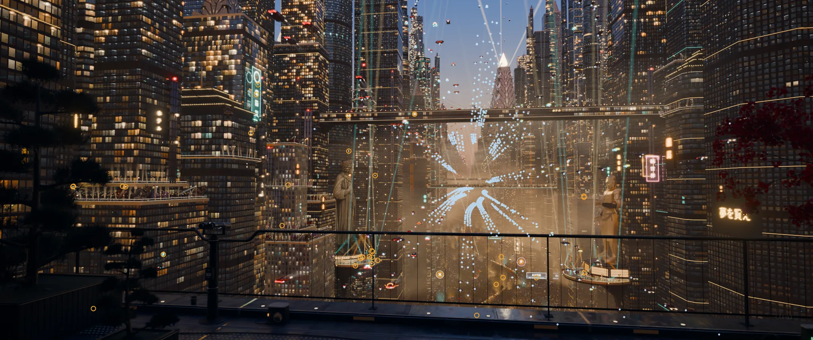

# SoundStage

Spatial sound for Blender animations, computed from the scene and rendered offline.

**Website: [agents-robots.github.io/soundstage](https://agents-robots.github.io/soundstage/)**



You put sounds on objects in a Blender scene: an engine hum on a ship, a door slam at frame 240,
a beacon beeping every two seconds. SoundStage follows the camera through the animation and
renders one stereo audio file in which every sound sits where the picture shows it. Close sounds
are louder, sounds on the left come from the left, passing objects shift in pitch (Doppler),
distant ones arrive late, as they would in air, and a source behind a building is muffled. The
file starts exactly on the first frame, so it drops straight onto the video editor's timeline
(made for DaVinci Resolve) next to the rendered frames.

## Why

In a video editor, spatial sound is drawn by hand: a volume curve and a pan curve per object, a
pitch bend per pass-by, and all of it again after each camera cut. The Blender scene already
holds what those curves describe: where every object and the camera are on every frame, the
lens, and what stands in between. SoundStage reads it from there, so when the camera path or the
cut changes, one more run makes the sound fit the picture again. The same scene and the same
samples give the same file, bit for bit.

```
Blender scene (speakers or tags) ──▶ bake (camera + object paths) ──▶ render ──▶ stereo WAV ──▶ Resolve
```

SoundStage is a command-line tool, not an add-on: headless Blender bakes the scene, the engine
renders it. The .blend file is only read.

## How to use it

There are three ways to say which object makes which sound. They can be mixed in one scene, and
all end in the same two commands.

### 1. By hand, in Blender

Blender's own Speaker objects are the sources, and the scene's active camera is the microphone.

1. Add → Speaker and parent it to the object that makes the sound.
2. Object Data → Sound: open a sound file (mono for spatial sound). The speaker plays the file
   once at each of its NLA sound strips.
3. Volume, Pitch, Distance and Cone of the speaker carry over. For a loop, such as an engine, add
   a custom property `sfx_speaker` to the speaker: `{"mode": "loop", "group": "engines"}`.
4. Animate as usual. If timeline markers switch between cameras, the sound cuts with the picture.
5. Bake and render, then put the WAV on the editor's timeline at the first frame:

```bash
soundstage bake shot.blend --out audio/bake                 # camera, speakers, what hides them
soundstage render audio/bake/scene.json -o audio/shot.wav --report --plot --set reverb=city_streets
```

Details: [usage, speakers](docs/usage.md#2b-or-place-speaker-objects-by-hand).

### 2. In the script that builds the scene

If Python scripts generate the scenes, the same scripts tag the sounds, one line per sound. The
tags are saved with the scene, so rebuilding the scene rebuilds its sound:

```python
from soundstage.blender import tag

tag.add_sound(ship, "engine_hum.wav", ref_distance=20, offset=(0, -12, 0), group="engines")
tag.add_sound(beacon, "beep.wav", mode="once", frame=list(range(1, 601, 60)))
tag.add_sound(crate, "impact.wav", mode="once", frame=180, sync_to_picture=True)
```

For an existing .blend, the same lines go into a separate file that the bake applies
(`soundstage bake shot.blend --run sounds.py --out audio/bake`); the .blend stays untouched.
Details: [scene-builder guide](docs/scene-builder-guide.md), [all tag keys](docs/spec/tagging.md).

### 3. With a coding agent

The [agent guide](docs/agent-guide.md) is a step-by-step procedure for coding agents such as
Claude Code: scan the shot for its cameras and for what moves (`soundstage scan`), write the
tagging file, bake, render. An agent cannot listen, so every render comes with a report (loudness,
true peak, each source's distance, delay and pitch range) and a plot of every source over the
frames. The final check is by ear.

## What it does

- **Placement**: loudness by distance (OpenAL distance models), constant-power panning with a
  small interaural delay and head shadow, a cue for sources behind the camera, directivity cones.
  Panning follows the picture: a source at the frame edge is heard at the screen edge whatever
  the lens, and zooms move sounds with the picture ([E17](research/experiments/E17-lens-and-pan.md)).
- **Propagation**: sound travels at 343 m/s, so distant events are heard late; Doppler from the
  motion of sources and camera (exact retarded time, not an approximation); air absorption after
  ISO 9613-1; clean camera cuts.
- **Environment**: occlusion behind buildings and vehicles, baked by ray casting in Blender
  (quieter, duller, low frequencies bending around edges); reverb from 113 named environments
  (hangar, city street, forest, space station …) or an impulse response, with a send that falls
  with distance so distant traffic does not fill the reverb.
- **Scale**: thousands of sources. The loudest 64 of each group run the full chain, the rest a
  cheaper far field; culling skips what is inaudible within an error budget. 10 000 flying cars,
  each with its engine, render 60 s in under 3 minutes and 12 GB ([E18](research/experiments/E18-traffic.md)).
- **Output**: 48 kHz float WAV aligned to the first frame, stems per group for Fairlight, a
  loudness report (LUFS, true peak), optional normalization and true-peak limiting, a debug plot,
  an MP4 preview for sync checks.
- **Reproducible**: the bake is headless, tags can live in scripts, renders are bit-identical for
  the same inputs, every model is documented with its measurements ([research](research/README.md)).

Not yet: binaural and ambisonic output, animated parameters, random variation of one-shots
([roadmap](docs/roadmap.md)).

## Try it

Requires Linux, Python 3.12+ and Blender 5.x on `PATH`; ffmpeg for previews.

```bash
git clone https://github.com/Agents-Robots/soundstage && cd soundstage
python3 -m venv .venv && .venv/bin/pip install -e '.[dev]'
.venv/bin/python tools/make_test_samples.py                     # placeholder sounds
blender -b --factory-startup --python examples/flyby.py -- --save out/flyby.blend
.venv/bin/soundstage bake out/flyby.blend --run examples/flyby_sounds.py --out out/flyby
.venv/bin/soundstage render out/flyby/scene.json -o out/flyby/mix.wav --report --plot --set reverb=city
.venv/bin/soundstage preview out/flyby/mix.wav --frames <rendered frames dir>   # optional: MP4 with sound (ffmpeg)
```

The tool alone, without the examples: `pip install git+https://github.com/Agents-Robots/soundstage`
gives the `soundstage` command (scan, bake, render, preview).

`out/flyby/mix.wav` is 8 seconds of a ship passing from left to right (its engine drops in pitch
as it passes), a beacon beeping on the left and a crate hitting the ground on the right, in the
reverb of a city street; `mix.plot.png` shows each source's distance, level, pan, delay, pitch and
visibility over the frames.

For your own animation, continue with [usage](docs/usage.md): samples, speakers and tags, baking,
rendering, importing into Resolve.

## How long it takes

Measured on a 16-core desktop CPU (AMD Ryzen 9 3950X), for a 60-second shot in a city of 200
buildings with default settings, culling off and every source through the full chain
([E15](research/experiments/E15-option-costs.md)). Both steps take a fixed time plus a time per
source:

| step | fixed | per source | 10 sources | 100 sources | 1000 sources |
|---|---|---|---|---|---|
| bake | 7 s | 0.38 s | 11 s | 45 s | 6.5 min |
| render | 4 s | 0.19 s | 5 s | 23 s | 3.4 min |

The per-source time is proportional to the shot length: a 120 s shot takes about twice as long.
Render memory is about 4 GB at 100 sources and 28 GB at 1000. Below 30 sources the render is
dominated by its fixed time, so the fixed costs in the tables below matter more than the factors.
Culling at its default (`cull_db=-40`) takes 4–9 % off the render and 3–6 % off the bake
([E16](research/experiments/E16-culling.md)).

**Thousands of sources** ([E18](research/experiments/E18-traffic.md), flying cars in a canyon of
towers, 60 s). Per group, at most `detail_voices` (64) sources run the full chain at a time; the rest
run the far field. The render then costs a time per source plus a time per near voice, and its
memory follows the near voices, not the sources:

| | per source | per near voice (at most about 2 × `detail_voices` at once) | 10 000 cars, default |
|---|---|---|---|
| render | 15 ms | 0.17–0.21 s, 23–34 MB | 2.9 min, 12 GB |
| bake | 0.14–0.17 s | | 25 min |

The bake gives the sources ranked beyond 2 × `detail_voices` the direct path only for their
visibility; with every path it took 91 min for the same 10 000 cars. `--set detail_voices=null`
renders every source through the full chain (0.22 s and 25 MB per car here; 2000 cars took 7.4 min
and 52 GB).

**Render options**, most expensive first (effect relative to the defaults, at 100 sources):

| change | effect |
|---|---|
| `doppler_factor` ≠ 1 (scene or source) or `sync_to_picture` on a one-shot with several triggers | every trigger renders as a separate voice over the whole shot: 2.5× with culling off in a mix with 20 % one-shots of 10–20 triggers each; culling skips the silent parts of those voices, which leaves about 1.3× |
| `--stems` or `--report` (either or both) | about 1.5 s per group (+6 s with four groups), nearly independent of the number of sources |
| `--set reverb=<name>` | +10 %; long reverbs (hangar, 10 s) add 2 s more |
| `--set cull_db=null` (culling off) | +4 to +10 % |
| `--limit` | +1.2 s |
| `--plot` | +0.6 s |
| `panner=amplitude` instead of the default hybrid | −11 % |
| sources not occluded (no visibility baked) | −12 % |
| `head_shadow=0` | −8 % |
| `air_absorption=0`, `itd_scale=0`, pan law, `--normalize`, `--pcm24` | 0–4 % |
| `--quality high` | −18 % (−26 % at 1000 sources); slightly slower below 30 sources |
| `--set cull_db=-20` instead of −40 | −21 to −40 % (more with more sources), error 20 dB below each group |

**Bake settings**:

| change | effect |
|---|---|
| objects in the scene, animated or not | Blender's frame step costs 0.7 ms at 1000 objects, 9 ms at 4000 and 35 ms at 16 000, and the bake steps about 8000 times for a 60 s shot: 16 000 objects add 4.5 minutes, even with one source |
| `occlusion_rate` (default 10 Hz) | per-source time ≈ 0.1 s + 0.03 s per Hz: 0 Hz is 0.35×, 40 Hz is 2.9× |
| `substeps` (default 4) | 1 is 0.7×, 8 is 1.4×, 16 is 2.3× |
| `pad_seconds` (default 3) | proportional to the baked length: 10 s is 1.24× |
| sources instanced by geometry nodes | +7 s |
| `occluder_min_size`, sources in collection instances | no measurable effect |

To estimate a combination, add the fixed costs and multiply the per-source factors. In the tests
this was within 17 % of the measured time.

## Documentation

- [Usage](docs/usage.md): speakers and tags, baking, rendering, importing into Resolve
- [Scene-builder guide](docs/scene-builder-guide.md): sound in scripts that build scenes
- [Agent guide](docs/agent-guide.md): add sound to an existing animation, step by step
- [Requirements](docs/requirements.md) and [roadmap](docs/roadmap.md)
- [Architecture](docs/architecture.md) and the [specifications](docs/spec/): [tagging](docs/spec/tagging.md), [scene format](docs/spec/scene-format.md), [signal model](docs/spec/signal-model.md), [command line](docs/spec/cli.md)
- [Research](research/README.md): survey of existing tools, one page per acoustic model with its choices, reproducible experiments, papers; and the [decision records](docs/adr/README.md)
- [AGENTS.md](AGENTS.md) for coding agents working on this repo, [CONTRIBUTING.md](CONTRIBUTING.md) for people
- The [website](https://agents-robots.github.io/soundstage/) is the folder [site/](site/), deployed by a workflow on every push to `main`

## Status

Phases 0 to 3 of the [roadmap](docs/roadmap.md) are implemented (baseline, placement, physics,
environment and mixing); Phase 4 items (culling, the far field, screen-relative panning) are added
as shots need them. The unit tests run on every push; the end-to-end tests need Blender. Work is
tracked in this repository's [issues](https://github.com/Agents-Robots/soundstage/issues).

## Licence

GPL-3.0-or-later ([LICENSE](LICENSE)). The Blender side runs inside Blender, which is GPL; the
engine is under the same licence. The reverb presets in `soundstage/engine/data/efx_presets.json` are
converted from OpenAL Soft's `efx-presets.h` (LGPL), whose terms allow their use under the GPL.
