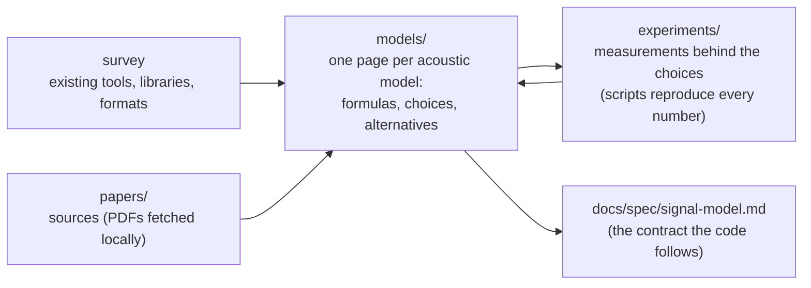

# Research

Scientific background, model decisions and measurements behind soundstage. The specs in
[docs/spec/](../docs/spec/) say *what* the engine computes; this folder says *why*, what else was
considered, and what was measured.

## Models

| Model | What it decides |
|---|---|
| [Processing chain](models/processing-chain.md) | Order of the stages, emission vs reception side, chunks, threads, how to add a model |
| [Coordinates and time](models/coordinates-and-time.md) | Camera space, time base, control rate |
| [Trajectories](models/trajectories.md) | Splines, kinks, camera rotation, teleport detection |
| [Retarded time](models/retarded-time.md) | The propagation delay and its solver |
| [Doppler and delay](models/doppler-and-delay.md) | Read delays, Doppler factor, sync to picture, rate clamp |
| [Fractional delay](models/fractional-delay.md) | Interpolators, oversampling, pre-emphasis |
| [Distance attenuation](models/distance-attenuation.md) | Distance laws |
| [Air absorption](models/air-absorption.md) | ISO 9613-1 and its filter |
| [Panning](models/panning.md) | Pan laws |
| [ITD](models/itd.md) | Interaural time difference |
| [Head shadow](models/head-shadow.md) | Brown–Duda shelf |
| [Rear cue](models/rear-cue.md) | Marking sources behind the camera |
| [Directivity](models/directivity.md) | Cones |
| [Time-varying filters](models/time-varying-filters.md) | Filter structures under modulation |
| [Cuts and teleports](models/cuts-and-teleports.md) | Switching without glides |
| [Loops and one-shots](models/loops-and-one-shots.md) | Dry signal, loop seams, voices |
| [Occlusion](models/occlusion.md) | Fresnel-zone visibility, occluders, transmission filter, obstruction vs occlusion |
| [Reverb](models/reverb.md) | EFX presets, synthetic impulse responses, the send and its distance law |
| [Mixing and loudness](models/mixing-and-loudness.md) | Stems, loudness and true peak, normalization, limiter, report |
| [Blender integration](models/blender-integration.md) | Speaker objects, instanced assets, occluder marking: manual and scripted workflows |
| [Culling](models/culling.md) | Skipping sources that do not matter within an error budget, in render and bake |
| [Level of detail](models/level-of-detail.md) | The far field: the loudest sources per group in full, the rest cheaply, for thousands of sources |

## Experiments

| | Experiment | Result in one line |
|---|---|---|
| [E01](experiments/E01-blender-speaker-baseline.md) | Blender's speakers as a baseline (Phase 0) | Same distance law and timing; no Doppler, stepped parameters, softer pan law, 16-bit only via a video render |
| [E02](experiments/E02-loop-crossfade.md) | Loop seam crossfade law (Phase 1) | Equal power +2.9 dB on correlated loops, linear −2.9 dB on uncorrelated; correlation-adaptive flat on both |
| [E03](experiments/E03-interpolators.md) | Fractional-delay interpolators | 4-point Hermite −27 dB at 10 kHz; 2× + pre-emphasis + optimal polynomial −85 to −110 dB to 20 kHz |
| [E04](experiments/E04-preemphasis.md) | Pre-emphasis for the optimal-2× read | Droop −1.2 dB at 10 kHz, −4.9 dB at 20 kHz; 63 taps fix it |
| [E05](experiments/E05-air-absorption.md) | ISO 9613-1 and its filter | Matches ISO 9613-2 Table 2; two sections with zeros (order 4) within 0.9 dB of ISO below 20 dB of loss and 2.4 dB to 60 dB, against 2.3 and 29 dB for 4 one-poles; 26 % cheaper; far field and full chain within 0.73 dB |
| [E06](experiments/E06-ear-model.md) | Ear-model responses | Reference curves of head shadow, rear cue, pan laws, ITD for tuning |
| [E07](experiments/E07-retarded-time.md) | Retarded-time solver | Fixed point: 1.8 % pitch error at Mach 0.5; Newton: exact to 1e-9 s up to Mach 0.95 |
| [E08](experiments/E08-known-answers.md) | Phase 2 known answers | 343 m → 1.000000 s; 1111/909 and 1100/900 Hz; ITD 0.656 ms; clean cut |
| [E09](experiments/E09-flyby-doppler.md) | Doppler in the flyby | Rates 0.920–1.094 as expected; found and fixed a spline overshoot at a motion kink |
| [E10](experiments/E10-performance.md) | Render performance | 50 sources × 5 min in 42 s, 63 s with occlusion, reverb and stems (target 300 s) |
| [E11](experiments/E11-blender-raycast.md) | Ray casting in Blender (Phase 3) | Box BVH 5 µs per ray against 0.3–6 ms for `scene.ray_cast` (44 ms on a 24 000-object city); triangle BVH out of memory |
| [E12](experiments/E12-reverb.md) | Synthetic EFX reverb | Decay per octave band within 0.8 % (median) of the curve over all 113 presets; DRR −6.02 dB per doubling |
| [E13](experiments/E13-occlusion.md) | Occlusion response | Hidden: −12.1 dB and the transmission low-pass within 0.15 dB; attack/release 136/330 ms; low band bends around an edge |
| [E14](experiments/E14-loudness-and-limiter.md) | Loudness report and limiter | LUFS, LRA and true peak equal to ffmpeg's meter; limiter holds −1 dBTP (−0.99 ideal) |
| [E15](experiments/E15-option-costs.md) | Execution time per option and source count | Render ≈ 3.7 s + 190 ms per source, bake ≈ 7.3 s + 380 ms (60 s shot); `doppler_factor` ≠ 1 2.5×, `occlusion_rate` linear in the per-source bake cost, `frame_set` 35 ms at 16 000 objects |
| [E16](experiments/E16-culling.md) | Culling against budget and source count | Default −40 dB: render 4–9 % and bake 3–6 % faster, error of the shot 4–10 dB below the budget; −20 dB: 1.3–1.7×; `doppler_factor` 0.5: 1.9–2.0×. Distant sources that fill an area carry a similar power share per octave of distance, so few can be skipped; memory (27 MB per source) is not reduced |
| [E17](experiments/E17-lens-and-pan.md) | Where a source at the frame edge is heard, against the lens | Camera mode ignores the lens: frame edge heard at 9° with 50 mm (HD screen edge 16.5°), 2.3° with 200 mm; `pan_reference = screen`: 16.5° for every lens |
| [E18](experiments/E18-traffic.md) | Thousands of flying cars with the far field (`detail_voices`) | 10 000 cars over 60 s at the default 64: render 174 s and 16.7 GB (every car in the full chain: 0.23 s and 40 MB per car); band levels within what other loop phases change, 0.7–1.1 dB at pitch 1 (p95); distance bands √2 apart; far field 0.6–1.3 dB duller at 3–6 kHz, because the full chain absorbs at the emitted frequency, before the Doppler shift (#40); direct-path visibility for far cars makes the bake 2.3–3.6× faster at no measurable render difference |
| [E19](experiments/E19-reverb-send.md) | Reverb send over distance with thousands of sources | EFX law (constant send): reverb 13–14 LU louder than 2000–10 000 cars, 94 % of it from cars beyond 100 m; revised law (Barron and Lee, then spreading): 3–4 LU below the cars, 1 % from beyond 1 km; far-field send with band air absorption matches the full chain within 0.2 dB up to 8 kHz (8–25 dB too bright before) |

## Conventions

- **One page per model**: the model with its formulas, a table of choices with the alternatives and
  why they lost, the implementation (files and functions), verification (tests, experiments),
  limits and open questions, references. When a model changes, its page changes in the same
  commit, together with the spec and the tests.
- **Experiments are reproducible**: every number in an experiment page comes from a script in
  [experiments/scripts/](experiments/scripts/), run from the repository root in the venv
  (`.venv/bin/python research/experiments/scripts/eNN_*.py`); scripts print the tables and write
  figures to [figures/](figures/). E01, E09, E11, E13, E15, E16 and E18 need Blender on `PATH` (E19 needs E18's scenes), E14 needs ffmpeg.
- **Corrections stay visible**: when a measurement turns out wrong, the page says what was wrong and
  shows the corrected result, instead of silently replacing it.
- **Papers**: [papers/](papers/README.md) lists every source with what it is used for;
  `python3 research/papers/fetch.py` downloads the openly accessible PDFs into the gitignored
  `research/papers/pdf/`.
- Survey of existing tools, libraries and formats: [survey.md](survey.md).
