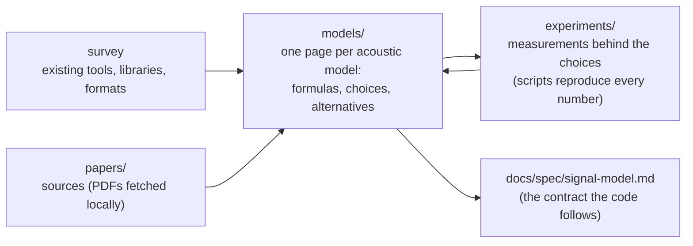

# Research

Scientific background, model decisions and measurements behind soundstage. The specs in
[docs/spec/](../docs/spec/) say *what* the engine computes; this folder says *why*, what else was
considered, and what was measured.

## Models

| Model | What it decides |
|---|---|
| [Processing chain](models/processing-chain.md) | Order of the stages, emission vs reception side, chunks, threads, how to add a model |
| [Coordinates and time](models/coordinates-and-time.md) | Camera space, time base, control rate |
| [Trajectories](models/trajectories.md) | Splines, kinks, camera rotation, teleport detection |
| [Retarded time](models/retarded-time.md) | The propagation delay and its solver |
| [Doppler and delay](models/doppler-and-delay.md) | Read delays, Doppler factor, sync to picture, rate clamp |
| [Fractional delay](models/fractional-delay.md) | Interpolators, oversampling, pre-emphasis |
| [Distance attenuation](models/distance-attenuation.md) | Distance laws |
| [Air absorption](models/air-absorption.md) | ISO 9613-1 and its filter |
| [Panning](models/panning.md) | Pan laws |
| [ITD](models/itd.md) | Interaural time difference |
| [Head shadow](models/head-shadow.md) | Brown–Duda shelf |
| [Rear cue](models/rear-cue.md) | Marking sources behind the camera |
| [Directivity](models/directivity.md) | Cones |
| [Time-varying filters](models/time-varying-filters.md) | Filter structures under modulation |
| [Cuts and teleports](models/cuts-and-teleports.md) | Switching without glides |
| [Loops and one-shots](models/loops-and-one-shots.md) | Dry signal, loop seams, voices |

## Experiments

| | Experiment | Result in one line |
|---|---|---|
| [E01](experiments/E01-blender-speaker-baseline.md) | Blender's speakers as a baseline (Phase 0) | Same distance law and timing; no Doppler, stepped parameters, softer pan law, 16-bit only via a video render |
| [E02](experiments/E02-loop-crossfade.md) | Loop seam crossfade law (Phase 1) | Equal power +2.9 dB on correlated loops, linear −2.9 dB on uncorrelated; correlation-adaptive flat on both |
| [E03](experiments/E03-interpolators.md) | Fractional-delay interpolators | 4-point Hermite −27 dB at 10 kHz; 2× + pre-emphasis + optimal polynomial −85 to −110 dB to 20 kHz |
| [E04](experiments/E04-preemphasis.md) | Pre-emphasis for the optimal-2× read | Droop −1.2 dB at 10 kHz, −4.9 dB at 20 kHz; 63 taps fix it |
| [E05](experiments/E05-air-absorption.md) | ISO 9613-1 and its filter | Matches ISO 9613-2 Table 2; 4 fitted one-poles within 2.5 dB where audible (old model 6–13 dB off) |
| [E06](experiments/E06-ear-model.md) | Ear-model responses | Reference curves of head shadow, rear cue, pan laws, ITD for tuning |
| [E07](experiments/E07-retarded-time.md) | Retarded-time solver | Fixed point: 1.8 % pitch error at Mach 0.5; Newton: exact to 1e-9 s up to Mach 0.95 |
| [E08](experiments/E08-known-answers.md) | Phase 2 known answers | 343 m → 1.000000 s; 1111/909 and 1100/900 Hz; ITD 0.656 ms; clean cut |
| [E09](experiments/E09-flyby-doppler.md) | Doppler in the flyby | Rates 0.920–1.094 as expected; found and fixed a spline overshoot at a motion kink |
| [E10](experiments/E10-performance.md) | Render performance | 50 sources × 5 min in 46 s (target 300 s) |

## Conventions

- **One page per model**: the model with its formulas, a table of choices with the alternatives and
  why they lost, the implementation (files and functions), verification (tests, experiments),
  limits and open questions, references. When a model changes, its page changes in the same
  commit, together with the spec and the tests.
- **Experiments are reproducible**: every number in an experiment page comes from a script in
  [experiments/scripts/](experiments/scripts/), run from the repository root in the venv
  (`.venv/bin/python research/experiments/scripts/eNN_*.py`); scripts print the tables and write
  figures to [figures/](figures/). E01 and E09 need Blender on `PATH`.
- **Corrections stay visible**: when a measurement turns out wrong, the page says what was wrong and
  shows the corrected result, instead of silently replacing it.
- **Papers**: [papers/](papers/README.md) lists every source with what it is used for;
  `python3 research/papers/fetch.py` downloads the openly accessible PDFs into the gitignored
  `research/papers/pdf/`.
- Survey of existing tools, libraries and formats: [survey.md](survey.md).
