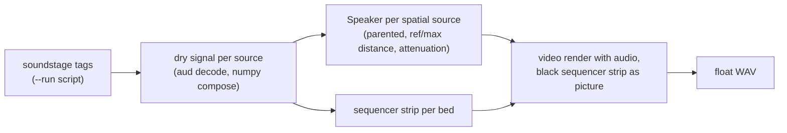
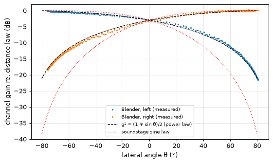

# E01: Blender's speakers as a baseline (Phase 0)

**Question.** What do Blender's built-in Speaker objects give, rendered headless, compared with
soundstage on the same scene and tags? (Phase 0 of the roadmap, issue #7.)

**Date / versions.** 2026-10-25, Blender 5.2.2. Re-run after Phase 2 with soundstage at
Phase 1-equivalent settings (`panner=amplitude`, `air_absorption=0`, `doppler_factor=0`), so the
comparison is about spatialization, as in Phase 0.

## Setup

`tools/blender_mixdown.py` gives every soundstage source the same dry signal soundstage plays and
lets Blender spatialize it:



Scene: the flyby example. Measurement tags: a 1 kHz sine on the ship (`ref_distance` 15 m; the ship
passes 25 m in front of the camera at 30 m/s), a click on the crate at frame 180.

## Getting audio out of Blender headless

| Attempt | Result |
|---|---|
| `bpy.ops.sound.mixdown` under `blender -b` | Returns `FINISHED` at once; it runs as a job, and the process exits after the first 2048 samples. Waiting until the file reaches its full size fixes the length. |
| ... with waiting | Contains sequencer strips only; **speakers are silent**, with or without `-setaudio`, after stepping through the frames, after `bpy.ops.sound.bake_animation`. |
| Video render with an audio codec | Contains the speakers. With a black color strip and `render.use_sequencer`, the 3D render is skipped: 240 frames in 0.4 s. Audio is 16-bit (FLAC or PCM; no float). **Used.** |
| Speaker made with `bpy.data` | No NLA sound strip, plays nothing; `bpy.ops.object.speaker_add` creates the strip. |
| `aud`: `Sound.loop(-1).limit(...)` | Never ends on a mono sound (wrote 17 GB). |
| `aud`: `Sound.write` | Pads the file or aborts the process ("filling the audio frame failed") depending on the length; the tool composes in numpy and writes WAVs with the standard library. |
| Blender 5 file format | `image_settings.media_type = "VIDEO"` must be set before `file_format = "FFMPEG"`. |

## Results

Output of `e01_blender_baseline.py`:

| Engine | Level vs inverse law | Balance at 76° | Frequency first / last frame |
|---|---|---|---|
| Blender | ±0.48 dB (current distance) | 18.1 dB | 1000 / 1000 Hz |
| soundstage | ±0.02 dB (retarded distance) | 31.2 dB | 1000 / 1000 Hz (Doppler off here) |
| Blender, Doppler factor 10 | | | 1000 / 1000 Hz |

| Crate click at frame 180 | Onset sample |
|---|---|
| Blender | 286400 (= frame 180) |
| soundstage (`sync_to_picture`) | 286399 (band-limited read rings ahead of a click by a sample) |

Blender's 3D parameters change in steps: 54 level steps above 0.1 dB within 1 ms during the pass,
spaced 4608 samples (the FLAC encoder's frame size, 96 ms). soundstage changes by at most 0.019 dB
per ms.



Blender's channel gains follow `g² = (1 ∓ sin θ)/2` (constant power, power split linearly with the
lateral sine) within 0.03 in linear gain; soundstage's default `sine` law pans much harder at the
sides.

Same tags, full flyby mix (Phase 0 run): Blender −23.3 LUFS, soundstage −23.4 LUFS, both about
1.2 s to render.

## Conclusions

- Distance law and timing agree; Blender's speakers are a usable reference for both.
- Blender produces **no Doppler** in rendered audio (factor 1 and 10), no propagation delay, steps
  its parameters per audio buffer, and gives only 16-bit audio headless.
- Its pan law is softer at the sides; soundstage now offers it as `pan_law = "power"`
  ([panning](../models/panning.md)); by ear both work, `sine` stays the default (#15).
- Lists of dicts as custom properties survive save and reload in Blender 5.2 (the roadmap's other
  Phase 0 question; checked in Phase 1).

## Reproduce

```bash
.venv/bin/python research/experiments/scripts/e01_blender_baseline.py    # needs blender on PATH
```
