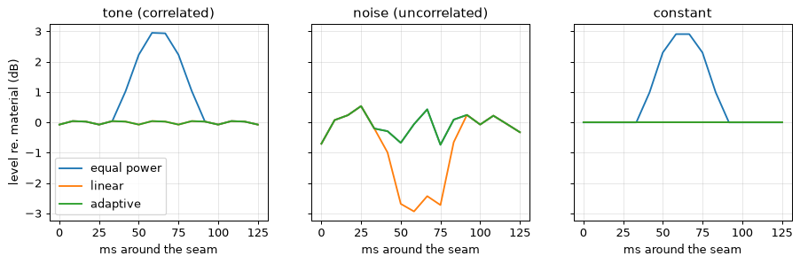

# E02: loop seam crossfade law (Phase 1)

**Question.** Which crossfade law keeps the level constant at a loop seam? Found in Phase 1 when
the engine hum (a tonal loop) got louder at every seam with the equal-power crossfade of the
original spec.

## Setup

One loop cycle is built with each law (50 ms crossfade, tail into head) for three materials: a
tone with whole cycles (head and tail identical: correlation 1), white noise (uncorrelated) and a
constant. The cycle is tiled and the RMS measured in 400-sample windows around the first seam,
relative to the material's RMS.

## Results

Output of `e02_loop_crossfade.py` (min / max of the windows, dB):

| Material | Equal power | Linear | Correlation-adaptive |
|---|---|---|---|
| tone (correlated) | −0.07 / **+2.95** | −0.07 / +0.04 | −0.07 / +0.04 |
| noise (uncorrelated) | −0.74 / +0.54 | **−2.93** / +0.54 | −0.74 / +0.54 |
| constant | +0.00 / **+2.91** | +0.00 / +0.00 | +0.00 / +0.00 |



The ±0.7 dB on noise is the window-to-window variance of the noise itself (it appears with every
law away from the seam too).

## Conclusion

Equal power is right only for uncorrelated material, linear only for correlated material. The
adaptive law `a² + b² + 2ρab = 1` with the measured correlation `ρ` of head and tail (Fink,
Holters, Zölzer) is right for both and is the engine's default
([loops and one-shots](../models/loops-and-one-shots.md)).

## Reproduce

```bash
.venv/bin/python research/experiments/scripts/e02_loop_crossfade.py
```
