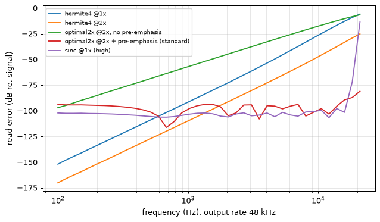

# E03: fractional-delay interpolators

**Question.** How accurate is each candidate for the delay-line read, across frequency, when the
read position moves at a varying rate (as with Doppler)?

## Setup

A sine is generated at the interpolator's input rate (1× = 48 kHz or 2× = 96 kHz), optionally
pre-emphasized, and read at positions `t · f_in` with `t` advancing at a rate between 0.95 and 1.05.
The error against the exact sine at those times is given in dB relative to the signal (RMS).

## Results

Output of `e03_interpolators.py`:

| Interpolator | 100 Hz | 1 kHz | 5 kHz | 10 kHz | 15 kHz | 18 kHz | 20 kHz |
|---|---|---|---|---|---|---|---|
| hermite4 @1× | −151.9 | −91.7 | −47.5 | −26.6 | −14.7 | −9.7 | −7.1 |
| hermite4 @2× | −170.0 | −109.8 | −67.2 | −47.5 | −35.4 | −29.9 | −26.6 |
| optimal2x @2×, no pre-emphasis | −97.0 | −57.2 | −29.3 | −17.7 | −11.3 | −8.7 | −7.4 |
| **optimal2x @2× + pre-emphasis (standard)** | −93.9 | −98.4 | −109.5 | −92.2 | −103.3 | −95.0 | −84.7 |
| sinc @1× (high) | −102.1 | −103.5 | −102.3 | −102.0 | −97.0 | −91.3 | −25.6 |



- The original spec's 4-point Hermite on plain input is unusable for high frequencies (−27 dB at
  10 kHz): Doppler on bright material would add audible distortion.
- The optimal-2× polynomial **without** pre-emphasis is worse than Hermite at 2×: its error is
  dominated by passband droop (−1.2 dB at 10 kHz), not images ([E04](E04-preemphasis.md)).
- With pre-emphasis it is at about −85 to −110 dB up to 20 kHz.
- The sinc's 20 kHz value is outside its passband (cutoff 0.92 × 24 kHz = 22 kHz with a transition
  band below it): band-limiting, not error in the usual sense.

## Conclusion

Standard quality: 2× oversampling, 63-tap pre-emphasis, optimal-2× polynomial. High quality:
Kaiser sinc with rate-scaled cutoff, for extreme Doppler where the standard read would alias
([fractional delay](../models/fractional-delay.md)).

## Reproduce

```bash
.venv/bin/python research/experiments/scripts/e03_interpolators.py
```
