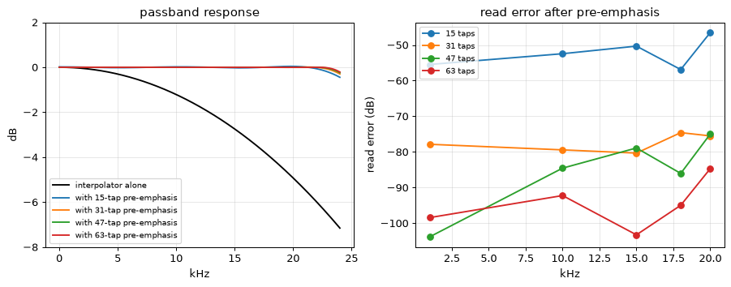

# E04: pre-emphasis for the optimal-2× interpolator

**Question.** The optimal-2× polynomial measured worse than expected in E03 without pre-emphasis.
Why, and how long must the correcting filter be?

## Finding

Niemitalo's "optimal" polynomials are optimized for image rejection (his modified SNR counts only
the stopbands) and accept a non-flat passband, to be corrected by the oversampling stage. The
passband response of the 6-point, 5th-order optimal-2× read, from the Fourier transform of its
continuous impulse response, for 48 kHz audio at the 2× rate (output of `e04_preemphasis.py`):

| Frequency | Gain |
|---|---|
| 1 kHz | −0.01 dB |
| 5 kHz | −0.30 dB |
| 10 kHz | −1.21 dB |
| 15 kHz | −2.74 dB |
| 20 kHz | −4.92 dB |

## Design

A symmetric FIR at the 2× rate, fitted by least squares so that `FIR(f) · H(f) = 1` on 0–0.234 of
the 2× rate (0–22.5 kHz), kept bounded above 0.266 (where the 2× signal has no content); this is
`kernels.optimal2x_preemphasis`.

Read error of the pre-emphasized signal (dB re. signal):

| Taps | 1 kHz | 10 kHz | 15 kHz | 18 kHz | 20 kHz |
|---|---|---|---|---|---|
| 15 | −55.5 | −52.4 | −50.3 | −56.9 | −46.5 |
| 31 | −77.8 | −79.4 | −80.3 | −74.6 | −75.5 |
| 47 | −103.8 | −84.5 | −78.9 | −86.0 | −75.0 |
| **63** | −98.4 | −92.2 | −103.3 | −95.0 | −84.7 |



## Conclusion

63 taps: below −90 dB up to 18 kHz, −85 dB at 20 kHz. The filter is applied once per source to the
sample or the loop cycle (circularly), so its length costs nothing during the render. (A first
measurement reported −0.3 dB droop at 1 kHz; it read past the end of its test buffer. The values
above are from the corrected script.)

## Reproduce

```bash
.venv/bin/python research/experiments/scripts/e04_preemphasis.py
```
