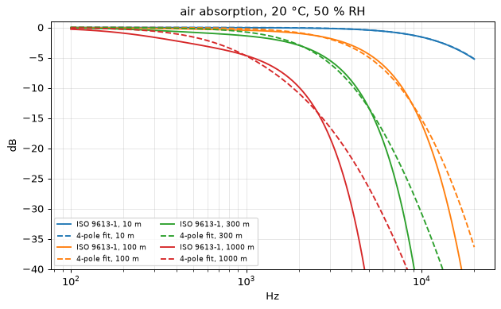

# E05: air absorption (ISO 9613-1) and its filter

**Questions.** Is the ISO 9613-1 implementation right? Which filter realizes it well enough, also
where the loss is large (distant sources), is the fitted table smooth over distance, how close are
the far field's filters to the full chain's, and what does it cost?

## 1. ISO 9613-1 against ISO 9613-2 Table 2

Output of `e05_air_absorption.py` at the exact band centres (63.1 … 7943 Hz), dB/km (table values
in brackets):

| Climate | 63 Hz | 125 Hz | 250 Hz | 500 Hz | 1 kHz | 2 kHz | 4 kHz | 8 kHz |
|---|---|---|---|---|---|---|---|---|
| 10 °C, 70 % | 0.1 (0.1) | 0.4 (0.4) | 1.0 (1) | 1.9 (1.9) | 3.7 (3.7) | 9.7 (9.7) | 32.8 (32.8) | 116.9 (117) |
| 20 °C, 70 % | 0.1 (0.1) | 0.3 (0.3) | 1.1 (1.1) | 2.8 (2.8) | 5.0 (5) | 9.0 (9) | 22.9 (22.9) | 76.6 (76.6) |
| 30 °C, 70 % | 0.1 (0.1) | 0.3 (0.3) | 1.0 (1) | 3.1 (3.1) | 7.4 (7.4) | 12.7 (12.7) | 23.1 (23.1) | 59.3 (59.3) |
| 15 °C, 20 % | 0.3 (0.3) | 0.6 (0.6) | 1.2 (1.2) | 2.7 (2.7) | 8.2 (8.2) | 28.2 (28.2) | 88.8 (88.8) | 201.8 (202) |
| 15 °C, 50 % | 0.1 (0.1) | 0.5 (0.5) | 1.2 (1.2) | 2.2 (2.2) | 4.2 (4.2) | 10.8 (10.8) | 36.2 (36.2) | 128.6 (129) |
| 15 °C, 80 % | 0.1 (0.1) | 0.3 (0.3) | 1.1 (1.1) | 2.4 (2.4) | 4.2 (4.1) | 8.3 (8.3) | 23.7 (23.7) | 82.8 (82.8) |

Every value matches to the table's rounding (4.2 against 4.1 lies on the rounding boundary). At the
nominal frequencies (4000, 8000 Hz) the formula gives up to 1.2 % more, which is the frequency
difference, not an error.

## 2. Filter structures

Largest error against ISO (20 °C, 50 % RH) over 40 distances from 1 m to 20 km, at the 96 kHz
emission rate, each structure fitted per distance by least squares on the loss in dB: where the
loss is below 20 dB and from 20 to 60 dB (50 Hz – 16 kHz), and how far the filter stays short of
60 dB where ISO exceeds it (up to 0.45 of the rate; negative: more). "Spec one-pole" is the
original spec's one-pole at the 3 dB point of `0.1 dB/m · (f/8 kHz)²`; "one-poles fitted below
20 dB" is the first engine (free beyond 20 dB); the others are fitted to follow ISO below 60 dB and
to reach at least 60 dB beyond. "Sections" are second-order low-passes, "with zeros" each with a
pair of zeros on the frequency axis (an elliptic-type section):

| structure | order | < 20 dB | 20-60 dB | short of 60 dB |
|---|---|---|---|---|
| spec one-pole | 1 | 18.3 | 53.0 | 53.6 |
| one-poles fitted below 20 dB (earlier engine) | 4 | 2.3 | 29.0 | 30.8 |
| one-poles | 4 | 7.3 | 14.7 | 14.2 |
| one-poles | 8 | 3.8 | 8.6 | 7.9 |
| one-poles | 12 | 3.0 | 5.6 | 6.0 |
| sections | 4 | 4.8 | 11.0 | 10.8 |
| sections | 6 | 0.7 | 4.7 | 4.6 |
| sections | 12 | 0.4 | 0.1 | -0.3 |
| sections with zeros | 2 | 11.1 | 19.3 | 19.0 |
| sections with zeros (engine) | 4 | 0.9 | 1.3 | 0.8 |
| sections with zeros | 6 | 0.6 | 0.3 | 0.0 |

The loss in dB grows with `f²` and in proportion to the distance, so at long range ISO falls far
faster per octave than a low order can (56 dB from 3.2 to 6.4 kHz at 1 km). One-poles and plain
sections need order 12 to come close; the zeros let order 4 fall steeply enough and keep its floor
below 60 dB. The engine uses two sections with zeros: the same order as the first engine, within
0.9 dB below 20 dB of loss and 1.3 dB from 20 to 60 dB, where the first engine was up to 29 dB too
bright.



## 3. The engine's table

Over 2000 distances from 1 m to 20 km (between the table's 112 fitted distances too), dB; the
largest response change between neighbouring distances (0.46 % apart) where the loss is below 20
and 60 dB; the time to fit the table (once per render and rate):

| rate | < 20 dB (to 16 kHz) | 20-60 dB (to 16 kHz) | short of 60 dB | < 20 dB, 16-20 kHz | largest step 0.46 % apart (< 20 / 60 dB) | fit (s) |
|---|---|---|---|---|---|---|
| 48 kHz | 1.43 | 2.78 | 1.7 | 7.1 | 1.43 / 1.43 | 0.89 |
| 96 kHz | 0.94 | 2.43 | 1.6 | 0.4 | 0.14 / 0.61 | 0.41 |

The full chain filters at 96 kHz. The far field filters its buses at 48 kHz, at its fixed band
distances: there the bilinear transform compresses the top octave, and above 16 kHz the fit takes
up to 7 dB more than ISO where the loss is below 20 dB. The largest steps lie where they cannot be
heard (at 59–60 dB of loss at 96 kHz, at 19.5 kHz at 48 kHz); below 20 dB of loss the 96 kHz
response changes by at most 0.14 dB between neighbouring distances.

## 4. Far field against the full chain

A far voice between two distance bands is the sum of their filters (weights linear in log
distance), whose phases differ. Largest difference where the loss is below 20 dB, 100 Hz – 6.5 kHz,
25 m – 3 km:

| band spacing | far - full chain | far - ISO | full chain - ISO |
|---|---|---|---|
| sqrt(2) (engine) | 0.73 | 0.91 | 0.94 |
| octave | 2.16 | 1.75 | 0.94 |

Bands √2 apart keep the tiers within 0.73 dB of each other and the far field within 0.91 dB of ISO;
an octave apart, 2.2 dB.

## 5. Cost

The emission-side stage alone, a source moving from 10 m to 2 km over 60 s at 96 kHz: 12.8 ns per
sample with four one-poles (per-sample table search and interpolation), 9.5 ns with two sections
whose coefficients are stepped by per-sample increments (no division). A full-chain render of 48
moving sources over 20 s on one worker: 12.65 s with air absorption, 11.82 s without (+7.0 %).
Interpolating the sections' `h = 1/(1 + g k)` with the other coefficients instead of computing it
keeps `h (1 + g k)` within 4.6·10⁻⁸ of 1.

## 6. Doppler

One source of noise at 80 m/s towards the listener (from 700 m), away from it (from 300 m), or
standing at 450 m, 3 s measured, rendered by the full chain (air absorption on the emission side)
and by the far field (after the read, at the received frequency). Far field minus full chain (dB),
with the full chain's filter at the emitted frequency (before, 4bffce2) and with its corners
divided by the playback rate (6f62301), and the difference the shift of the loss to the emitted
frequency `f / r` predicts with a loss in proportion to `f²` (`r` the Doppler factor):

| source | before: 1 kHz | 3.2 kHz | 6.4 kHz | now: 1 kHz | 3.2 kHz | 6.4 kHz | predicted 6.4 kHz |
|---|---|---|---|---|---|---|---|
| +80 m/s, 700 m | -0.9 | -2.9 | -12.8 | -0.2 | -0.4 | +1.0 | -14.3 |
| -80 m/s, 300 m | +0.4 | +2.6 | +11.9 | -0.2 | +0.1 | +1.0 | +18.1 |
| +0 m/s, 450 m | -0.2 | -0.2 | +1.4 | -0.2 | -0.2 | +1.4 | 0.0 |

The air absorbs the wave at its frequency in the air, the shifted one: the far field was right,
and the full chain gave an approaching source too little loss and a receding one too much (issue
#40). With the corners scaled, the tiers agree for moving sources as for a standing one, within
1.4 dB at 30 dB of loss.

## Conclusion

The implementation of ISO 9613-1 is correct. Two second-order sections with a pair of zeros each,
fitted per distance to follow ISO down to 60 dB of loss, stay within 0.94 dB of it where the loss is
below 20 dB and 2.4 dB down to 60 dB, at the same order and a quarter less time than the four
one-poles they replace, which followed ISO only to 20 dB and left distant sources up to 29 dB too
bright beyond ([air absorption](../models/air-absorption.md), issue #36).

## Reproduce

```bash
.venv/bin/python research/experiments/scripts/e05_air_absorption.py             # all sections
.venv/bin/python research/experiments/scripts/e05_air_absorption.py --doppler   # section 6 alone
```
