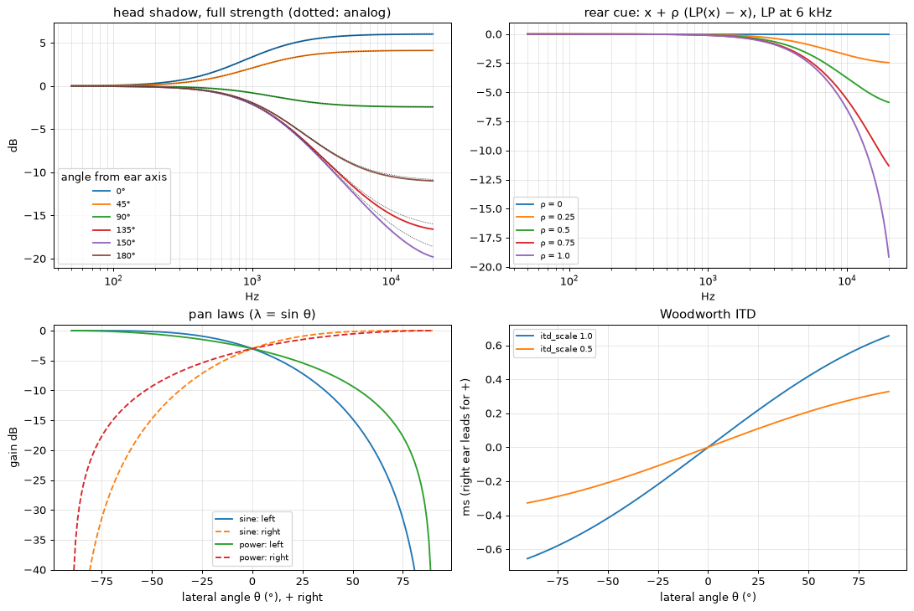

# E06: ear-model responses

**Question.** What do the head shadow, rear cue, pan laws and ITD do, as implemented? (Reference
curves for tuning by ear in #15.)

## Results

Output of `e06_ear_model.py`.

Head shadow (Brown–Duda), θ from the ear's axis:

| θ | α (full) | HF limit | at 10 kHz (full) | α (0.5) | at 10 kHz (0.5) |
|---|---|---|---|---|---|
| 0° | 2.000 | +6.0 dB | +6.0 dB | 1.500 | +3.5 dB |
| 45° | 1.608 | +4.1 dB | +4.1 dB | 1.304 | +2.3 dB |
| 90° | 0.756 | −2.4 dB | −2.4 dB | 0.878 | −1.1 dB |
| 135° | 0.146 | −16.7 dB | −14.9 dB | 0.573 | −4.7 dB |
| 150° | 0.100 | −20.0 dB | −16.7 dB | 0.550 | −5.1 dB |
| 180° | 0.281 | −11.0 dB | −10.5 dB | 0.641 | −3.8 dB |

Rear cue shelf (before the rear gain), `rear_cutoff_hz = 6000`:

| ρ | 1 kHz | 6 kHz | 12 kHz | 18 kHz |
|---|---|---|---|---|
| 0 | +0.00 | +0.00 | +0.00 | +0.00 |
| 0.25 | −0.05 | −1.07 | −2.03 | −2.40 |
| 0.5 | −0.08 | −2.04 | −4.44 | −5.66 |
| 0.75 | −0.10 | −2.75 | −6.99 | −10.49 |
| 1 | −0.11 | −3.01 | −8.34 | −15.44 |

Pan laws, channel balance R/L for a source on the right:

| Angle | `sine` | `power` |
|---|---|---|
| 30° | 7.7 dB | 4.8 dB |
| 60° | 19.5 dB | 11.4 dB |
| 76° | 32.6 dB | 18.2 dB |
| 90° | ∞ | ∞ |

ITD at 90°: 0.656 ms at `itd_scale` 1.



## Notes

- The discrete head-shadow shelf matches the analog response (dotted) up to several kHz; above, the
  bilinear transform compresses the response towards Nyquist.
- The rear shelf is exactly flat at ρ = 0, unlike a low-pass with a cutoff at 20 kHz.
- With the defaults, a source straight to the right gives: level balance from the pan law, a
  0.328 ms lead in the right channel, and a far-channel treble cut of 3.8 dB at 10 kHz (head shadow
  at 0.5). These values were judged by ear and kept (#15, [spec](../../docs/spec/signal-model.md#tuning-phase-2-15)).

## Reproduce

```bash
.venv/bin/python research/experiments/scripts/e06_ear_model.py
```
