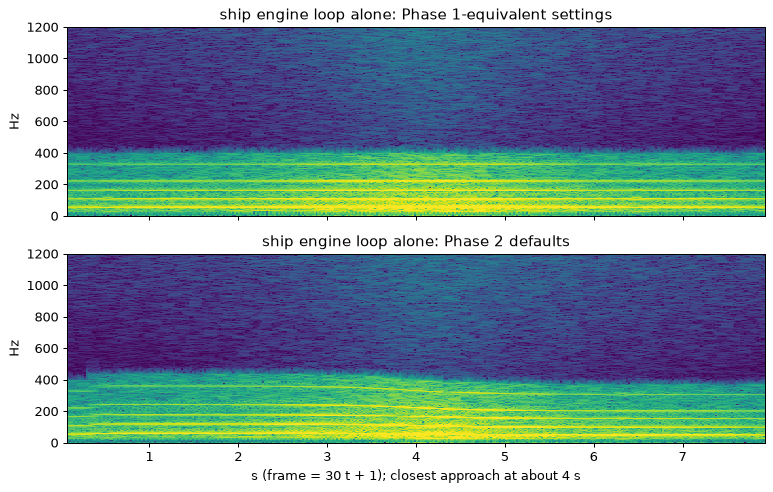

# E09: Doppler in the flyby example

**Question.** Does the example scene (a ship passing at 30 m/s, a slowly dollying camera) show the
expected Doppler, delays and playback rates, and nothing unexpected?

## Setup

The flyby is built and baked with its own tags (`examples/flyby_sounds.py`, 4 sub-frames, 3 s
padding). The ship's engine loop is rendered alone with Phase 1-equivalent settings (no Doppler or
delay variation, amplitude panner, no air absorption) and with the Phase 2 defaults; the full mix
with the defaults gives the report.

## Results

Report of the full mix (output of `e09_flyby_doppler.py`):

| Source | Distance (m) | Delay (ms) | Playback rate |
|---|---|---|---|
| Beacon:0 | 14.47–21.67 | 42.2–63.2 | 0.9996–1.0036 |
| Crate:0 | 9.02–16.69 | 26.3–48.7 | 0.9995–1.0113 |
| Ship:0 | 24.99–123.71 | 72.9–360.7 | 0.9204–1.0942 |

Expected for the ship from the geometry: at the start the radial speed is 29.2 m/s (30.1 m/s at
14° off the line of sight) and the camera approaches at 0.3 m/s along the line of sight, giving
`(343 + 0.3) / (343 − 29.2) = 1.0941`; at the end 0.921. Master: −6.11 dBFS, −23.16 LUFS.



The harmonics of the engine hum glide down between about 3.3 and 5 s around the pass (closest
approach at 4 s plus 73 ms travel time); with Phase 1 settings they stay flat.

**Found here:** the first version reported a maximum rate of 1.1121. The ship stands still until
frame 1 (inside the bake's padding) and starts at full speed; the cubic spline through that kink
overshot the velocity for a few frames. Splitting the interpolation at kinks fixed it
([trajectories](../models/trajectories.md)); a regression test covers it.

## Reproduce

```bash
.venv/bin/python research/experiments/scripts/e09_flyby_doppler.py    # needs blender on PATH
```
