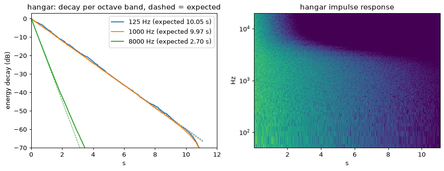

# E12: synthetic EFX reverb (Phase 3)

**Question.** Does the impulse response synthesized from an EFX preset decay as the preset says, in
every octave band? Does the send keep the reverberant level constant over distance, so the
direct-to-reverberant ratio falls 6 dB per doubling? Which late-tail method should be used?

## Setup

`e12_reverb.py` synthesizes the impulse responses at 48 kHz and measures the decay time per octave
band (63 Hz to 16 kHz) by Schroeder backward integration (T30: fit from −5 to −35 dB, after a
4th-order Butterworth band-pass applied forward and backward, `reverb.rt60`).

The reference is **not** the preset's three numbers. Where the decay time changes inside a band (an
octave band around a reference frequency), the slower part dominates the late decay, and a
measurement against the value at the band centre reports a model error that is not there (the first
version of this script did that and found 38 of 339 bands "over 10 %"). Instead,
`reverb.expected_rt60` computes the T30 the decay curve predicts for that band: the energy decay of
white noise with decay time `T60(f)`, weighted by the same band filter. Bands whose expected decay is
shorter than the band filter's own ringing (`T < 12 / f_c`, e.g. 0.19 s at 63 Hz) are skipped.

That the curve itself holds the preset's values is checked separately
(`test_decay_curve_has_the_preset_decay_times_away_from_the_references`: low, mid and high decay
times within 2 % two octaves away from the reference frequencies).

## Results

**Film-relevant presets** (full impulse response: early reflections, late tail, shelves):

| preset | low | mid | high | median error | max error | energy dB |
|---|---|---|---|---|---|---|
| generic | 1.49 | 1.49 | 1.24 | 1.4 % | 8.3 % | -8.7 |
| room | 0.40 | 0.40 | 0.33 | 2.4 % | 6.1 % | -12.1 |
| concerthall | 3.92 | 3.92 | 2.74 | 0.6 % | 3.6 % | -12.6 |
| hangar | 10.05 | 10.05 | 2.31 | 0.9 % | 3.7 % | -10.6 |
| city | 1.49 | 1.49 | 1.00 | 1.4 % | 7.3 % | -29.9 |
| alley | 1.49 | 1.49 | 1.28 | 0.8 % | 17.6 % | -11.6 |
| forest | 1.49 | 1.49 | 0.80 | 2.1 % | 4.5 % | -17.1 |
| mountains | 1.49 | 1.49 | 0.31 | 2.8 % | 7.9 % | -27.4 |
| underwater | 1.49 | 1.49 | 0.15 | 3.1 % | 11.6 % | 5.0 |
| sewerpipe | 2.81 | 2.81 | 0.39 | 1.5 % | 4.9 % | -1.5 |
| spacestation_hall | 4.34 | 7.11 | 2.70 | 0.8 % | 1.9 % | -16.3 |
| spacestation_alcove | 0.64 | 1.16 | 0.94 | 1.6 % | 3.9 % | -7.6 |
| factory_hall | 9.73 | 7.43 | 3.52 | 0.8 % | 1.9 % | -13.1 |
| castle_hall | 1.95 | 3.14 | 2.48 | 0.4 % | 7.2 % | -13.7 |

Decay times in seconds (low and high with the HF limit from air absorption). The energy column is
the impulse response's energy per channel; it sets the direct-to-reverberant ratio at the reference
distance (city and mountains are quiet presets, underwater a loud one).

**Late-tail method**, noise tail only, all 113 presets, 1009 octave bands:

| method | bands | median | 95th pct | max | over 10 % |
|---|---|---|---|---|---|
| 1/3-octave bank (used) | 1009 | 0.8 % | 8.3 % | 29.5 % | 43 |
| STFT 1024 (earlier) | 1009 | 0.8 % | 8.7 % | 30.8 % | 46 |

Both realize the curve. The difference is at low frequencies: the STFT's 47 Hz bins cannot follow a
transition at `lf_reference` ≈ 100 Hz; in the 63 Hz band of `icepalace_mediumroom` the STFT decays
in 1.09 s, the bank in 0.98 s, expected 0.84 s (+30.8 % against +17.5 %). The remaining errors of the
bank are short decays in narrow bands (`driving_incar_luxury` 500 Hz: 0.16 s expected 0.12 s): a
single noise realization has few degrees of freedom there, and ISO 3382-2 gives a relative standard
deviation of about `0.88 / sqrt(B T)` ≈ 13 % for a 350 Hz wide band and 0.12 s. The bank costs 1.2 s
for the hangar's 11 s stereo response, once per render.

**Direct-to-reverberant ratio** over distance (concert hall, room rolloff 0, 1 kHz tone, reference
distance 5 m):

| distance m | DRR dB |
|---|---|
| 5 | 6.74 |
| 10 | 0.72 |
| 20 | -5.30 |
| 40 | -11.32 |

6.02 dB per doubling: the reverberant level stays constant while the direct sound follows the
distance law.

**Bus.** A click sent through the hangar bus: reverb return T30 at 1 kHz 9.94 s, expected 9.97 s
(preset decay time 10.05 s).



## Corrections

- The late tail went through three versions: three bands split with first-order filters, then
  with causal 4th-order Butterworth filters, then the STFT. The second measured 5.65 s for the
  hangar's high band (7.5–15 kHz, preset 2.31 s): the slow mid band leaks through the 24 dB/octave
  slopes and dominates the late decay. The model page concluded that band splits do not work. That
  was too broad; the script reproduces the comparison on one noise signal:

  | late tail | hangar high band T30 |
  |---|---|
  | 3 bands, causal 4th-order Butterworth (24 dB/octave) | 4.94 s |
  | 3 bands, same filters forward and backward (48 dB/octave) | 2.39 s |
  | 1/3-octave bank (used) | 2.45 s |

  Steep or narrow bands work; the 1/3-octave bank also avoids the STFT's low-frequency smear.
- An earlier measurement of the click through the hangar reported 9.77 s against the preset's
  10.05 s; that was the broadband T30 with the STFT tail, not a band.

## Reproduce

```bash
.venv/bin/python research/experiments/scripts/e12_reverb.py    # about 1 minute
```
