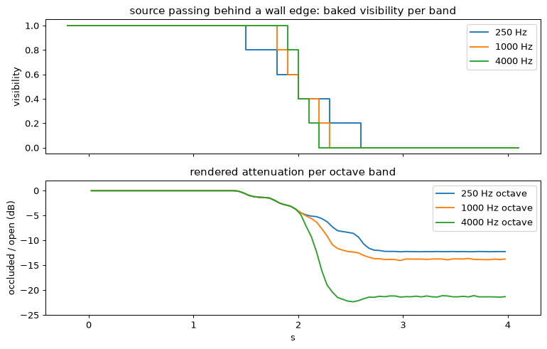

# E13: occlusion response (Phase 3)

**Question.** Does the engine turn per-band visibility into the intended attenuation over
frequency? How fast does it react? What does a baked source passing behind a wall edge look and
measure like?

## Setup

`e13_occlusion.py`, default settings (`occlusion_gain_db` −12, `occlusion_cutoff_hz` 1500), amplitude
panner, no air absorption, no Doppler.

- Engine only: a noise source 10 m in front of the camera whose visibility drops at frame 30.5 from
  1 to the given per-band values (250 Hz, 1 kHz, 4 kHz); transfer function of the render against
  the same render with full visibility (Welch cross-spectrum, 8192 points).
- Step response: a 250 Hz tone, visibility 1 → 0 and 0 → 1 between frames 60 and 61; 10–90 % time
  of the 10 ms RMS envelope.
- Baked (Blender): camera at the origin looking along +Y, a 10 m × 1 m × 6 m wall at y = 10 m, a noise
  source at y = 20 m moving from x = −20 m to 0 at 5 m/s, visibility at 10 Hz; rendered with the
  default transmission and with transmission 0 dB / 20 kHz; attenuation per octave band in 50 ms
  windows.

## Results

**Attenuation per frequency.** *Target* is each band's `v + (1 − v) T(f)`, interpolated over log
frequency between the band centres and held beyond them; *realized* is the broadband gain and
one-pole the engine derives; *measured* is the render.

| v (250 / 1k / 4k) | Hz | target | realized | measured |
|---|---|---|---|---|
| 0, 0, 0 | 125 | -12.03 | -12.15 | -12.15 |
| | 250 | -12.12 | -12.23 | -12.23 |
| | 500 | -12.46 | -12.56 | -12.56 |
| | 1000 | -13.60 | -13.67 | -13.66 |
| | 2000 | -16.44 | -16.45 | -16.47 |
| | 4000 | -21.09 | -21.07 | -21.22 |
| | 8000 | -26.69 | -26.65 | -27.44 |
| 1, 0.6, 0.2 | 125 | 0.00 | -0.06 | -0.06 |
| | 250 | 0.00 | -0.23 | -0.22 |
| | 500 | -1.44 | -0.84 | -0.84 |
| | 1000 | -3.30 | -2.68 | -2.68 |
| | 2000 | -6.19 | -6.45 | -6.48 |
| | 4000 | -11.35 | -11.66 | -11.84 |
| | 8000 | -12.50 | -17.46 | -18.28 |
| 0.6, 0.2, 0 | 125 | -3.10 | -3.33 | -3.33 |
| | 250 | -3.11 | -3.93 | -3.93 |
| | 500 | -5.30 | -5.75 | -5.75 |
| | 1000 | -8.70 | -9.49 | -9.49 |
| | 2000 | -12.55 | -14.69 | -14.73 |
| | 4000 | -21.09 | -20.47 | -20.67 |
| | 8000 | -26.69 | -26.43 | -27.28 |

- Fully hidden: the transmission curve is itself a one-pole, so gain and low-pass realize it within
  0.15 dB to 4 kHz. Above that, the digital one-pole (bilinear, TPT) falls slightly faster than the
  analog curve (−0.8 dB at 8 kHz).
- Partly hidden: one gain and one one-pole cannot pass through three band values; at the band
  centres the realized response is within 0.8 dB of the target, between them within 2.1 dB (2 kHz,
  where the target is only an interpolation). Above 4 kHz the one-pole keeps falling, while the
  target is held at the 4 kHz value: −17.5 dB against −12.5 dB at 8 kHz for `1, 0.6, 0.2`. What
  the right value above the highest band is depends on the geometry (behind an edge the high
  frequencies tend to the direct path's state), so neither is exact.

**Step response** (250 Hz tone; visibility samples 1/30 s apart, interpolated linearly):

| step | level change dB | 10–90 % time ms |
|---|---|---|
| hidden (attack) | -12.23 | 136 |
| reappears (release) | +12.23 | 330 |

As designed: the follower's time constants 60 ms and 150 ms give 2.2 τ = 132 ms and 330 ms.

**Baked wall edge.** The line of sight reaches the wall at t ≈ 1.9 s.

| band Hz | partly visible s | attenuation behind the wall dB |
|---|---|---|
| 250 | 1.5–2.5 | -12.25 |
| 1000 | 1.8–2.2 | -13.78 |
| 4000 | 1.9–2.1 | -21.31 |

The 250 Hz band's Fresnel zone (radius 2.7 m at the midpoint) starts closing 0.4 s before the line
of sight and is fully closed 0.6 s after; the 4 kHz zone (0.7 m) closes within 0.2 s, the time
resolution of 10 Hz visibility. The low band bends around the edge; the high band is cut off sharply.



## Corrections

The first version of the engine and bake had two defects that this experiment showed:

- **Paired ring points.** The 250 Hz ring had its points on the horizontal and vertical axes of the
  path, so for a vertical edge the upper and lower points crossed together with the direct path:
  3 of 5 paths closed in one step, in every band at once. The rings are now turned by 22.5°, 37.5°
  and 52.5°, so no two points of a band cross a horizontal or vertical edge together (the 250 Hz
  band now steps at five distinct times).
- **Lowest cutoff wins.** The cutoff was the lowest of the cutoffs that matched each upper band
  alone. While the 250 Hz band was still partly open and the others closed, the 1 kHz band asked for
  a cutoff near 610 Hz, which over-attenuated 4 kHz: in the baked case the 4 kHz octave dipped to
  −24.5 dB and then brightened to −21.3 dB as the source went further behind. With partial
  visibility `1, 0.6, 0.2` the old rule realized −7.45 dB at 2 kHz and −12.84 dB at 4 kHz (targets
  −6.19 and −11.35). The cutoff is now fitted to the upper bands in dB by least squares
  (`filters.fit_onepole_cutoff`): −6.45 and −11.66 dB, and the dip is 1.0 dB.
- **Ground and own body** (found on the flyby example, not in this scene). The flyby's beacon, half a
  metre above a ground plane, had visibility 0.93: Fresnel points under the ground counted as
  blocked. Its ship was fully occluded for 81 frames by its own body, which was taken at the
  current frame while the engine was cast from its retarded position. Occluders beyond both
  endpoints now reflect instead of blocking, and moving occluders are placed where they were when
  the sound passed them ([model](../models/occlusion.md)); every flyby source is now fully visible.

## Reproduce

```bash
.venv/bin/python research/experiments/scripts/e13_occlusion.py    # about 10 s, needs Blender
```
