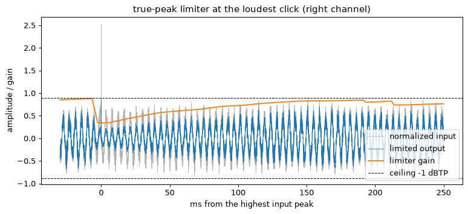

# E14: loudness report and limiter (Phase 3)

**Question.** Does the render report measure integrated loudness, loudness range and true peak
like a standard meter? Does the true-peak limiter hold its ceiling as other meters see it, and keep
the stems summing to the master?

## Setup

`e14_loudness.py` synthesizes the EBU test signals (1 kHz tones in stereo at the given levels and
durations: Tech 3341 for loudness, Tech 3342 for loudness range, and a sine at fs/4 with 45° phase,
whose sample peaks are 3.01 dB below its true peak) and a rendered mix (three sources with the city
reverb, 12 s). Each is measured by the report (`report.metrics`: pyloudnorm for integrated
loudness, EBU Tech 3342 loudness range, 4× true peak) and by ffmpeg 7.0's `ebur128` filter
(`peak=true`), an independent implementation that reports to 0.1.

The limiter test normalizes the mix to −8 LUFS (+26 dB, so the clicks and noise peaks go far over)
and limits it at −1 dBTP.

## Results

Integrated loudness (LUFS), loudness range (LU), true peak (dBTP), SoundStage / ffmpeg:

| signal | expected | I | LRA | TP |
|---|---|---|---|---|
| Tech 3341 #1: 1 kHz at -23 dBFS | I -23.0 | -23.03 / -23.0 | 0.00 / 0.0 | -23.00 / -23.0 |
| Tech 3341 #2: 1 kHz at -33 dBFS | I -33.0 | -33.03 / -33.0 | 0.00 / 0.0 | -33.00 / -33.0 |
| Tech 3341 #3: -36/-23/-36 dBFS, 10/60/10 s | I -23.0 | -23.06 / -23.0 | 13.00 / 13.0 | -23.00 / -23.0 |
| Tech 3341 #4: -72/-36/-23/-36/-72, 10/10/60/10/10 s | I -23.0 | -23.06 / -23.0 | 13.00 / 13.0 | -23.00 / -23.0 |
| Tech 3342 #1: -20/-30 dBFS, 20 s each | LRA 10 | -22.63 / -22.6 | 10.00 / 10.0 | -20.00 / -20.0 |
| Tech 3342 #2: -20/-15 | LRA 5 | -16.85 / -16.8 | 5.00 / 5.0 | -15.00 / -15.0 |
| Tech 3342 #3: -40/-20 | LRA 20 | -20.07 / -20.0 | 20.00 / 20.0 | -20.00 / -20.0 |
| Tech 3342 #4: -50/-35/-20/-35/-50 | LRA 15 | -24.53 / -24.5 | 15.00 / 15.0 | -20.00 / -20.0 |
| true peak: fs/4 at 45 degrees, amplitude 0.5 | TP -6.02 | -2.75 / -2.7 | 0.10 / 0.1 | -6.02 / -6.0 |
| rendered mix: 3 sources, city reverb, 12 s | - | -34.43 / -34.4 | 6.97 / 7.3 | -18.07 / -18.1 |

- Integrated loudness within 0.06 LU of the expected values (Tech 3341 tolerance ±0.1) and of
  ffmpeg.
- Loudness range exact on the Tech 3342 cases. On the rendered mix 0.3 LU below ffmpeg, within
  Tech 3342's ±1 LU; ffmpeg computes the distribution from a histogram of short-term values, the
  report from the values themselves.
- True peak equal to ffmpeg within its rounding on all signals.

**Limiter** (normalized to −8 LUFS, ceiling −1 dBTP):

| | I LUFS | TP dBTP (ours) | TP dBTP (ffmpeg) |
|---|---|---|---|
| before | -8.00 | 8.36 | 8.4 |
| after | -10.07 | -1.00 | -1.0 |

Ideal (sinc) reconstruction around the highest peak after limiting, 32×: −0.993 dBTP. Maximum gain
reduction 9.37 dB, active 4.96 s of 12 s; the gain starts falling 7.5 ms before the first overshoot
(look-ahead 5 ms, then the box average); the stems, limited with the same gain curve, sum to the
master within 1.5e-07 (float32 stems).

The limited mix ends 2.07 LU below the normalization target: normalization comes first, and a mix
that needs 9 dB of limiting loses loudness in the limiter. The report states both
(`processing.normalize_gain_db`, `master.lufs_integrated`); hitting a loudness target under a hard
peak limit is a mastering decision left to Resolve.



## Corrections

The first true-peak meter used scipy's default `resample_poly` low-pass (Kaiser β 5, cutoff at the
original Nyquist, already attenuating above about 18 kHz). On the limited mix, which contains
full-band noise, it read −1.00 dBTP where ffmpeg read −0.9 and the ideal reconstruction −0.90: the
limiter, checking itself with that meter, overshot its ceiling by 0.1 dB as others measure it. The
meter now uses a defined interpolation filter (32 taps per phase, Kaiser β 8: flat within 0.01 dB
to 20 kHz, images above 28 kHz down 69 dB), and the limiter checks itself at 8× oversampling, since
a 4× grid can miss a continuous peak by up to about 0.5 dB near 20 kHz.

## Reproduce

```bash
.venv/bin/python research/experiments/scripts/e14_loudness.py    # about 20 s, needs ffmpeg
```
