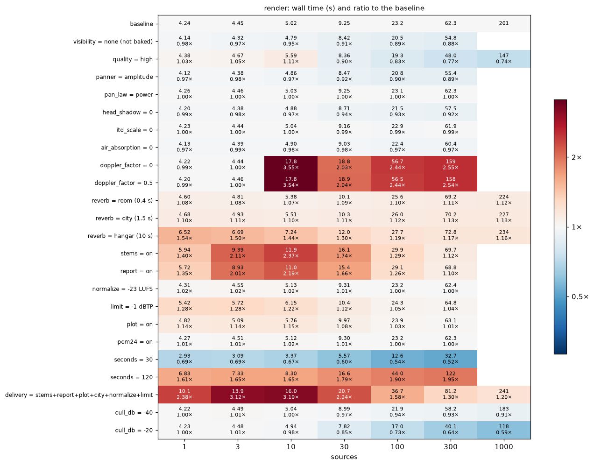
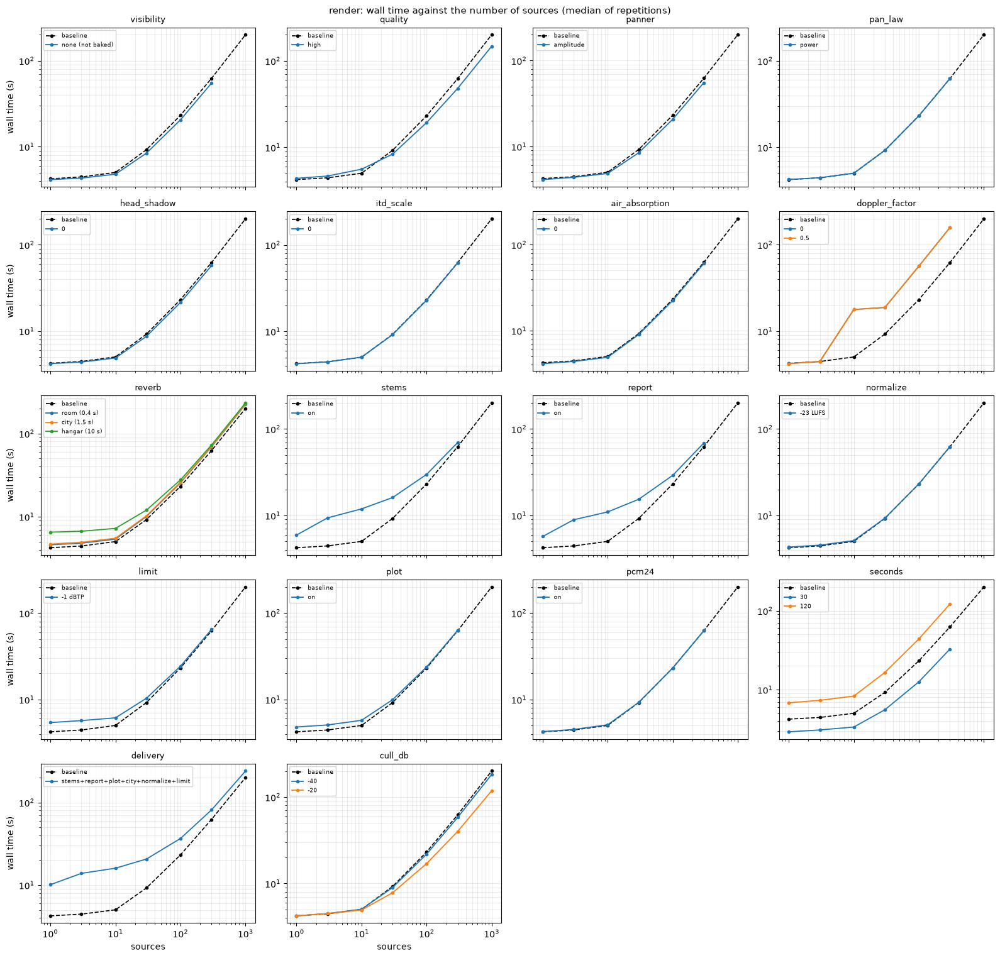
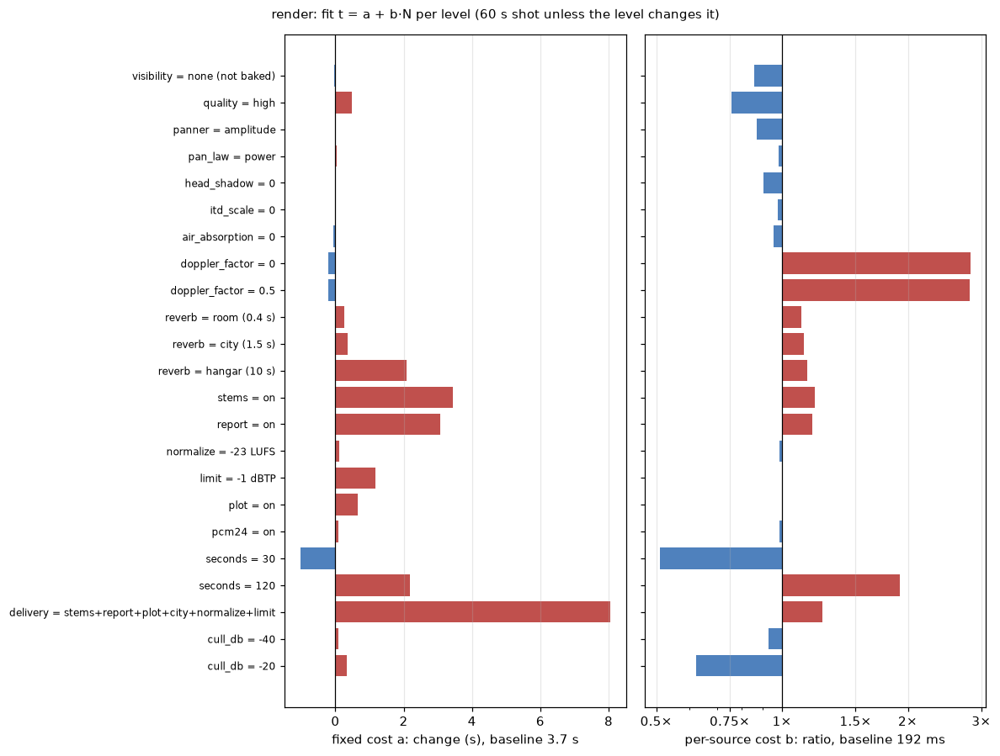
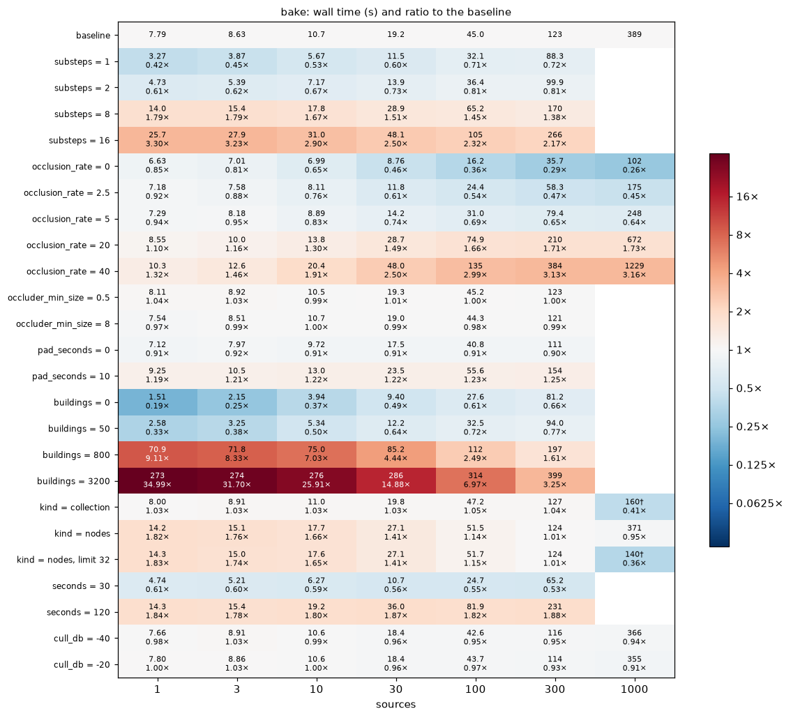
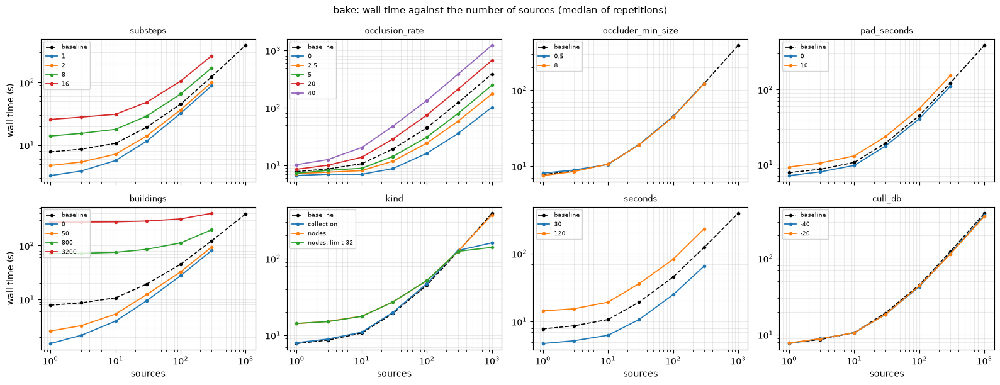
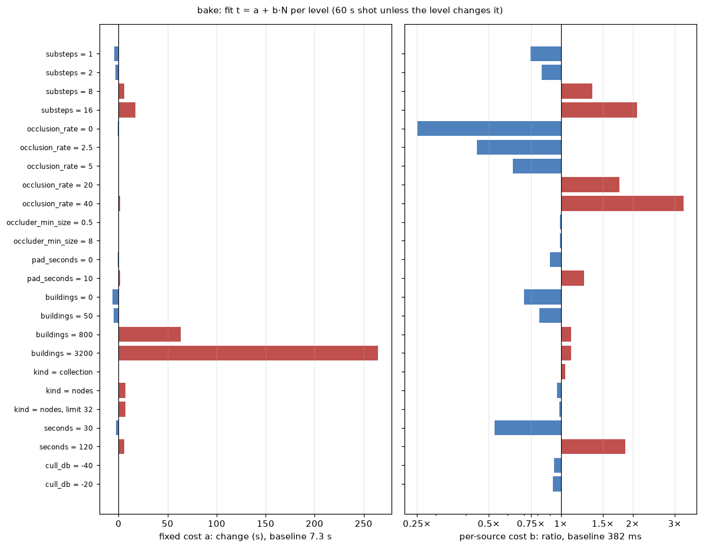

# E15: execution time per option against the number of sources

**Question.** How does each bake and render option change the execution time, and how does the
time grow with the number of sound sources in the scene?

## Setup

`e15_scene.py` builds a benchmark city inside Blender: a grid of buildings (default 200, each with
four props of 0.5–3 m), a camera flying down a street at 15 m/s for 60 s at 30 fps, and N tagged
sources: 60 % moving loops (straight 20 s passes at 5–40 m/s, repeated), 20 % static loops, 20 %
one-shots with a trigger every 3–6 s, in four groups. The scene is seeded, so a given N always gives
the same sources.

`e15_option_costs.py` runs the real command lines (`soundstage bake`, `soundstage render`) as
subprocesses and records wall time, CPU time and peak memory (`wait4`). It does not run the full
option × option × N grid:

- **One factor at a time** around a baseline (bake defaults; render defaults with no stems, report,
  plot, normalization or limiter). Each option level is swept over
  N = 1, 3, 10, 30, 100, 300 (and 1000 for the baseline and a few levels), and summarised by the
  fit t = a + b·N: a fixed cost a and a per-source cost b (least squares weighted by 1/t).
- **Plackett–Burman screening** (12 runs, 11 two-level render options, N = 100) to check whether
  the one-factor effects add up when options are combined.

Bake: 161 cases × 2 repetitions. Render: 152 cases × 3 repetitions, plus 12 × 2 screening runs.
Culling (`cull_db`, default −40 dB) is off in every case except its own rows, so that the other
options are measured on the full render and stay comparable with each other.
The order is shuffled per repetition. Each render stage starts with a warm-up run that is not
recorded. Tables show medians. Machine: one AMD Ryzen 9 3950X compute node per stage (16 cores /
32 threads), with no other work running.

## Results: render







Baseline: 4.2 s for 1 source, 23 s for 100 and 201 s for 1000 (60 s shot), so a ≈ 3.7 s and
b ≈ 190 ms per source. At N = 1 the time is mostly process start, imports and numba loading
("other" 2.6 s, setup 0.9 s, audio 0.7 s); at N = 1000 it is setup 53 s and audio 142 s. Peak
memory grows from 0.7 GB (N = 1) to 4.2 GB (100), 9.5 GB (300) and 27.7 GB (1000).

| option | fixed cost a | per-source cost b | at N = 100 | cause |
|---|---|---|---|---|
| baseline | 3.7 s | 192 ms | 23.2 s | |
| `doppler_factor` 0 or 0.5 | 3.5 s | 540 ms | 2.5× | one-shots with several triggers are split into one renderer per trigger (`_voices` in `source.py`) when k ≠ 1 or `sync_to_picture` is set. Each renderer covers the whole shot, so a one-shot with 10–20 triggers costs 10–20 sources. The step appears at N = 10, where the first one-shots enter the mix. With the default culling, each voice is skipped where it is silent, which halves this cost ([E16](E16-culling.md)) |
| `cull_db` −40 (the default) / −20 | 3.8 / 4.1 s | 177 / 120 ms | 0.94× / 0.70× (0.91× / 0.59× at N = 1000) | skips the quietest voices of each group per 0.4 s within the budget. At −40 dB it mostly skips one-shots between their triggers; in this city the distant sources together still carry a few percent of the power, so few of them can go ([E16](E16-culling.md)) |
| `quality` high | 4.2 s | 145 ms | 0.82× (0.74× at N = 1000) | sinc at 1× emission rate replaces optimal2x, which runs the emission filters at 96 kHz. Slightly slower below N ≈ 30 |
| `stems` or `report` | +3.5 s | +38 ms | 1.3× | both compute the per-group metrics (true peak at 4× oversampling, LUFS, LRA): about 1.5–1.7 s per group (+1.7 s at N = 1 with one group, +5 s at N = 3, +6.7 to +7.4 s from N = 10 with all four groups), nearly independent of N. The fit's a and b split this constant badly, because N = 1 and 3 have fewer groups. `stems` alone also builds the report data |
| reverb hangar (10 s) | +2.1 s | +28 ms | 1.21× | impulse-response synthesis is fixed. Room and city add about 10 % |
| `limit` −1 dBTP | +1.2 s | 0 | 1.05× | |
| `plot` | +0.7 s | 0 | 1.03× | |
| visibility not baked | 0 | −27 ms | 0.88× | no occlusion filters |
| `panner` amplitude | 0 | −25 ms | 0.89× | no ITD reads or head shadow |
| `head_shadow` 0 | 0 | −19 ms | 0.92× | |
| `air_absorption` 0, `itd_scale` 0, `pan_law`, `normalize`, `pcm24` | | | 0.96–1.00× | |
| shot length 30 / 120 s | | 98 / 367 ms | 0.54× / 1.86× | per-source cost is proportional to the length |
| delivery set: stems, report, plot, city reverb, normalize, limit | 11.8 s | 239 ms | 1.56× | 2.4–3.2× for a few sources, 1.2× at N = 1000 |

**Interactions.** The 12 screening runs (each a different half of the 11 options switched on) were
predicted from the one-factor results in three ways:

| model | median error | max error |
|---|---|---|
| one-factor effects added | 6.7 % | 36 % |
| one-factor ratios multiplied | 11.6 % | 54 % |
| fixed costs added, per-source costs multiplied, stems and report counted once | 8.4 % | 17 % |

The large errors come from two interactions. `doppler_factor` ≠ 1 multiplies the number of voices,
so every per-voice option (visibility, panner, air absorption) changes the time by more than it does
alone. `stems` and `report` share the group metrics, so turning on both costs about as much as
turning on one. With those two handled, the third model predicts every combination within 17 %.

## Results: bake







Baseline: 7.8 s for 1 source, 45 s for 100 and 389 s for 1000, so a ≈ 7.3 s and b ≈ 380 ms per
source. Building the scene takes 0.6 s of that. The visibility pass is about 70 % of the bake at
large N (285 of 389 s at N = 1000). Peak memory: 0.4 GB at N = 1, 1.2 GB at N = 1000.

| option | fixed cost a | per-source cost b | at N = 100 | note |
|---|---|---|---|---|
| baseline | 7.3 s | 382 ms | 45.0 s | |
| `occlusion_rate` 0 / 2.5 / 5 / 20 / 40 Hz (default 10) | 6.4–8.9 s | 96 / 170 / 240 / 670 / 1243 ms | 0.35× … 2.9× | per-source cost is linear in the rate: about 96 ms + 29 ms per Hz |
| `substeps` 1 / 2 / 8 / 16 (default 4) | 3.0 / 4.3 / 13.4 / 24.6 s | 286 / 317 / 517 / 795 ms | 0.69× … 2.3× | the fixed cost is proportional to the number of `frame_set` calls |
| buildings 0 / 50 / 800 / 3200 (default 200) | 1.3 / 2.3 / 70.9 / 272 s | 267–422 ms | 0.62× … 6.9× | `frame_set` cost grows with the object count (below) |
| `pad_seconds` 0 / 10 (default 3) | | | 0.90× / 1.24× | proportional to the baked length |
| shot length 30 / 120 s | 4.5 / 13.2 s | 202 / 710 ms | 0.54× / 1.85× | |
| `occluder_min_size` 0.5 / 8 m | | | 1.00× | no measurable effect |
| sources in collection instances | 7.5 s | 397 ms | 1.04× | |
| sources instanced by geometry nodes | 14.2 s | 368 ms | 1.12× | +7 s fixed for evaluating the node tree at every sub-frame |
| `cull_db` −40 (the default) / −20 | 7.4 / 7.5 s | 358 / 354 ms | 0.95× / 0.94× (0.94× / 0.91× at N = 1000) | skips the visibility rays of sources 20 dB below the budget: visibility pass 261 / 251 s instead of 285 s at N = 1000 ([E16](E16-culling.md)) |

With instances, `instance_limit` (32 per tagged object, ten tagged assets) caps the baked sources at
320. The N = 1000 cells for collection instances and for geometry nodes with the limit (marked †)
baked fewer sources and are left out of the fits.

**Where the fixed bake cost comes from.** `e15_frame_set.py` times `scene.frame_set` in the same
city with one source:

| buildings | objects | frame_set (ms) | with subframe (ms) | + depsgraph, camera (ms) |
|---|---|---|---|---|
| 0 | 3 | 0.02 | 0.02 | 0.02 |
| 200 | 1003 | 0.69 | 0.69 | 0.71 |
| 800 | 4003 | 8.80 | 8.72 | 8.75 |
| 3200 | 16003 | 34.76 | 34.78 | 34.45 |

None of these objects is animated, but `frame_set` still costs about 2 µs per object at 1000
objects and over 8 µs per object at 16 000. A 60 s shot with 3 s padding and 4 sub-frames is
about 7 900 `frame_set` calls: 5 s at 200 buildings and 270 s at 3200, which matches the fixed
costs in the table. Setting `frame_current` and updating the view layer or depsgraph was about 2×
slower than `frame_set` (measured once on a workstation, not part of the script).

## What to take from it

- Render time is close to linear in N above about 30 sources. Below that it is dominated by about
  4 s of process start and setup.
- The most expensive render settings are `doppler_factor` ≠ 1 or `sync_to_picture` on one-shots
  with many triggers (2.5× in this mix). After that come `stems` / `report`, which cost about 1.5 s
  per group in total, and the reverb. Panning, pan law, ITD, air absorption, normalization and PCM
  output cost almost nothing.
- Bake time is set by the occlusion rate (per source) and by the scene's object count (fixed, via
  `frame_set`), not by the number of occluders kept (`occluder_min_size`).
- Culling at its default (−40 dB) saves 6–9 % of render time and 5–6 % of bake time in this city, and
  41 % of the render at −20 dB with 1000 sources. [E16](E16-culling.md) explains why the saving is small when
  the sources fill the area around the camera.
- Combined render options are predicted within 17 % by adding the fixed costs and multiplying the
  per-source ratios, once the doppler and stems/report interactions are accounted for.

## Reproduce

Each stage runs for several hours. Run one `run` per idle machine. The render cases need the
scenes kept by the bake (`base`, `noocc`, `s30`, `s120` under `out/e15/scenes/`).

```bash
.venv/bin/python research/experiments/scripts/e15_option_costs.py run bake --reps 2
.venv/bin/python research/experiments/scripts/e15_option_costs.py run render --reps 3
.venv/bin/python research/experiments/scripts/e15_option_costs.py run pb --reps 2
.venv/bin/python research/experiments/scripts/e15_option_costs.py analyse --figures research/figures
.venv/bin/python research/experiments/scripts/e15_frame_set.py     # needs Blender, about 2 minutes
```
