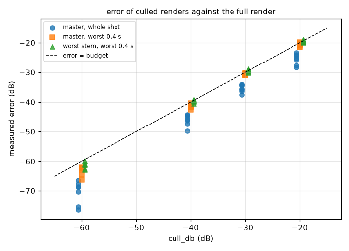
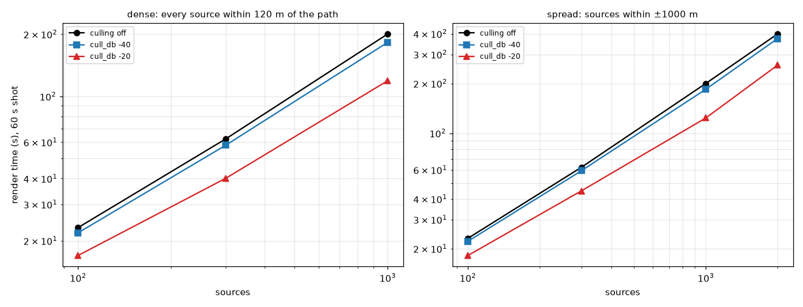

# E16: culling against the number of sources

**Question.** How much render and bake time does culling (FR-68,
[model](../models/culling.md)) save at each budget, how does that change with the number of sources
and with how far they are spread, and does the measured error of the master and of every stem stay
within the budget?

## Setup

`e16_culling.py`, on two versions of the E15 benchmark city (200 buildings, the camera flies 900 m
down a street in 60 s, 60 % moving loops, 20 % static loops, 20 % one-shots every 3–6 s, four
groups):

- **dense**: E15's baked `base` scenes. Every source is within 120 m of the street, so every source
  passes close to the camera at some point.
- **spread**: the same generator with `E15_SPREAD=1000`: the sources are spread over a band
  ±1000 m across the street and 880 m beyond either end of the camera's path (2 × 2.8 km). Baked
  here, once with culling off and once with the default culling in the bake.

Budgets: off, −60, −40 (the default), −30 and −20 dB. Every render case runs twice: once for its
time (no stems) and once with `--stems` for its error against the render without culling of the
same scene. The error is the energy of (render − reference) relative to the reference, over the
whole shot and in the worst 0.4 s window that has sound, for the master and for the worst of the
four stems. "Bake culled" renders the scene baked with culling, so its error also contains the
interpolated visibility of the sources the bake skipped. The spread scene with 5000 sources is
only baked: at about 27 MB of render memory per source (E15), its render without culling would
need about 135 GB, and the culled renders, which skip few sources before setup, were killed at 73
and 111 GB as well. Two extra
cases render the dense scene with `doppler_factor` 0.5, where every one-shot trigger is its own
voice over the whole shot (the 2.5× case of E15).

One run per case (E15's repetitions varied by 1–3 %), on AMD Ryzen 9 3950X compute nodes (16 cores),
one job per node.

## Results: error



The worst case over all scenes and sizes, in dB relative to the render without culling:

| budget | master, whole shot | master, worst 0.4 s | worst stem, whole shot | worst stem, worst 0.4 s |
|---|---|---|---|---|
| −60 | −66.3 | −62.0 | −64.8 | −59.8 |
| −40 (default) | −44.3 | −40.4 | −43.6 | −39.2 |
| −30 | −34.1 | −30.2 | −32.8 | −28.9 |
| −20 | −23.3 | −19.9 | −22.8 | −18.9 |
| off, scene baked with culling | −88.1 | −62.7 | −77.8 | −52.6 |

The error of the whole shot is 3–16 dB below the budget (4–10 dB at the default), because most
0.4 s blocks skip less than the budget allows: the rule stops at the last source that fits, and a
chunk is skipped only when all ten of its blocks agree. The worst 0.4 s of the master stays within
0.1 dB of the budget. The worst stem in its worst 0.4 s exceeds the budget by up to 1.1 dB.

A per-block comparison of the estimates with the rendered stems (spread scene, 300 sources, −20 dB,
the worst case) shows why. The rule held in every block by the estimate. The estimate is 0.8 dB
above the rendered energy in the median block, but up to 2 dB above in blocks dominated by close
sources: it takes the maximum of neighbouring control points, which raises levels that change fast
(a source passing the camera) more than the slowly changing levels of distant sources. The group
total is then overestimated more than the skipped part, and their ratio is about 1 dB too
favourable in those blocks.

The first run of this experiment used an estimate without the filters (air absorption, occlusion
low-pass, head shadow, rear cue). Its group totals were 2.2 dB above the stems in the median block
and 4.5 dB in the worst, and the worst stem window exceeded a −30 dB budget by 1.8 dB. The results
above are with the filters in the estimate ([model](../models/culling.md)).

## Results: render time



Render time without culling, and the speedup at each budget:

| scene | N | off (s) | −60 | −40 | −30 | −20 |
|---|---|---|---|---|---|---|
| dense | 100 | 23.1 | 0.99× | 1.06× | 1.14× | 1.36× |
| dense | 300 | 62.2 | 0.99× | 1.07× | 1.23× | 1.55× |
| dense | 1000 | 200 | 0.99× | 1.10× | 1.29× | 1.68× |
| spread | 100 | 23.1 | 0.99× | 1.04× | 1.11× | 1.27× |
| spread | 300 | 62.2 | 0.99× | 1.05× | 1.15× | 1.39× |
| spread | 1000 | 200 | 1.00× | 1.08× | 1.24× | 1.62× |
| spread | 2000 | 398 | 1.00× | 1.07× | 1.21× | 1.54× |
| dense, `doppler_factor` 0.5 | 100 | 56.1 | | 1.88× | | |
| dense, `doppler_factor` 0.5 | 300 | 158 | | 1.99× | | |

The audio pass shrinks with the voice time rendered (78–87 % at −40 dB, 33–57 % at −20 dB). The
estimate costs time and memory of its own: setup takes 15–17 % longer (53 → 63 s with 1000 sources)
and memory grows by 5–12 % (27.2 → 30.0 GB), so −60 dB is slightly slower than off. Skipping before
setup removes few sources: none at −40 dB, up to 63 of 2000 at −20 dB. The spread scene does not
gain more than the dense one; at the same N it gains slightly less.

With `doppler_factor` ≠ 1 every trigger of a one-shot is a voice over the whole shot (E15). Those
voices are silent outside their trigger, so culling skips 76 % of the voice time and halves the
render.

## Why the saving is small when sources fill the area

The power each source contributes at the camera, every 0.4 s, summed per octave of its distance at
that moment (gain, distance law, sample level, one-shots while they sound; `by_distance` in the
script):

| distance at the moment | dense: sources (mean) | dense: share of power | spread: sources (mean) | spread: share of power |
|---|---|---|---|---|
| 0–15 m | 2 | 24.0 % | 0 | 21.6 % |
| 15–30 m | 6 | 19.9 % | 1 | 16.2 % |
| 30–60 m | 24 | 21.1 % | 2 | 15.8 % |
| 60–120 m | 88 | 18.0 % | 7 | 14.4 % |
| 120–240 m | 193 | 10.8 % | 26 | 11.1 % |
| 240–480 m | 333 | 4.8 % | 94 | 8.8 % |
| 480–960 m | 326 | 1.4 % | 371 | 8.3 % |
| 960–1920 m | 27 | 0.0 % | 485 | 3.7 % |
| over 1920 m | | | 13 | 0.0 % |

(1000 spatial sources each.)

With the inverse-distance law, a source's power falls with 1/d², while the number of sources at
distance d grows with d when they fill an area. Every octave of distance therefore brings about
the same total power: the 485 sources beyond 960 m in the spread scene still carry 3.7 % of the
power (−14 dB), the 371 between 480 and 960 m 8.3 %. An energy budget of −40 dB (0.01 %) can drop
only the very quietest of them. The rule drops 6–7 % of the sounding source time at −40 dB and
45–48 % at −20 dB, in both scenes. The rest of the render saving comes from voices that are silent
(one-shots between their triggers, 14 % of the source time here).

So culling saves time in proportion to how much of the source time is silent or far below the rest
of its group, not in proportion to the number of distant sources. What the distant sources
contribute is a diffuse background whose details (Doppler, filters, exact direction) are not
audible one by one; rendering them as a few clustered voices instead of individually is the method
that scales to thousands of sources (clustering, as in Tsingos et al. 2004), not culling.

## Results: bake

| N | bake off (s) | bake culled (s) | visibility off / culled (s) | visibility skipped |
|---|---|---|---|---|
| 100 | 43.3 | 42.0 | 27.7 / 26.1 | 10 % |
| 300 | 117 | 111 | 80.4 / 74.8 | 10 % |
| 1000 | 367 | 346 | 260 / 239 | 11 % |
| 2000 | 754 | 717 | 520 / 482 | 11 % |
| 5000 | | 1785 | — / 1205 | 11 % |

Bake memory stays below 5 GB even at 5000 sources.

The bake's culling skips the visibility rays of sources 20 dB below the budget (−60 dB at the
default). For the reason above, that is 10–11 % of the source samples at every N, and it saves
3–6 % of the bake. The render of a scene baked with culling differs from the render of the scene
baked without it by −88 dB over the whole shot (worst stem window −52.6 dB).

## What to take from it

- At the default −40 dB, culling saves 4–9 % of the render and 3–6 % of the bake, with the error of
  the whole shot 4–10 dB below the budget. At −20 dB it saves 21–40 % of the render.
- It saves time in proportion to the source time that is silent or far below its group, not in
  proportion to the number of distant sources: sources that fill an area contribute a similar
  power share from every octave of distance.
- It halves the render with `doppler_factor` ≠ 1, where most voices are silent most of the time.
- It does not reduce memory, which stays at about 27 MB per source for a 60 s shot; 5000 sources
  did not fit in 110 GB. Shots with thousands of sources need clustering of distant sources and
  less memory per source, not culling.
- The budget holds for the master and, within 1.1 dB, for every stem in its worst 0.4 s.

## Reproduce

The render stage needs E15's `base` scenes (`e15_option_costs.py run bake`) and this experiment's
bakes. Each stage runs for several hours; run one `run` per idle machine. A second machine can work
on the same list from the other end with `--reverse`; `--sizes` limits a run to some N.

```bash
.venv/bin/python research/experiments/scripts/e16_culling.py run bake
.venv/bin/python research/experiments/scripts/e16_culling.py run render --only dense
.venv/bin/python research/experiments/scripts/e16_culling.py run render --only spread
.venv/bin/python research/experiments/scripts/e16_culling.py analyse --figures research/figures
```
