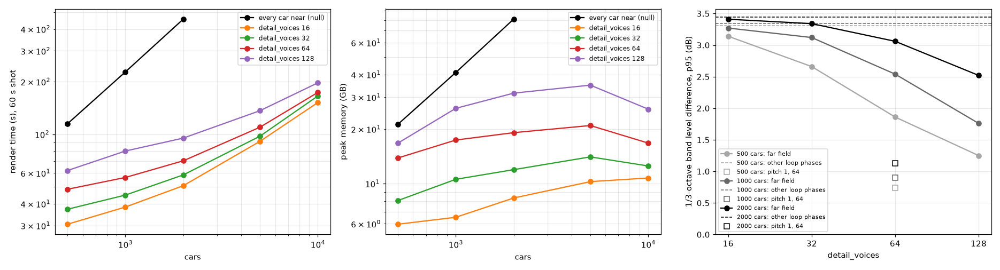

# E18: thousands of flying cars with the far field

**Question.** How long do 500 to 10 000 flying cars, each with its own engine sound, take to bake
and render with two render tiers (FR-56, [model](../models/level-of-detail.md),
[ADR 0013](../../docs/adr/0013-two-render-tiers.md)), and how much memory do they need, against
`detail_voices`? How far is the result from rendering every car through the full chain, measured
against what other random loop phases alone change? What does visibility from the direct path alone
for the far cars change in the bake?

## Setup

`e18_traffic.py`, on a scene built by `e18_traffic_scene.py`:

- a canyon 3 km long between two rows of towers (30–60 m wide, 120–400 m tall);
- 24 lanes (6 across, 4 heights from 40 to 130 m), cars on the left side flying one way, on the right
  side the other, at 40–83 m/s;
- every car an Empty instancing a car collection (a 4.5 × 2 × 1.4 m box), keyed along its lane and
  jumping back to the start at the end (a teleport), as traffic in a city scene is usually animated;
- every car one engine hum loop (`samples/engine_hum.wav`) at a pitch of 0.85–1.15, reference
  distance 8 m, all in one group;
- the camera flying down the middle at 85 m height and 30 m/s, 60 s.

N = 500, 1000, 2000, 5000 and 10 000 cars, baked with substeps 2, 6 s of padding and visibility
at 10 Hz. Two bakes per N:

- **all paths**: every car gets every visibility path at every sample (`detail_voices` null in the
  bake). Renders of these scenes differ from the reference by the far field alone.
- **far: direct**: the default bake (`detail_voices` 64): cars ranked beyond 128 at a sample get
  the direct path only. Rendered at 64 against the same reference (case `direct`).

Render cases: `detail_voices` null (every car through the full chain: the reference, up to 2000
cars, which needed 70 GB), 16, 32, 64 and 128. Every case runs the command line as a subprocess
(wall time and peak memory as in E15).

The difference to the reference is measured on the master, per 0.4 s block:

- the waveform error, over the shot and in the worst block (as in E16);
- the level in 1/3-octave bands (50 Hz to 16 kHz, L + R), over the bands within 60 dB of the
  block's loudest: the median difference and the 95th percentile of the absolute difference;
- the left/right balance per octave band (95th percentile of the absolute difference);
- the level of the block (95th percentile of the absolute difference).

Two baselines:

- **phase**: the full render again with other random loop phases (the source ids renamed), against
  the reference. The far field reads each car's loop from one unpitched cycle shared by all cars,
  with the pitch in the read, so at a pitch other than 1 a car's loop starts at another point than
  in the full chain. This baseline is what that alone changes.
- **unpitched**: every pitch set to 1, rendered at null (its own reference) and at 64. Both tiers
  then start each loop at the same point, so the difference is what the far field's
  simplifications change: no ITD, head shadow or rear low-pass, air absorption per distance band,
  one broadband visibility.

The two **clutter** bakes time how the moving occluders are placed per visibility sample: 500 cars,
20 s, and a million balconies on the canyon walls (geometry-nodes instances of a 3 m box), once by
the instancer's matrix (the default) and once by a lookup in the depsgraph's instances, a walk over
every instance.

One run per case (E15's repetitions varied by 1–3 %), on AMD Ryzen 9 3950X compute nodes (16 cores),
one job per node.

## Results: render time and memory

These are the runs with the air filter of 7e92f98 (two sections with zeros, E05); the first runs
(c81a028, four one-poles) are kept in `out/e18/results_c81a028.jsonl` on the machines that ran them.



Render time (s) and peak memory (GB), 60 s shot, scenes baked with every path:

| cars | null (every car near) | 16 | 32 | 64 (default) | 128 |
|---|---|---|---|---|---|
| 500 | 115 / 21.2 | 31 / 6.0 | 37 / 8.1 | 48 / 13.9 | 62 / 16.7 |
| 1000 | 228 / 41.1 | 38 / 6.5 | 45 / 10.6 | 57 / 17.4 | 80 / 26.0 |
| 2000 | 457 / 81.0 | 51 / 8.3 | 59 / 11.9 | 71 / 19.1 | 95 / 31.6 |
| 5000 | | 91 / 10.3 | 98 / 14.1 | 110 / 20.9 | 136 / 35.0 |
| 10 000 | | 152 / 10.7 | 166 / 12.5 | 174 / 16.7 | 197 / 25.8 |

- With every car through the full chain, time and memory grow with the number of cars: about
  0.23 s and 40 MB per car (2000 cars: 457 s, 81 GB). The first runs needed 35 MB per car: the air
  filter's coefficients per control point take 6–7 MB more per voice over a 60 s shot (#32).
- With the far field, the render time is a part per car plus a part per near voice. A
  least-squares fit over `detail_voices` 16–128 against the most near voices alive at once gives
  0.17–0.20 s per near voice, on a base that grows from 25 s at 500 cars to 149 s at 10 000: about
  15 ms per far car, 1/15 of the full chain. 10 000 cars at the default 64 render in 174 s with
  16.7 GB (first runs: 173 s, 15.8 GB).
- Memory follows the near voices alive at once, not the number of cars. They peak at about
  2 × `detail_voices` (hysteresis 1.5 and renderers overlapping at chunk boundaries). The same fit
  gives 63–110 MB per near voice at the peak, on a base of 4–8 GB that grows with the number of
  cars (their positions).
- The setup (positions, estimates, tiers) takes 12 s at 10 000 cars; the rest is audio.

## Results: difference to the full render

| cars | case | band level median / p95 (dB) | balance p95 (dB) | block level p95 (dB) |
|---|---|---|---|---|
| 500 | phase | −0.01 / 3.31 | 3.02 | 2.34 |
| 500 | 16 | −0.21 / 3.14 | 3.22 | 2.27 |
| 500 | 64 | 0.02 / 1.86 | 1.25 | 1.08 |
| 500 | 128 | 0.01 / 1.25 | 0.72 | 0.56 |
| 500 | direct | 0.03 / 1.88 | 1.25 | 1.08 |
| 500 | unpitched, 64 | 0.02 / 0.74 | 0.28 | 0.08 |
| 1000 | phase | −0.02 / 3.34 | 3.03 | 2.71 |
| 1000 | 16 | −0.32 / 3.27 | 3.54 | 2.16 |
| 1000 | 64 | −0.07 / 2.54 | 2.30 | 1.56 |
| 1000 | 128 | 0.02 / 1.76 | 1.37 | 1.03 |
| 1000 | direct | −0.06 / 2.54 | 2.23 | 1.55 |
| 1000 | unpitched, 64 | −0.01 / 0.90 | 0.79 | 0.12 |
| 2000 | phase | 0.00 / 3.44 | 3.10 | 2.54 |
| 2000 | 16 | −0.39 / 3.41 | 3.95 | 2.65 |
| 2000 | 64 | −0.27 / 3.06 | 3.42 | 2.13 |
| 2000 | 128 | −0.08 / 2.52 | 2.40 | 1.65 |
| 2000 | direct | −0.26 / 3.06 | 3.39 | 2.17 |
| 2000 | unpitched, 64 | −0.06 / 1.13 | 1.09 | 0.12 |

- **Other loop phases alone** change the band levels by up to 3.3–3.4 dB (95th percentile), the
  balance by 3.0–3.1 dB and the block level by 2.3–2.7 dB. Loops of nearly the same tone beat
  against each other, and where they beat depends on the phases, which the full chain draws at
  random from the source id. A difference of this size is not an error of the far field.
- **The far field** stays at or below that in band level and block level in every case, and comes
  closer to the reference with more near voices. The balance is the exception: at 2000 cars and
  `detail_voices` up to 64 (and at 1000 cars and 16) it differs by 3.4–4.0 dB, more than other
  phases change it (3.0–3.1 dB). The far field has no ITD or head shadow.
- **With pitch 1** (both tiers read the loops at the same point), the far field differs from the
  full render by 0.7–1.1 dB in band level, 0.3–1.1 dB in balance and 0.1 dB in block level (95th
  percentiles).
- **Far visibility from the direct path** (the default bake) renders within 0.07 dB of the bake
  with every path, in every measure.

## Results: high frequencies

Median band level difference per octave (dB; the octave from the given frequency up), 2000 cars:

| case | 400 Hz | 800 Hz | 1.6 kHz | 3.2 kHz | 6.4 kHz |
|---|---|---|---|---|---|
| phase | 0.03 | −0.04 | 0.00 | 0.00 | 0.11 |
| 16 | 0.17 | −0.13 | −0.34 | −1.00 | −2.25 |
| 64 | 0.06 | 0.02 | −0.21 | −0.64 | −1.31 |
| 128 | 0.30 | 0.11 | −0.05 | −0.30 | −0.63 |
| unpitched, 64 | 0.04 | 0.02 | −0.20 | −0.63 | −1.29 |

The far field is duller above 3 kHz, by as much with pitch 1 (so not from the loop phases) and
more with fewer near voices (so from the far voices). With the first air filter the medians were
−0.65 and −1.09 dB at 64; the new filter, whose two tiers agree within 0.73 dB below 20 dB of loss
and follow ISO to 60 dB, did not remove them:

| distance (m) | 3.2 kHz: ISO / far (48 kHz) / full (96 kHz) (dB) | 6.4 kHz | 9 kHz |
|---|---|---|---|
| 141 | −2.9 / −3.0 / −3.0 | −9.8 / −9.6 / −9.6 | −18.5 / −18.4 / −18.6 |
| 283 | −5.7 / −6.0 / −6.2 | −19.7 / −19.9 / −20.0 | −37.0 / −36.9 / −37.3 |
| 566 | −11.5 / −10.9 / −10.8 | −39.4 / −39.3 / −39.7 | −74.1 / −64.0 / −66.7 |
| 1131 | −22.9 / −23.5 / −23.6 | −78.7 / −62.9 / −63.9 | −148.0 / −62.5 / −61.0 |

The cause is the Doppler shift. The full chain filters on the emission side, before the delay
line: at the emitted frequency. The far field filters its buses after the read: at the received
frequency. The air absorbs the wave at its frequency in the air, which for a moving source is the
shifted one, and the loss grows with the square of the frequency at high frequencies: a car closing
at 80 m/s (Doppler factor 1.3) loses about 1.7 times as many dB as the full chain gives it. One
source, far field minus full chain ([E05](E05-air-absorption.md), section 6):

| source | 1 kHz | 3.2 kHz | 6.4 kHz |
|---|---|---|---|
| approaching at 80 m/s, 700 m | −0.9 | −2.9 | −12.8 |
| receding at 80 m/s, 300 m | +0.4 | +2.6 | +11.9 |
| standing, 450 m | −0.2 | −0.2 | +1.4 |

In traffic the approaching cars are the brighter ones, so the full chain's high frequencies are too
loud, and the far field, here the more physical tier, sounds duller than it. Filtering the full
chain at the received frequency (its corners scaled by the playback rate) is issue #40. The
distance bands add a smaller part: a voice between two bands is the sum of their filters, whose
phases differ (up to 0.3 dB at 6.5 kHz, E05); with bands an octave apart the medians were 0.1–0.25 dB
further off (the first runs), so the 20 bands (√2 apart) stay, at 5–13 % more render time.

## Results: bake

60 s shot, 721 visibility samples:

| cars | visibility paths | bake (s) | per car (s) | of which visibility (s) | visibility per car and sample (ms) | share of the bake | direct path only | memory (GB) |
|---|---|---|---|---|---|---|---|---|
| 500 | all | 200 | 0.40 | 175 | 0.487 | 87 % | | 0.5 |
| 500 | far: direct | 87 | 0.17 | 63 | 0.174 | 72 % | 74 % | 0.5 |
| 1000 | all | 410 | 0.41 | 356 | 0.493 | 87 % | | 0.8 |
| 1000 | far: direct | 146 | 0.15 | 91 | 0.127 | 63 % | 87 % | 0.8 |
| 2000 | all | 899 | 0.45 | 765 | 0.531 | 85 % | | 1.3 |
| 2000 | far: direct | 285 | 0.14 | 150 | 0.104 | 53 % | 94 % | 1.3 |
| 5000 | all | 2479 | 0.50 | 2130 | 0.591 | 86 % | | 2.7 |
| 5000 | far: direct | 703 | 0.14 | 347 | 0.096 | 49 % | 97 % | 2.7 |
| 10 000 | all | 5473 | 0.55 | 4763 | 0.661 | 87 % | | 5.2 |
| 10 000 | far: direct | 1505 | 0.15 | 766 | 0.106 | 51 % | 99 % | 5.1 |

- With every path for every car, visibility is 85–87 % of the bake, 0.49–0.66 ms per car and
  sample. It grows with the number of cars, since every car is a moving occluder for the others.
- With the direct path for the far cars, visibility is 3–6 times faster and the bake 2.3–3.6 times:
  10 000 cars bake in 25 min instead of 91 min.
- The rest of the bake (Blender's frame steps, reading every car's position at every sample,
  writing the scene) takes about 12 min for 10 000 cars.

## Results: moving occluders

500 cars, 20 s, a million balconies (1 000 102 static occluders with the towers):

| moving occluders placed by | visibility per sample (ms) | of which moving the occluders (ms) | bake (s) |
|---|---|---|---|
| their instancer's matrix (default) | 93 | 6 | 232 |
| lookup in the depsgraph's instances | 1194 | 1109 | 582 |

The lookup walks every instance of the scene at every visibility sample, the balconies too, so it
costs by the size of the scene, not by the number of moving occluders. A car is rigid with its
instancer, so its box is its instancer's matrix times a fixed relative matrix, measured at the
three snapshots of the occluder setup.

## What to take from it

- The default `detail_voices` 64 renders 10 000 cars over 60 s in under 3 min and 17 GB on a 16-core
  node, against 0.23 s and 40 MB per car through the full chain.
- The far field's difference to the full render is at or below what other random loop phases
  change, except for the left/right balance of dense traffic at `detail_voices` 64 or less. Raising
  `detail_voices` lowers it at 0.17–0.20 s of render and 63–110 MB per near voice.
- The far field is 0.6–1.3 dB duller than the full chain at 3–6 kHz in dense traffic because the
  full chain absorbs at the emitted frequency, before the Doppler shift (#40).
- The bake follows the tiers: the direct path for the far cars costs nothing measurable in the
  render, and makes the bake of thousands of cars 2–4 times faster.
- Distant traffic was too bright in both tiers with the first air filter, which stopped following
  ISO 9613-1 beyond 20 dB of loss. The current filter follows it to 60 dB ([E05](E05-air-absorption.md)).
- In a scene with millions of instances, moving occluders must be placed without walking the
  instances: by their instancer's matrix it takes 6 ms per visibility sample instead of 1.1 s with
  a million balconies.

## Reproduce

Each stage runs for several hours; run one `run` per idle machine. A second machine can work on the
same list from the other end with `--reverse`; `--sizes` limits a run to some N, `--again` runs
cases again.

```bash
.venv/bin/python research/experiments/scripts/e18_traffic.py run bake
.venv/bin/python research/experiments/scripts/e18_traffic.py run render
.venv/bin/python research/experiments/scripts/e18_traffic.py analyse --figures research/figures
```
