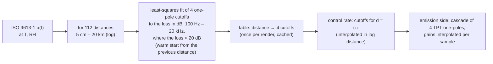

# Air absorption

High frequencies are absorbed by air on the way: distant sounds are duller.

## Model

The pure-tone attenuation coefficient `α(f)` (dB/m) from **ISO 9613-1**, which models absorption by
the relaxation of oxygen and nitrogen molecules plus classical absorption, as a function of
frequency, temperature, relative humidity and pressure:

```
p_sat = p_r · 10^(−6.8346 (T₀₁/T)^1.261 + 4.6151)            T₀₁ = 273.16 K, p_r = 101.325 kPa
h     = RH · p_sat / p_a                                       molar water-vapour concentration (%)
f_rO  = (p_a/p_r) (24 + 4.04·10⁴ h (0.02 + h) / (0.391 + h))
f_rN  = (p_a/p_r) (T/T₀)^(−1/2) (9 + 280 h exp(−4.170 ((T/T₀)^(−1/3) − 1)))      T₀ = 293.15 K
α     = 8.686 f² [ 1.84·10⁻¹¹ (p_r/p_a) (T/T₀)^(1/2)
                   + (T/T₀)^(−5/2) ( 0.01275 e^(−2239.1/T) / (f_rO + f²/f_rO)
                                   + 0.1068  e^(−3352.0/T) / (f_rN + f²/f_rN) ) ]
```

The loss over the propagation distance `d` is `A · α(f) · d` dB, with
`A = air_absorption · source.air_absorption`, at `air_temperature_c` (20 °C) and
`air_humidity_pct` (50 %). At 20 °C and 50 %: about 0.005 dB/m at 1 kHz, 0.03 at 4 kHz, 0.1 at
8 kHz, 0.36 at 16 kHz.

### Realization



Four cascaded one-pole low-passes approximate the ISO curve within about 2 dB wherever the loss is
below 20 dB, and keep attenuating by more than 17.7 dB beyond. Where the loss at 20 kHz is below
0.05 dB (closer than about 10 cm) the stage passes the signal unchanged. The filter runs on the
emission side ([processing chain](processing-chain.md)).

## Choices

| Question | Choice | Alternatives and why not |
|---|---|---|
| Coefficient | ISO 9613-1 with temperature and humidity | The original spec's `0.1 dB/m · (f/8 kHz)²`: underestimates the mid range about 3× (ISO is not proportional to f²) and has no climate. pyfar implements the same formula; one formula did not justify the dependency, and the implementation is tested against ISO 9613-2 Table 2 instead. |
| Filter | 4 one-poles fitted per distance | One one-pole at the 3 dB point of the f² law (original spec): 6–13 dB error from 30 m to 3 km. Fitted 1/2/3 poles: up to 7.2 / 4.2 / 2.7 dB. Octave-band EQ (as some game engines): coarse steps between bands. STFT filtering with the exact curve: accurate at any distance, but block-based and harder to combine with per-sample modulation. |
| Fit region | Loss below 20 dB | Fitting larger losses forces the poles to trade accuracy where the sound is audible for accuracy where it is already 20 dB down. |
| Smoothness | Warm start along distance | Independent fits jump between equivalent parameter sets; with warm start the response changes by at most 0.37 dB between distances 0.46 % apart (in the audible region). |
| Placement | Emission side, mono | After the read per ear: twice the work, no audible difference. |

Physically, absorption acts at the frequency of the wave in the air (the emitted frequency
shifted by the source's motion); applying it before the read means the filter's corner is shifted
by the Doppler factor too. At 30 m/s that is 10 % of the corner frequency, far inside the fit
error.

## Verification

[E05](../experiments/E05-air-absorption.md):

- ISO 9613-2 Table 2, six climates, 63 Hz – 8 kHz: matches to the table's rounding at the exact
  band centres (63.1 … 7943 Hz).
- Largest error of the engine's table against ISO where the loss is below 20 dB: 0.04 dB at 10 m,
  0.09 at 30 m, 1.9 at 100 and 300 m, 2.5 at 1 km, 1.05 at 3 km.

`tests/test_filters.py`: the Table 2 rows; a render of noise at 10, 100 and 1000 m measured through
the engine matches the designed filter within 0.5 dB and ISO within 2.6 dB at 1, 4, 8, 16 kHz where
the loss is below 20 dB, and attenuates more than 17 dB elsewhere.

## References

- ISO 9613-1:1993 (no open copy); formula as reproduced by
  [sengpielaudio](https://sengpielaudio.com/AirdampingFormula.htm) and in pyfar's
  `air_attenuation`; ISO 9613-2:1996 Table 2 for the reference values.
