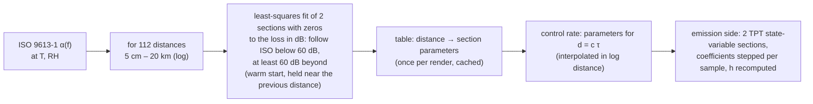

# Air absorption

High frequencies are absorbed by air on the way: distant sounds are duller.

## Model

The pure-tone attenuation coefficient `α(f)` (dB/m) from **ISO 9613-1**, which models absorption by
the relaxation of oxygen and nitrogen molecules plus classical absorption, as a function of
frequency, temperature, relative humidity and pressure:

```
p_sat = p_r · 10^(−6.8346 (T₀₁/T)^1.261 + 4.6151)            T₀₁ = 273.16 K, p_r = 101.325 kPa
h     = RH · p_sat / p_a                                       molar water-vapour concentration (%)
f_rO  = (p_a/p_r) (24 + 4.04·10⁴ h (0.02 + h) / (0.391 + h))
f_rN  = (p_a/p_r) (T/T₀)^(−1/2) (9 + 280 h exp(−4.170 ((T/T₀)^(−1/3) − 1)))      T₀ = 293.15 K
α     = 8.686 f² [ 1.84·10⁻¹¹ (p_r/p_a) (T/T₀)^(1/2)
                   + (T/T₀)^(−5/2) ( 0.01275 e^(−2239.1/T) / (f_rO + f²/f_rO)
                                   + 0.1068  e^(−3352.0/T) / (f_rN + f²/f_rN) ) ]
```

The loss over the propagation distance `d` is `A · α(f) · d` dB, with
`A = air_absorption · source.air_absorption`, at `air_temperature_c` (20 °C) and
`air_humidity_pct` (50 %). At 20 °C and 50 %: about 0.005 dB/m at 1 kHz, 0.03 at 4 kHz, 0.1 at
8 kHz, 0.36 at 16 kHz.

### Realization



The loss in dB grows with `f²` at high frequencies and in proportion to the distance: the
magnitude response is close to a Gaussian in frequency, whose fall steepens without bound. A
rational filter of order `n` falls at most `6n` dB per octave far above its corners, so a cascade of
one-pole low-passes cannot follow it beyond the first 20 dB or so: at 1 km ISO falls 56 dB between
3.2 and 6.4 kHz. A low-pass section with a pair of zeros on the frequency axis (an elliptic-type
section) can: its notch makes the fall steeper than its order, and its floor beyond the notch can be
placed below 60 dB, where the exact loss no longer matters.

Two such sections (order 4, as before):

```
H_k(s) = (1 + m_k s²) / (1 + 2 R_k s + s²),   s in units of the corner f_k,   zeros at f_k / √m_k
```

are fitted per distance, from 50 Hz to 20 kHz, to follow ISO where its loss is below 60 dB, and to
reach at least 60 dB (or ISO, if less) everywhere else up to 0.45 of the rate: frequencies above
20 kHz at the emission rate can be brought down into the audible range by a receding source's
Doppler shift. The damping is kept in `R` ∈ [0.3, 2] (no resonance above 0 dB), the zeros at 1.02–60
times the corner. Each distance starts from the previous one's parameters and is held near them, so
the table changes smoothly. The sections run as TPT state-variable filters
([time-varying filters](time-varying-filters.md)) on the emission side
([processing chain](processing-chain.md)).

At 96 kHz (the full chain's emission rate) the result follows ISO within 0.94 dB where the loss is
below 20 dB and within 2.4 dB from 20 to 60 dB (50 Hz – 16 kHz), and attenuates at least 58 dB
beyond. The far field filters its buses at 48 kHz: within 1.4 and 2.8 dB to 16 kHz; above 16 kHz the
bilinear transform's compression near Nyquist leaves up to 7 dB more loss than ISO, where little is
audible. Where the loss at 20 kHz is below 0.05 dB (closer than about 10 cm) the stage passes the
signal unchanged.

## Choices

| Question | Choice | Alternatives and why not |
|---|---|---|
| Coefficient | ISO 9613-1 with temperature and humidity | The original spec's `0.1 dB/m · (f/8 kHz)²`: underestimates the mid range about 3× (ISO is not proportional to f²) and has no climate. pyfar implements the same formula; one formula did not justify the dependency, and the implementation is tested against ISO 9613-2 Table 2 instead. |
| Filter | 2 second-order sections with a pair of zeros each, fitted per distance | One one-pole at the 3 dB point of the f² law (original spec): 18 dB error below 20 dB of loss. 4 one-poles fitted below 20 dB (the first engine): within 2.3 dB there, but up to 29 dB too bright from 20 to 60 dB (distant traffic sounds bright). One-poles fitted to 60 dB: 4/8/12 poles leave 7.3/3.8/3.0 dB below 20 dB and 15/8.6/5.6 dB above. Sections without zeros: 6 of them (order 12) to match what 2 sections with zeros do. 3 sections with zeros: 0.6 / 0.3 dB, one more section per voice. Octave-band EQ (as some game engines): coarse steps between bands. STFT filtering with the exact curve: accurate at any distance, but block-based and harder to combine with per-sample modulation. ([E05](../experiments/E05-air-absorption.md)) |
| Fit region | Follow ISO below 60 dB of loss; at least 60 dB beyond | Below 20 dB only (the first engine): where the loss exceeds 20 dB the filter was free, and a thousand distant cars summed their too-bright highs (E18). Beyond 60 dB the exact loss does not matter; asking for it would cost accuracy where it does. |
| Smoothness | Warm start along distance, held near the previous fit | Independent fits jump between equivalent parameter sets. |
| Structure in time | TPT state-variable sections, `g`, `k`, `c`, `m` stepped per sample, `h = 1/(1 + g k)` recomputed per sample | Direct-form biquads with interpolated coefficients: intermediate sets can be unstable. Interpolating `h` too (the first version, no division per sample): within 10⁻⁷ of consistent for ordinary motion, but a close pass with exaggerated Doppler moves the corner 24 % per control point and the section diverged (#42, [E05](../experiments/E05-air-absorption.md) section 7). |
| Cost | Same order as before | The stage takes about 10 ns per emission sample against 12.8 ns for the 4 one-poles (no per-sample table search); air absorption adds 7 % to a full-chain render. |
| Placement | Emission side, mono, corners scaled by the playback rate | After the read per ear: twice the work for the same response. Unscaled on the emission side (the first engine): absorbs at the emitted frequency, up to 13 dB off at 6.4 kHz for a source at 80 m/s. |

**Doppler.** Absorption acts at the frequency of the wave in the air: the emitted frequency
shifted by the source's motion. The stage runs before the read, on the emitted frequency, so its
corners are divided by the playback rate `r` at each control point (`g' = tan(atan(g) / r)`; the
zeros and the damping are relative to the corner and stay): the filter then acts on the emitted
signal as the fitted one does at the received frequency `r·f`. Without it, a source closing at
80 m/s (`r` 1.3) got 1.7 times too little loss in dB, since the loss grows with `f²`: at 700 m
12.8 dB too much at 6.4 kHz against the far field (which filters after the read), and a receding
one 11.9 dB too little; with it the two tiers agree within 1 dB, as for a standing source
([E05](../experiments/E05-air-absorption.md), section 6; issue #40). The playback rate includes the
listener's motion, which the frequency in the air does not: an error of the listener's speed over
`c` (9 % of the frequency at 30 m/s), the same in both tiers.

## Verification

[E05](../experiments/E05-air-absorption.md):

- ISO 9613-2 Table 2, six climates, 63 Hz – 8 kHz: matches to the table's rounding at the exact
  band centres (63.1 … 7943 Hz).
- The engine's table over 2000 distances from 1 m to 20 km (between its fitted distances too):
  within 0.94 dB of ISO below 20 dB of loss and 2.4 dB from 20 to 60 dB at 96 kHz; at least 58 dB
  beyond.
- The far field's filters (48 kHz, a voice between two bands √2 apart) against the full chain's
  (96 kHz): within 0.73 dB where the loss is below 20 dB, up to 6.5 kHz; against ISO within 0.91 dB.

`tests/test_filters.py`: the Table 2 rows; a render of noise at 10, 100 and 1000 m measured through
the engine matches the designed filter within 0.5 dB where the loss is below 60 dB and ISO within
1.0 dB below 20 dB and 2.7 dB from 20 to 60 dB, and attenuates more than 57 dB beyond; the
designed loss changes by less than 0.5 dB between distances 0.46 % apart below 60 dB of loss
(0.5 m – 5 km); a section is −3.01 dB at its corner. `tests/test_kernels.py`: the state-variable
kernels against the direct-form bilinear transform, in chunks, with stepped coefficients.

## References

- V. Zavalishin, *The Art of VA Filter Design* (`zavalishin2020vafilter`): the TPT state-variable
  filter.
- ISO 9613-1:1993 (no open copy); formula as reproduced by
  [sengpielaudio](https://sengpielaudio.com/AirdampingFormula.htm) and in pyfar's
  `air_attenuation`; ISO 9613-2:1996 Table 2 for the reference values.
