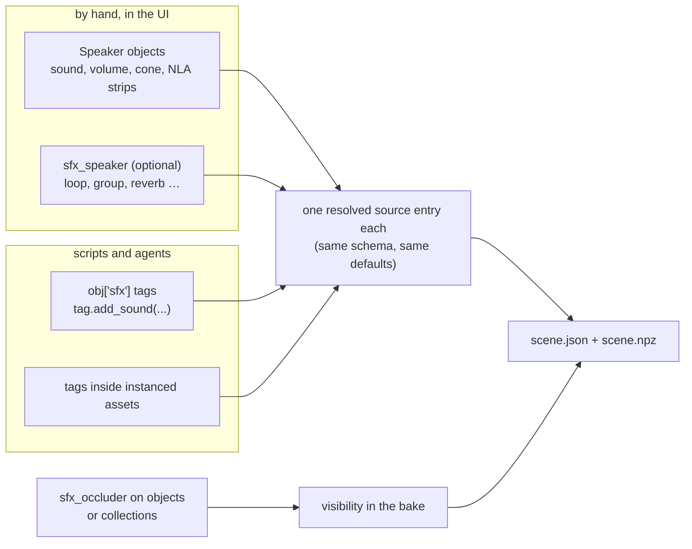

# Blender integration: where sources come from

Two kinds of people put sound into a Blender scene: someone working by hand in the UI, and a
script or agent that builds or extends a scene. Both should end up with the same sources, and
neither should have to learn the other's way.

## What Blender users already do

- **Speaker objects** are Blender's own way to place sound (Add → Speaker; Blender manual, "Speaker
  Objects"). A speaker has a sound, volume, pitch, distance reference and maximum, attenuation, and
  a cone (inner/outer angle in degrees, outer volume); the scene's Audio panel sets the distance
  model, the speed of sound and the Doppler factor. **Timing lives in the NLA editor**: adding a
  sound creates a sound strip at the current frame, more strips make the speaker play again, and
  each strip plays the whole file regardless of its length. Spatial playback needs mono sounds
  (multichannel files are taken as already spatialized). The viewport plays speakers relative to the
  active camera, and `bpy.ops.sound.mixdown` renders them (E01 compared this baseline with the
  engine).
- **Community add-ons** build on Speakers rather than replacing them: *Speaker Overhaul* (automated
  sound design on top of speakers), *bmusic* (speaker tutorials and helpers), Verge3D's positional
  audio (speakers exported to the web). There is no established add-on for offline physical
  rendering; path-traced or binaural audio inside Blender is a recurring wish on Blender Artists.
- **Assets are instanced.** Vehicles, props and crowds come from asset collections placed as
  collection instances or scattered by geometry nodes; the instanced objects are not in the view
  layer themselves.
- **Game-audio vocabulary** is what sound designers bring: obstruction (direct path blocked, the
  room still reverberates the sound) versus occlusion (both blocked) from Wwise and FMOD;
  raycast and volumetric occlusion with frequency-dependent transmission from Steam Audio; reverb
  zones with named EFX/I3DL2 presets from OpenAL, FMOD and Unreal.

## Decisions

| Question | Choice | Alternatives and why not |
|---|---|---|
| Manual workflow | Read Speaker objects as sources ([ADR 0012](../../docs/adr/0012-speakers-and-instanced-tags-as-sources.md)) | A custom panel or add-on UI: another thing to install and maintain, while Speakers already have UI, viewport preview and tutorials. Typing tag dictionaries into custom properties: error-prone. |
| Speaker timing | Each unmuted NLA sound strip is a trigger (`mode = once`) | Strip length as play length: Blender itself plays the whole file. Loops: Speakers cannot express them; `sfx_speaker = {"mode": "loop"}` does. |
| Speaker parameters | Mapped one to one (volume → dB, distances, attenuation, cone, scene distance model) | Own defaults: a scene that already sounds right in Blender's preview should keep its levels and distances. |
| What Speakers cannot say | `sfx_speaker` custom property, a dict of tag keys | Separate tag on another object: the speaker's position and the tag would drift apart. |
| Instanced assets | One source per instance, at most 32 per tagged object, nearest to the camera | All instances: a 500-car traffic system renders 500 engines. Only the asset: no sound from instances at all. |
| Occluders | Everything rendered and large, opt out with `sfx_occluder = False`, opt in to real geometry with `"mesh"` | Opt in per object: scenes would be silent behind buildings until someone marks them all. Real geometry by default: billions of instanced triangles ([E11](../experiments/E11-blender-raycast.md)). |
| Vocabulary | Obstruction/occlusion modes, EFX preset names, OpenAL distance models and cones | Own terms: neither users nor agents would know them. |

## For agents

Agents work from scripts and numbers: `soundstage scan` (what moves, what is near the camera),
tags through `tag.add_sound` in a tagging script applied with `bake --run` (the .blend stays
untouched), `render --report --plot` to check levels, distances, visibility and playback rates
without listening. Speakers are read as well, so an agent extending a hand-made scene keeps the
user's speakers and adds tags beside them. [docs/agent-guide.md](../../docs/agent-guide.md) has the
procedure, [docs/scene-builder-guide.md](../../docs/scene-builder-guide.md) the conventions for
scripts that build scenes.

## Blender API notes (5.2)

Found while building the bake; they matter for anything that walks a large scene headless.

- **`view_layer.objects` is synced lazily.** Objects that a `--run` script has just created and linked
  into a collection are missing from it until the depsgraph is evaluated (`view_layer.update()`).
  The bake decides view-layer membership by walking the layer collections (skipping excluded ones),
  which are up to date immediately.
- **`DepsgraphObjectInstance.object` leaks** about 125 bytes per read (measured: 25 MB per 20 walks
  over 10 000 instances; `parent`, `persistent_id`, `matrix_world`, `random_id`, `instance_object`
  do not leak). A bake that walks 52 000 instances at every visibility sample grew by 7 GB over a
  two-minute shot. Per-sample walks identify instances by instancer name and `persistent_id` only;
  `inst.object` is read once, when the sources and occluders are set up.
- **Instance structs are only valid during the iteration**: copy matrices and names out while
  iterating; touching an instance afterwards raises `ReferenceError`.
- **An object whose geometry nodes output several geometry types** (for example mesh plus curves) is
  listed once as itself and again as an instance of itself (`inst.parent.original == inst.object.original`);
  the bake skips such self-instances, or a tagged object would give two sources.
- **`scene.ray_cast`** builds each object's BVH on the first call (0.55 s on a 24 000-object city),
  then costs 44 ms per ray there; it does see geometry-nodes instances. A `mathutils.bvhtree.BVHTree`
  over boxes costs about 5 µs per ray ([E11](../experiments/E11-blender-raycast.md)).
- **Materials tell what is solid**: a volume-only material (fog, haze) or a surface made only of
  Emission/Transparent shaders (light beams, holograms) is not something sound bounces off; the
  occluder snapshot reads the material output's linked inputs.

## Verification

- `tests/test_blender_sources.py`: a Speaker (volume 0.5, reference distance 2 m, one strip at frame
  10) renders the same level (within 0.01 dB) as a tagged empty with the equivalent tag; a tagged
  object inside three collection instances and two geometry-nodes instances gives five sources at
  the right positions (instance offset included); `instance_limit = 2` keeps the two nearest; an
  object whose geometry nodes add a curve is not counted again as an instance of itself.
- `tests/test_blender_occlusion.py`: occluder rules (own box, small objects, moving objects and
  instances, ground and barriers).

## References

- Blender Manual, "Speaker Objects" (render/output/audio/speaker.html), versions 4.4 to 5.0.
- neXyon (audaspace author), GSoC 2011 "3D Audio: Speaker Objects" (Blender wiki).
- Speaker Overhaul (Superhive market); Verge3D 4.8 release notes (positional speakers); Blender
  Artists thread "Path traced and binaural audio for Blender".
- Audiokinetic Wwise: obstruction and occlusion; Valve Steam Audio: occlusion modes and transmission.
