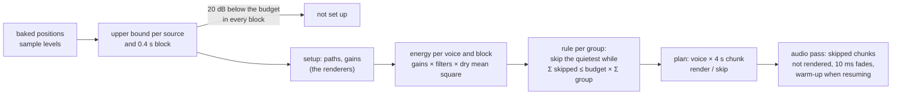

# Culling

A shot with thousands of sources (traffic in a city, a fleet, a crowd) costs bake and render time in
proportion to the total number of sources, although at any moment only the few dozen near the
camera are heard. Culling skips the rest, within an error budget, so the cost follows the number of
sources that matter (FR-68). Spec: [signal-model.md](../../docs/spec/signal-model.md#culling);
measurements: [E16](../experiments/E16-culling.md).

## Model



**The rule.** Per group and block, sort the entries by estimated energy and skip from the quietest
up while the skipped energy stays within `10^(cull_db/10)` of the group's total. The error of the
group's bus is then at most the budget (the skipped contributions are uncorrelated noise to the
rest, so their energies add), and the master's error at most the budget as well. With the default
−40 dB, everything skipped together is 40 dB below what is heard in that group at that moment.

**The estimate.** A source's output power at a control point is its gains, times the share of the
emitted power its filters pass, times the power of what it emitted:

```
P(t) = (g_L(t)² F_L(t) + g_R(t)² F_R(t) + g_send(t)² F_send(t)) · ms_dry(t − τ(t))
F(t) = Σ_b w_b · Π_stages |H_stage(p · f_b, t)|²
```

`g_L`, `g_R` hold gain, distance law, cone, rear cue, occlusion level and pan (the renderer computes
them in its setup anyway). `F` weights the magnitude responses of the path's filters (air
absorption, rear cue, occlusion low-pass, head shadow per ear) with the sample's spectrum: power
shares `w_b` of its 1/3-octave bands at their power-weighted centres `f_b`, shifted by the pitch `p`;
the responses follow from the filter coefficients the renderer already holds, every 16 control
points. `ms_dry` is the dry signal's mean square around the emission time, from 1 ms block sums of
the sample or the loop cycle (exact per block, linear in between), before the interpolator's
prefilter, which the interpolator undoes. The spectrum is the whole sample's, so a sound whose
spectrum changes over time (a bright attack, a dull tail) is estimated with its average spectrum.

**Before setup.** Setup (geometry, retarded time, filter fits) is about a quarter of a render with
1000 sources, and its memory grows with the number of sources. A cheaper bound decides which
sources need no setup at all: the straight-line distance at every baked sample, the distance law,
gain, send, the sample's highest 10 ms mean square, one-shots only while they sound; mapped to the
reception time `t + d/c`. Cone, occlusion and pan only lower the true value. Because this bound
ignores occlusion, a loud source's real level can be up to `|occlusion_gain_db|` (12 dB) lower than
its estimate, which would make the quiet ones look relatively quieter than they are; the bound
therefore culls only 20 dB below the budget.

**The bake.** The visibility pass casts 25 rays per occluding source and visibility sample, about
0.4 ms per source with the Python overhead, 70 % of a bake with 1000 sources
([E15](../experiments/E15-option-costs.md)). The bake estimates each source's level from the
distance of the sound heard at the sample, gain, distance law and the sample's level (read with
Blender's `aud`) and applies the rule 20 dB below the budget. The skipped samples are filled by
interpolation from the source's computed samples, so the scene file keeps its format; they belong
to sources whose contribution is at least 60 dB below their group at the default.

## Choices

| Choice | Taken | Alternatives and why not |
|---|---|---|
| What the budget bounds | the summed energy of everything skipped, per group | **A threshold per source** (skip what is X dB below the loudest): many quiet sources add up; in the dense E15 city, 381 sources each 30 dB below the loudest sum to about −25 dB. **A fixed number of voices** (game engines' voice limit, the N loudest): no bound on the error, and the right N depends on the scene. **An absolute level** (skip below −60 dBFS): ignores masking by the rest of the mix and depends on the final gain staging |
| Budget per group | yes | A master-only budget would let a quiet group (an ambience stem) be skipped almost entirely, audible when the stem is played alone in Fairlight; per-group budgets also make the master the same with and without `--stems` |
| Decision resolution | 0.4 s blocks, 4 s render chunks | Deciding per 4 s chunk let the error reach −29 dB in the worst 1 s at a −40 dB budget, and −10.5 dB at −20 (a loud event in one part of the chunk hides a louder background elsewhere); with 0.4 s blocks (the EBU R 128 momentary-loudness window) the worst 0.4 s stayed within 1 dB of the budget. Smaller render chunks would skip more, at the cost of more warm-ups |
| What is skipped | voices (one per trigger when a one-shot needs per-trigger references) | Per source would keep every voice of a multi-trigger one-shot for the whole shot, which was the 2.5× cost of `doppler_factor` ≠ 1 in E15 |
| Transitions | 10 ms raised-cosine fades rendered inside the skipped chunk; a resumed voice rebuilds its delay line and clears its filters 50 ms earlier | Fading inside the rendered chunk would change it (a one-shot's attack right at the chunk start); without warm-up the filter states would start from zero. With both, rendered chunks equal the full render to 1e-9 |
| Level of detail | skip | Rendering quiet sources cheaply (amplitude pan only, no filters or Doppler) instead of skipping them would keep the texture of a crowd at a fraction of the cost; not needed while the budget keeps the error far below the mix |
| Filters in the estimate | included, through the sample's band spectrum | Leaving them out overestimates every source, but not by the same amount: the occlusion low-pass takes most of the energy of a bright impact, air absorption little of a rumble. In E16's first run without them, the estimated group totals were 2.2 dB above the rendered stems (median, 4.5 dB in the worst blocks), and one stem's worst 0.4 s exceeded a −30 dB budget by 1.8 dB. With them, totals are 0.8 dB above the stems in the median block, and the worst stem window exceeds the budget by at most 1.1 dB (see Limits). The prefilter of the standard interpolator had the same effect for bright samples (3 dB on white noise) until the energy was measured before it |
| Masking model | broadband energy | A psychoacoustic masking model per band (as in perceptual audio rendering, Tsingos et al. 2004) culls more where spectra differ, but needs per-band estimates of every source; the energy budget is simpler and conservative where spectra are similar |
| Default | −40 dB, on | Off by default would leave large shots slow unless the user knows the setting; at −40 dB the measured error of the whole shot is −44 dB or lower and no 0.4 s of any stem exceeds −39 dB (E16), far under audibility in a mix. `null` gives the full render for reference |

## Limits

- **Spectral masking is not modelled.** The budget is broadband: a quiet bright source (a beep)
  under a loud low rumble is skipped by the same rule as a quiet rumble, though it may remain
  audible. Give such a source its own group, or lower `cull_db`.
- **The estimate uses the sample's average spectrum and ignores the Doppler shift** in the filter
  responses. The one-control-point widening keeps it about 0.8 dB above the rendered energy (median
  block in E16), but up to 2 dB above for close sources whose level changes fast. In blocks
  dominated by such sources the group total is overestimated more than the quiet skipped part, so a
  stem's worst 0.4 s can exceed the budget by about 1 dB (1.1 dB in E16); the master stayed within
  0.1 dB.
- **Far sources are not negligible when they fill an area.** With the inverse-distance law, every
  octave of distance carries a similar share of the power (E16), so an energy budget drops few of
  them and render time still grows with the total number of sources. Rendering the distant ones as
  a few clustered voices would scale; culling does not.
- **Memory is not reduced** unless sources are skipped before setup: about 27 MB per source for a
  60 s shot, so 5000 sources did not fit in 110 GB in E16, with or without culling.
- **A render with a stricter budget than the bake** uses interpolated visibility for sources the
  bake skipped; their contribution is still at least 20 dB below the bake's budget.
- **Group totals include sources a group does not hear yet** (sound still travelling); the estimate
  uses the reception time, so this only matters within the 0.4 s blocks.

## Verification

- `tests/test_culling.py`: the rule (budget, ties, groups, beds), the dry-signal energy against the
  rendered dry signal, the estimate against the rendered energy per block for a source far away,
  behind and at the side (within 1 dB, filters included), culled renders within the budget overall
  and in the worst 0.4 s, a quiet
  group keeping its stem, a resumed voice equal to the full render (1e-9), sources skipped before
  setup, one-shot voices skipping their silent chunks, culling off reporting nothing.
- `tests/test_blender_occlusion.py`: the bake skips the visibility of a far quiet source and fills
  it with 1.
- With `cull_db` null, renders equal the engine before culling sample for sample (checked on the
  E15 scene with 100 sources).
- [E16](../experiments/E16-culling.md): render and bake time against the budget and the number of
  sources on a dense and a spread city, and the measured error of master and stems.

## References

- N. Tsingos, E. Gallo, G. Drettakis, "Perceptual Audio Rendering of Complex Virtual Environments",
  ACM Trans. Graphics 23(3):249–258 (SIGGRAPH 2004): masking-based culling and clustering of
  hundreds of sources from loudness estimates; the idea behind skipping what the mix hides.
- EBU Tech 3341: the 400 ms momentary-loudness window used as the decision block.
