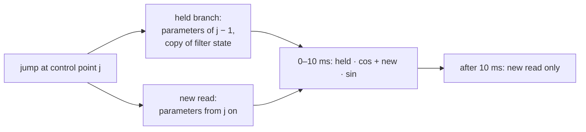

# Cuts and teleports

A camera switch (cut) or a source that jumps (a vehicle recycled from the end of a lane to its
start) makes the delay jump. Following the jump with the read would sweep the pitch across it; the
engine switches instead, with a short crossfade.

## Model

**Detection.** A *jump* starts at a control point where the listener segment, the source piece or
the audibility changes:

- listener segments: camera switches recorded by the bake (`cuts`) and listener jumps faster than
  `teleport_speed`;
- source pieces: `src_cuts` from the scene file and source jumps faster than `teleport_speed`
  (default 3 × `speed_of_sound`), found by the engine in the baked positions;
- audibility: entering or leaving a stretch without a retarded solution ([retarded time](retarded-time.md)).

**Switch.** Control-rate values are never interpolated across a jump (the step before a jump
already takes the new value; Catmull-Rom neighbours do not reach across). At the jump a *held
branch* starts: a second read of the delay line with every parameter frozen at its last value
before the jump (read delays, gains, pan gains, head-shadow coefficients, with a copy of the
head-shadow state). Over 10 ms the output crossfades from the held branch to the new read:

The delay line keeps every emission sample a future read may need, so a cut to a farther camera
(the new read lies further back in emission time) finds its samples.

| Case | What is heard |
|---|---|
| Camera cut, near → far | the old view's sound fades out in 10 ms; the new view's sound, delayed by its own travel time, fades in; no glide |
| Source teleports away (5 → 100 m) | old sound until its last emission arrives, fade out; silence until the first emission from the new place arrives (277 ms); fade in |
| Source teleports closer (100 → 5 m) | switch with crossfade when the new place's sound arrives (the old sound's last part is cut) |

## Choices

| Question | Choice | Alternatives and why not |
|---|---|---|
| Crossfade length | 10 ms, equal power (`sin`/`cos`) | Shorter: audible click-like switch; longer: both views audible at once. Equal power because old and new reads are mostly uncorrelated (different delays). |
| Old branch | Hold the parameters | Extrapolate the old trajectory: no data beyond the cut; holding is exact for 10 ms. |
| Teleport threshold | Speed above 3 × c between two baked samples, in the engine | In the bake: threshold changes would need a re-bake. Hide/unhide flags: not all teleports are hidden, and scale-0 hiding is a scene convention. |
| Teleport closer | Follow the new place only | Two reads during the overlap: physically both arrive, but it needs a second delay line for an edge case. |

## Verification

`tests/test_cuts.py`:

- camera cut 5 m → 100 m: level change −26.0 dB (expected −26.02), 1000.0 Hz 12–60 ms after the
  cut, largest sample step 1.0× a sine's own;
- teleport away: silence in the gap (< 1e-6), correct level and frequency after, no steps, no
  spurious rate-clamp warning; teleport closer: no steps, 1000 Hz after.

`tests/test_end_to_end.py`: a two-camera shot with timeline markers bakes with a cut at the marker
frame and renders.

## References

- ADR [0006](../../docs/adr/0006-propagation-retarded-time-delay-line.md) (consequences: cuts),
  [0009](../../docs/adr/0009-processing-chain.md).
