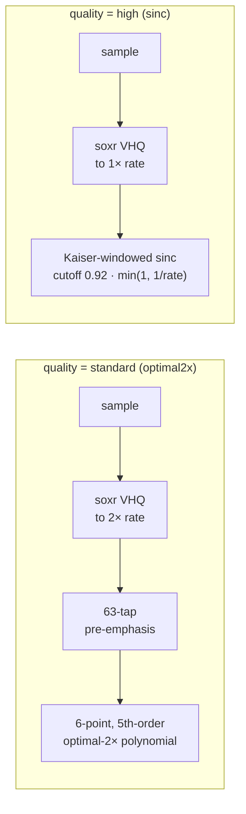

# Fractional-delay read

Reading the dry signal at non-integer positions with a position that moves at a varying rate
(the Doppler factor). The read decides how clean Doppler sounds, especially at high frequencies.

## Model

Two interpolators, chosen by `quality`:

**`optimal2x`** (default). Niemitalo's comparison of polynomial interpolators shows that none is
good at high frequencies on plain input, and recommends oversampling first by a simple ratio, then
a polynomial optimized for that ratio. The 6-point, 5th-order "optimal 2×" polynomial reaches
111.4 dB modified SNR on 2× input (against 23.5 dB for the 4-point Hermite). The samples are
resampled once to 2× at load time by soxr, so the whole emission side runs at 96 kHz.

The optimal polynomials are **not flat in the passband**: Niemitalo's measure counts only the
images and assumes the passband is corrected in the oversampling stage. Measured droop for 48 kHz
audio: −0.01 dB at 1 kHz, −0.3 dB at 5 kHz, −1.2 dB at 10 kHz, −4.9 dB at 20 kHz. A symmetric
FIR at the 2× rate, fitted by least squares so that FIR × interpolator response = 1 up to 0.234 of
the 2× rate (22.5 kHz), corrects it. It is applied once per source, to the sample (one-shots) or
circularly to the loop cycle (loops), so it costs nothing per chunk ([E04](../experiments/E04-preemphasis.md)).

**`sinc`** (high quality). Smith's bandlimited interpolation: a Kaiser-windowed sinc (β = 9,
16 zero crossings per side) stored as a table with 512 entries per zero crossing and linear
interpolation between entries. When reading faster than real time (`rate > 1`) the cutoff falls to
`0.92 / rate` of the output Nyquist and the kernel widens accordingly, which band-limits the
Doppler-shifted signal. Cost grows with the rate: 32 taps at rate ≤ 1, 128 at rate 4.

**`hermite4`** (4-point cubic Hermite on 1× input) is kept as a reference only.

## Choices

| Question | Choice | Alternatives and why not |
|---|---|---|
| Standard read | 2× oversampling + pre-emphasis + optimal-2× polynomial | 4-point Hermite at 1× (the original spec): −27 dB error at 10 kHz, −7 dB at 20 kHz. Hermite at 2×: −48 / −27 dB. Lagrange 6-point: flat passband but only 35 dB modified SNR at 2×. |
| Pre-emphasis length | 63 taps | 15 taps: about −50 dB; 31: about −78 dB; 47: −75 to −104 dB; 63: −85 to −103 dB up to 20 kHz. |
| Where pre-emphasis runs | Once per source on the sample / loop cycle | Per chunk as a streaming FIR: 63 multiply-adds per sample at 96 kHz per source, the largest single cost of a render before it was moved ([E10](../experiments/E10-performance.md)). |
| High quality | Windowed sinc with rate-scaled cutoff | Farrow structures or polyphase banks: same quality class, more code; the table sinc handles any rate directly. |
| Aliasing in `standard` | Accepted | Above 1.09× real time, content between 22 and 24 kHz folds back below 24 kHz; with 30 m/s (rate 1.1) this is inaudible. `high` removes it. |

## Verification

[E03](../experiments/E03-interpolators.md), error in dB re. the signal for a sine read at a varying
rate:

| Interpolator | 1 kHz | 10 kHz | 18 kHz | 20 kHz |
|---|---|---|---|---|
| hermite4 @1× | −91.7 | −26.6 | −9.7 | −7.1 |
| optimal2x @2×, no pre-emphasis | −57.2 | −17.7 | −8.7 | −7.4 |
| **optimal2x @2× + pre-emphasis** | −98.4 | −92.2 | −95.0 | −84.7 |
| sinc @1× | −103.5 | −102.0 | −91.3 | −25.6 (above its 22 kHz cutoff) |

`tests/test_kernels.py`: every kernel matches an independent reference implementation; the
optimal read with pre-emphasis is below −85 dB at 1, 10 and 18 kHz; the sinc read suppresses an
18 kHz tone read at rate 2 (it would alias to 12 kHz).

A side effect of any band-limited read: a single-sample click rings symmetrically for about ±16
samples, so the first sample above a tiny threshold comes before the click; tests measure clicks
by their peak.

## References

- O. Niemitalo, "Polynomial Interpolators for High-Quality Resampling of Oversampled Audio", 2001
  (`niemitalo2001`): coefficients of the 6-point, 5th-order optimal-2× interpolator (z-form).
- J. O. Smith, "Digital Audio Resampling" (`smith2002resample`).
- T. I. Laakso et al., "Splitting the Unit Delay", IEEE SPM 1996 (no open copy).
