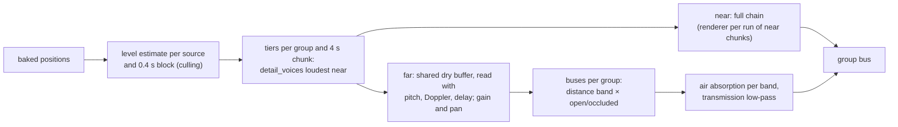

# Level of detail: the far field

Rendering thousands of sources (FR-56): the loudest sources of each group get the full processing
chain, the rest a cheaper far field. Spec: [signal-model.md](../../docs/spec/signal-model.md#far-field);
decision: [ADR 0013](../../docs/adr/0013-two-render-tiers.md); measurements:
[E18](../experiments/E18-traffic.md).

## Model

**Why two tiers.** The full chain (ADR 0009) costs about 0.2 s of render per source and minute and
holds 21–27 MB per source for a 60 s shot (E15, E16). Culling cannot remove distant sources that fill
an area, because their summed power is not negligible (E16). The cues that make the full chain
expensive per source (ITD, head shadow, per-source filters at the 2× emission rate, a delay line and
a held branch at every jump) are what is not audible one by one in a distant crowd; what is audible
is the level, the pitch movement, the side and the duller sound with distance. The far field keeps
those, per source, and shares the rest.

**What a far voice computes.** Per output sample one 6-point optimal-2x read from a buffer shared
by every voice of the same sample file (prefiltered once at twice the output rate), at the position
`(e − origin) · pitch + phase` with the emission index `e = (t − τ_read) · 2 f_s` (Doppler, delay
and pitch in one read), and a few multiply-adds into the buses with its gain and pan. Its geometry
(retarded delay by fixed-point steps on the baked positions, linear between baked samples) is
computed every 4 control points for the chunk only, and interpolated (Catmull-Rom for the delay, so
the playback rate stays smooth).

**What the buses share.** Air absorption depends on the distance; filtering every source at audio
rate is what costs. The far field sums the voices into buses per distance band (no filter, then
25 m to 12.8 km, √2 apart) and filters each bus once with the air absorption of its band distance. A
voice's weight is split between the two bands around its distance, linear in log distance, so a
moving car glides between bands without switching. Between two bands a voice is the sum of their
filters, and their phases differ: minimum-phase filters with different losses have different
phases. With bands an octave apart, the far field of 2000 cars in E18 was 0.8 and 1.3 dB low at
3.2 and 6.4 kHz in the median, also with every pitch at 1; √2 apart, a voice halfway between two
bands stays within 0.5 dB of the full chain up to 6.5 kHz. Occlusion is linear in the visibility v
(`g = v + (1 − v) T(f)`, [occlusion](occlusion.md)), so the same split into an open bus (v) and an
occluded bus (`(1 − v)` times the transmission gain, low-passed once) is exact for a broadband v.

**Tiers.** The ranking uses the culling estimate from the baked positions (distance law, gain,
sample level, activity), so it costs nothing per source beyond reading its positions. A near source
stays near while it ranks within 1.5 × `detail_voices` (hysteresis). A near renderer is built for its
run of near chunks only, on its part of the control grid, so render memory follows the number of near
voices alive at a time.

**Visibility in the bake.** The bake's visibility costs 1 + 3 × 4 paths per source and sample
(direct path and Fresnel rings, [occlusion](occlusion.md)), 0.5–0.7 ms per source and sample in
the E18 canyon: 85–87 % of the bake. The far field uses one broadband visibility, so the bake ranks
the sources of each group at every visibility sample by the render's estimate and gives those beyond
2 × `detail_voices` the direct path only. In E18 this made the bake of 500–10 000 cars 2.3–3.6 times
faster, and the render within 0.03 dB of the one from a bake with every path.

**Crossfade between tiers.** Both tiers render the first 100 ms of a chunk where a source changes
tier, crossfaded with `a² + b² + 2ρab = 1` (the law of the loop seam, E02). The correlation ρ of the
two renders is known from the source: at pitch 1 both read the same loop cycle at the same phase
(ρ = 1 with the amplitude panner; 0.5 with the hybrid panner, whose ITD and head shadow decorrelate
the highs), otherwise the far field's shared unpitched cycle starts at another point than the full
chain's resampled one (ρ = 0).

## Choices

| Choice | Taken | Alternatives and why not |
|---|---|---|
| What is clustered | filtering (distance band × occlusion), not direction | Direction clusters (Tsingos et al. 2004, Atmos spatial coding) premix sources and render each cluster at its centroid; in stereo a source's direction costs two multiplies per sample, so it stays exact per source; clusters would need re-clustering as the camera turns |
| Ranking | the culling estimate per 4 s chunk, per group | Distance only ignores gain and sample level; the precise estimate (filters) needs the setup the far field avoids |
| `detail_voices` | 64 per group | Scenes up to 64 sources per group render as before, sample for sample; E18 measures 16–128 |
| Interpolator | optimal-2x (as the full chain) | A 4-point Hermite would save part of the read cost, but with the same read a far voice equals the full chain without filters to −60 dB (the tests rely on it), and the far field is already a small part of the render time |
| Band spacing | √2: 20 bands from 25 m to 12.8 km | An octave (11 bands): the sum of two bands' filters, whose phases differ, made the far field 0.8–1.3 dB dull at 3–6 kHz (E18); closer bands cost more bus memory (16 tasks × 2 × bands × a chunk of stereo) and filtering |
| Geometry rate | every 4 control points (4 ms), interpolated | Every control point: 4 × the far field's geometry cost, which was its largest part; the delay of a car changes slowly |
| Jumps | fade out and in over 8 control points | The full chain's held branch needs per-voice state over the shot |
| Bus filters per task | each of 16 fixed tasks per group filters its own buses | Filtering is linear, so the sum of filtered task buses equals the filtered sum; summing the buses of every task in the main thread was the bottleneck; a fixed task count keeps the output independent of the number of workers |
| Far visibility in the bake | the direct path only, beyond 2 × `detail_voices` per group and sample | Every path for every source: 25 ray segments instead of 1 per source and sample; a lower visibility rate for far sources: they move as fast as near ones, behind the same towers |
| Loop buffers | one unpitched cycle per sample file, pitch in the read | One resampled cycle per pitch (as in the full chain) costs memory per source; the phase then differs from the full chain at pitch ≠ 1 |

## Limits

- **No ITD, head shadow or rear low-pass** in the far field; the rear cue stays as its level.
- **Air absorption per band**: the response is a mix of the two neighbouring bands' filters: within
  0.5 dB of the full chain up to 5 kHz at a band distance and up to 6.5 kHz halfway between two.
  Both fits follow ISO 9613-1 where the loss is below 20 dB; beyond it the far field's (at the
  output rate) is 0.5–2.5 dB duller above 6 kHz than the full chain's (at twice the rate), and both
  much brighter than ISO (E18).
- **One broadband visibility** per voice (the mean of the baked bands), and the transmission
  low-pass at its fixed cutoff instead of the per-source fitted one. Sources ranked beyond
  2 × `detail_voices` at a bake sample have the direct path only: 0 or 1, without the gradual
  shadow edge of the Fresnel rings. A near source can rank that low at a sample of its near chunk
  (the bake ranks per sample, the render per 4 s chunk); it is then among the quieter sources of
  its group.
- **No playback-rate clamp**: a far voice moving near the speed of sound reads at whatever rate the
  geometry gives.
- **Loop phase at pitch ≠ 1** differs from the full chain (another random phase). Sums of loops with
  nearly the same tone beat differently, so per 0.4 s block band levels differ from a full render by
  about as much as two full renders with different random phases do (E18).
- **Ranking per 4 s chunk**: a source becomes near at the chunk where its estimate ranks; a very
  fast pass inside one chunk is near for the whole chunk.

## Verification

- `tests/test_blender_occlusion.py`: a source ranked beyond 2 × `detail_voices` gets the direct
  path only (no partial values, the same in every band).
- `tests/test_farfield.py`: a far voice equals the full chain without filters (error < −60 dB); air
  absorption at a band distance within 0.5 dB of the full chain up to 5 kHz, halfway between two
  bands up to 6.5 kHz; Doppler 1111/909 Hz
  within 0.5 %; a 343 m delay of 1.000 s and the side; tier switches without a level step or a click
  (both crossfade laws); a teleport without a click; renders identical across worker counts, stems
  summing to the master, near voices bounded.
- [E18](../experiments/E18-traffic.md): time, memory and the difference to the full render against
  the number of cars and `detail_voices`.

## References

- N. Tsingos, E. Gallo, G. Drettakis, "Perceptual Audio Rendering of Complex Virtual Environments",
  ACM Trans. Graphics 23(3), 2004; H. Moeck et al., "Progressive Perceptual Audio Rendering of Complex
  Scenes", I3D 2007; J. Breebaart et al., "Spatial Coding of Complex Object-Based Program Material",
  JAES 67(7/8), 2019 ([survey](../survey.md#many-sources)).
