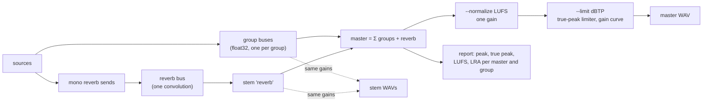

# Mixing, loudness and the report

The engine's output goes into DaVinci Resolve, where the final mix happens. It delivers a master,
optional stems for Fairlight, and a report that lets an agent judge a render without listening
(FR-62 to FR-65).

## Model

- **Stems** are the group buses (`group` of each source) plus the reverb return. Normalization and
  limiting apply the same gains to every stem, so the stems always sum to the master; in Fairlight
  they can be rebalanced and still match the master when left alone.
- **Loudness** (integrated, ITU-R BS.1770-4 with gating) through pyloudnorm, the reference Python
  implementation. **Loudness range** (EBU Tech 3342) is computed by the report: short-term loudness
  (3 s, K-weighted with pyloudnorm's filter stages) every 0.1 s, gated at −70 LUFS and 20 LU below
  the gated mean, 95th minus 10th percentile.
- **True peak** (BS.1770-4 Annex 2): 4× oversampling with a defined interpolation filter (32 taps per
  phase, Kaiser β 8, flat to 20 kHz), the maximum of the absolute values.
- **Normalization**: one gain to a target (−23 LUFS EBU R128 broadcast, −24 LKFS ATSC A/85, about −14
  LUFS for streaming platforms, −27 LKFS for a cinematic mix).
- **Limiter**: offline, so it can look ahead freely. The gain each sample needs, `min(1, ceiling /
  true peak)`, is spread back over the look-ahead (sliding minimum over ±5 ms, then a 5 ms moving
  average, so the gain is already down when the peak arrives, without a step), and recovers with an
  80 ms exponential release. It checks itself at 8× oversampling and repeats (up to four passes)
  until the result holds the ceiling.

## Choices

| Question | Choice | Alternatives and why not |
|---|---|---|
| Master processing by default | Off | On: the final mix happens in Resolve; normalizing or limiting there is the editor's decision (FR-64). |
| Stem split | By `group`, plus the reverb return | Per source: dozens of files for a city shot. Dry/wet per group: doubles the files; the reverb stem serves the usual need (rebalance the space). |
| Loudness meter | pyloudnorm (already a dependency) | Own implementation: pyloudnorm is the reference and matches ffmpeg's `ebur128` within 0.06 LU ([E14](../experiments/E14-loudness-and-limiter.md)). |
| Limiter type | Offline look-ahead with a gain curve, true peak at 8× | A real-time compressor/limiter design (attack/release detectors, Giannoulis et al.): needed only for real time. `pedalboard.Limiter`: sample peak only, and its gain cannot be applied to the stems. Clipping: distortion. |
| Normalize, then limit | That order, one pass | Iterating to hit the loudness target after limiting (ffmpeg `loudnorm` style): heavy limiting would then push the mix harder; the report states the final loudness, and mastering stays in Resolve. |
| Debug plot | Six rows per source on a frame axis, up to the 12 loudest sources | Per-source files: more to look at. Spectrograms: on request in experiments. |

## Verification

- `tests/test_phase3.py`: stems sum to the master within 1e-6 (float32 stems); `--normalize -8
  --limit -1` gives −8 ± 0.5 LUFS and a true peak at most −0.95 dBTP, and the limited stem equals the
  limited master; report LUFS equals pyloudnorm within 0.01; true peak of an fs/4 sine at 45° phase
  −6.02 ± 0.1 dBTP (sample peak −9.03); loudness range on the EBU Tech 3342 cases 10, 5 and 20 LU
  within 0.1.
- [E14](../experiments/E14-loudness-and-limiter.md): EBU Tech 3341 and 3342 signals and a rendered mix
  against ffmpeg's meter; the limiter holds −1 dBTP as ffmpeg and an ideal reconstruction measure it
  (−0.99 dBTP), with the stems still summing to the master.

## References

- ITU-R BS.1770-4, algorithms to measure audio programme loudness and true-peak audio level.
- EBU R 128 (loudness normalisation and permitted maximum level), EBU Tech 3341 (loudness metering,
  test signals), EBU Tech 3342 (loudness range) (`ebu_r128`, `ebu_tech3341`, `ebu_tech3342`).
- C. J. Steinmetz, J. D. Reiss, "pyloudnorm: A simple yet flexible loudness meter in Python", AES
  150th Convention, 2021.
- D. Giannoulis, M. Massberg, J. D. Reiss, "Digital Dynamic Range Compressor Design — A Tutorial and
  Analysis", JAES 60(6), 2012 (`giannoulis2012`; no copy fetched).
