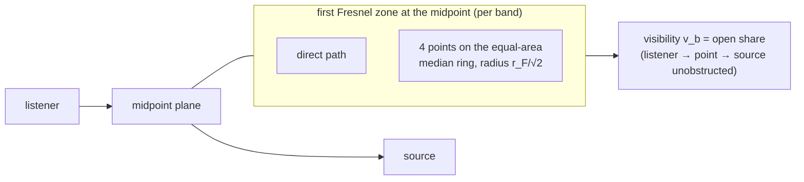
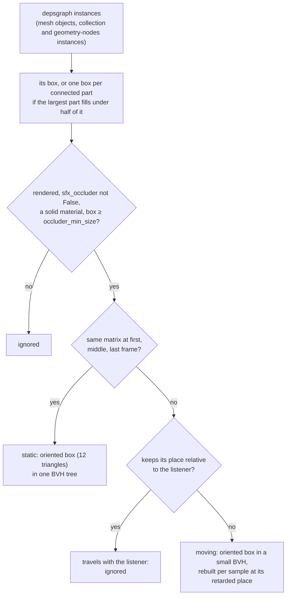

# Occlusion

A source behind a building, a wall or a passing truck is quieter and duller. The bake measures how
much of each source's sound path is open (FR-25); the engine turns that into a gain and a low-pass
(FR-47).

## Model

**Visibility = open share of the first Fresnel zone, per band.** By Huygens–Fresnel, sound reaching
the listener is the sum of secondary sources on a surface between source and listener; the
contribution of the first Fresnel zone dominates. Its radius at the midpoint of a path of length
`d` is

```
r_F(f) = ½ · sqrt(λ d),      λ = c / f
```

(at 100 m: 8.3 m at 125 Hz, 2.1 m at 2 kHz, 1.0 m at 8 kHz). An obstacle that blocks part of the
zone attenuates; one smaller than the zone lets the sound bend around it, more so at low
frequencies. Tsingos and Gascuel used exactly this for computer-animation soundtracks: the
fraction of the first Fresnel ellipsoid blocked by occluders, rendered from the receiver with
graphics hardware.



For each band (250 Hz, 1 kHz, 4 kHz) the bake casts the direct path and four broken paths
listener → point → source through points on the ring of radius `r_F/√2` (which halves the zone's
area), at least `occlusion_radius` (the source's own size). Visibility of a band is the open share
of its five paths. 13 points, 25 ray casts per source and sample, at `occlusion_rate` (10 Hz). The
rings are turned by 22.5°, 37.5° and 52.5°, so that no two points of a band cross a horizontal or
vertical edge at the same time ([E13](../experiments/E13-occlusion.md)).

**Which path.** The sound heard at time `t` left the source at `t − τ`. The bake casts from where the
source was then (solving `t_e = t − |x(t_e) − x_L(t)| / c` over the positions sampled so far) to the
listener at `t`: the same retarded path the engine uses for distance and direction. A car 100 m
away that drives out from behind a building opens up 0.29 s after the picture shows it, when its
sound arrives. Same-instant visibility would open the sound before the sound from the open position
could have arrived.

Moving occluders are placed where they were when the sound passed them: at `t − r/c`, with `r` their
distance to the listener, interpolated from the centres of earlier samples. A truck next to the
camera is where the picture shows it; a source's own body is where it was at emission, around the
emission point. Taking every occluder at `t` instead put a fast car's own body between the camera
and its retarded emission point while it approached (the flyby's ship was "fully occluded" for 81
frames).

Moving parts of instances (a keyed collection-instance car) are moved by their instancer's matrix
when their matrix relative to it is the same at every snapshot that has them (taken from the first
one that has them). A snapshot may lack the part where its instancer scales it below the minimum
size: traffic is usually hidden at scale 0 while it jumps back to the start of its lane, and a car
may be at scale 0 at the start of the shot. Occluders come from every snapshot, so such a car still
occludes once it appears; a plain object missing from a snapshot is skipped at the samples where it
is hidden from rendering. Only the other parts are looked up per sample in the
depsgraph's instances, and that lookup walks every instance of the scene, so it costs by the size
of the scene, not by the number of moving parts: with a million instanced balconies, 1109 ms per
visibility sample against 6 ms by the instancers' matrices, for 500 cars
([E18](../experiments/E18-traffic.md#results-moving-occluders)).

**Reflectors.** A Fresnel point under the ground is not blocked: the ground reflects, and the image
source fills that part of the zone. An occluder therefore does not block when it lies beyond both
endpoints: listener and source outside the same face of its box, with none of its face planes
between them (the ground under both, a wall behind both, a truck parked beside both). The ray goes
on past it. A low wall or roof edge between them has a face plane with the listener on one side and
the source on the other, and still blocks, so a barrier that the line of sight just clears still
cuts the wide low-frequency zones (barrier insertion loss at grazing incidence). Without this rule
every source near the ground lost up to 3 dB.

**Engine.** Per band, visibility is interpolated to the control rate and smoothed (60 ms when a
source becomes hidden, 150 ms when it reappears). What is blocked still passes partly *through*
the occluder (transmission, duller): the band gain is

```
g_b = v_b + (1 − v_b) · T(f_b),     T(f) = 10^(occlusion_gain_db/20) / sqrt(1 + (f / occlusion_cutoff_hz)²)
```

(−12 dB and 1.5 kHz by default). The lowest band's gain is applied as a broadband gain; the higher
bands' ratios to it set the cutoff of a one-pole low-pass, fitted to their attenuations in dB by
least squares. Fully hidden, this reproduces the transmission curve within 0.12 dB up to 4 kHz
(it is itself a one-pole; the broadband gain is taken at 250 Hz, not at DC); partly hidden, within
0.8 dB at the band centres. Both go on the direct sound only, per
ear after the read, on the reception-time control grid: the visibility already describes the path
of the sound heard at that time (see below).

**Obstruction and occlusion.** Game audio distinguishes *obstruction* (the direct path is blocked,
the room still reverberates the sound: a pillar, a car in the street) from *occlusion* (the sound
is in another space: behind a closed door). `occlusion_mode = "obstruction"` (default) leaves the
reverb send unchanged; `"occlusion"` applies the same gain and low-pass to the send.

## Occluder geometry



- **Merged meshes by their parts**: the box of a merged mesh is mostly air (the brackets around a
  tower, a railing, the lamps of a terrace, the buildings of a district in one object); on the test
  city such boxes made most sources "occluded" for the whole shot. When a mesh's largest connected
  part fills less than half of its box, each part gets its own box (parts found once per mesh by
  union-find over the edges, 0.1 s for 2 million edges, shared by its instances); parts below
  `occluder_min_size` drop out. Splitting every mesh instead turned the test city's 11 000 boxes into
  2.6 million (buildings have many large separate parts: floors, balconies, frames), 27 GB of memory
  and 5 minutes of setup, for parts that lie inside their building's box anyway.
- **Solid materials**: meshes whose materials only emit or pass light (volume-only materials such as
  fog and haze; surfaces made only of Emission, Transparent, Holdout, Add and Mix shaders: light
  beams, holograms) do not occlude. On a test city, haze banks 200–500 m across had made every
  source behind them "occluded". Glass occludes: glass panes block sound. Text objects do not
  occlude either: a box over lettering closes the gaps between the letters (a hologram sign on the
  test city blocked its own sound source).
- **The listener's vehicle**: an object whose position relative to the listener stays within its own
  size (at least 2 m) at the first, middle and last frame while it travels further is part of the listener (the car
  the camera rides on, a cockpit); on the test city the camera car's roof had blocked the city below.
- **Per path**: a box that contains the listener or the source does not occlude that source: an engine
  inside its car body, a camera inside a cockpit, and a box too coarse to say anything (the camera
  inside the box of a merged mesh of many buildings). A ray that hits such a box, or a reflecting box
  (see above), continues past it.

`sfx_occluder = "mesh"` on an object uses its real triangles instead of its box (static only);
`sfx_occluder = False` (on an object or the instanced collection) removes it. The bake records, per
source, the objects that block most of its paths (scene file, `soundstage inspect`), so the objects
to mark are found without guessing.

## Choices

| Question | Choice | Alternatives and why not |
|---|---|---|
| Model | Fresnel-zone visibility per band (Tsingos & Gascuel) | Single ray (game engines' raycast mode): binary, switches abruptly, no frequency dependence. Volumetric rays to a sphere around the source (Steam Audio): smooth, but frequency-independent and the sphere size is arbitrary. Barrier formulas (Maekawa `10 log₁₀(3 + 20N)`, Kurze–Anderson): need the diffraction path over an edge, not available for arbitrary scenes. Edge diffraction (UTD, BTM): needs edges and much more computation. |
| Bands | 250 Hz, 1 kHz, 4 kHz | More bands: more rays for differences the gain + one-pole filter cannot reproduce anyway. |
| Filter | Broadband gain from the lowest band, one-pole cutoff fitted to the upper bands (least squares in dB) | Lowest of the per-band cutoffs (first version): over-attenuated 4 kHz by 3 dB while the low band was still partly open, so the sound brightened again as the source went further behind. Two cascaded one-poles: could pass through all three bands, but not for every combination, at twice the filter cost. |
| Ray casting | `mathutils.bvhtree.BVHTree` over boxes | `scene.ray_cast`: on a 24 000-object city 0.55 s for the first ray (it builds every object's BVH), then 44 ms per ray: 2 minutes per visibility sample of a 111-source shot ([E11](../experiments/E11-blender-raycast.md)). A BVH over the real meshes: the same city has 4.0 billion triangles through instancing, at about 250 bytes each in a Python-built BVH. Boxes: about 5 µs per ray. |
| Small objects | Ignored below 2 m | Boxes around people and trees over-occlude; physically, obstacles small against the wavelength diffract sound around them. |
| Moving occluders | Detected at three frames; a small BVH of the moving boxes rebuilt per sample | Snapshot and rebuild of all occluders per sample: about 2 s per sample on the city (one walk over all instances and 19 000 boxes). Ignoring them: a passing truck would not occlude. |
| Rate | 10 Hz, smoothed in the engine | Per sub-frame: 12× the rays for changes smoothed over 60–150 ms anyway. |
| Timing | Retarded source; moving occluders where they were when the sound passed them | Source and listener at the same instant: wrong by the propagation delay for moving sources (1.1 s at 380 m). Occluders at the sample: a fast source's own body blocks its retarded emission point. |
| Ground and walls behind both | Reflect: a box beyond both endpoints does not block | Every box blocks: sources near the ground lose up to 3 dB at low frequencies. Image sources for ground reflection: interference patterns that depend on exact heights, more than the model can resolve. |
| Transmission | Fixed gain and low-pass per scene | Per-material transmission (Steam Audio): needs acoustic material data the scenes do not have. |

## Limits

- Boxes are coarse: an arch or a gap between two parts of one object is closed. Mark such objects
  `sfx_occluder = "mesh"`. A single connected part that wraps around open space (a courtyard
  building, brackets joined by a band) still blocks with its whole box.
- Five paths per band give visibility in steps of 0.2; the engine's smoothing (60/150 ms) and the
  interpolation between samples hide the steps, but a transition faster than the 0.1 s sample
  spacing is seen as one step.
- Above 4 kHz the one-pole keeps falling 6 dB per octave; partly hidden behind an edge, the true
  high-frequency level is somewhere between that and the 4 kHz value.
- Static/moving is decided from three frames; an object that moves only between them counts as
  static. Likewise a part of an instance that moves relative to its instancer only between them is
  moved with its instancer. An instance absent from all three snapshots (scaled to zero or hidden
  at each of them) does not occlude.
- The retarded positions and the Fresnel radii use the bake's `speed_of_sound`; a render with
  another `--set speed_of_sound` keeps the baked visibility.
- One reverb environment per render: `occlusion` mode reduces the send but does not switch to the
  other room's reverb.
- The reflector rule uses boxes: under a sloped roof or a large tilted object, the box decides
  whether both endpoints are on the same side.
- A source whose emitter lies outside its own object's box (an engine at the tail of a long hull)
  is shadowed by that object from the other side, as physics says; use cones for intended
  directivity, `sfx_occluder = False` on the object to switch the shadow off.

## Verification

- `tests/test_blender_occlusion.py`: a source moving behind a wall goes from fully visible to fully
  occluded, with the 250 Hz band at least as open as the 4 kHz band during the transition; an
  emitter inside its car body seen from inside a cockpit stays fully visible; a 1 m box does not
  occlude; a sliding door is detected as moving and occludes at the end; a source 343 m away
  passing behind a wall edge at 100 m/s is occluded from 3.3–3.5 s (retarded, expected 3.33 s), not
  at 2.2 s; baked and rendered, a 1 kHz tone behind a wall is 13.67 ± 0.3 dB below the same render
  with transmission set to 0 dB (−12.12 dB broadband plus the one-pole at 1528 Hz); a source above a
  ground plane is fully visible, while a barrier the line of sight clears by 1.05 m cuts the 250 Hz
  zone but not the 4 kHz zone; a box moving at 60 m/s past the camera is not occluded by itself; a
  moving collection instance occludes, moved by its instancer's matrix with the same visibility as
  from the depsgraph's instances, also when it is scaled to zero at a snapshot, the first one
  included (`test_instance_scaled_to_zero_at_the_first_snapshot_occludes_later`), and a part animated
  inside its instance is looked up there; a fog volume and an emissive light beam do not occlude, a
  glass wall does; the car carrying the camera does not occlude what is below it; a 100 m box around
  the camera does not occlude a source outside it; two buildings merged into one mesh leave the street
  between them open, and a ring of 1 m brackets in one mesh does not occlude.
- `tests/test_phase3.py`: fully occluded noise is −12.0 ± 0.3 dB at 200 Hz and a further −3 dB at
  the transmission cutoff; level changes by less than 0.5 dB per ms during the transition; partial
  visibility low-passes in band order; the cutoff fit equals a brute-force search; occlusion mode
  reduces the reverb send, obstruction does not.
- [E13](../experiments/E13-occlusion.md): attenuation per frequency against the model for full and
  partial visibility, attack and release times (136 ms and 330 ms, 10–90 %), and a baked source
  passing a wall edge (the 250 Hz zone closes over 1 s, the 4 kHz zone within 0.2 s).

## References

- N. Tsingos, J.-D. Gascuel, "Soundtracks for Computer Animation: Sound Rendering in Dynamic
  Environments with Occlusions", Graphics Interface 1997 (`tsingos1997`); "Fast Rendering of Sound
  Occlusion and Diffraction Effects for Virtual Acoustic Environments", AES 104th Convention, 1998
  (no open copy). Method as summarized by B. Kapralos, M. Jenkin, E. Milios, "Diffraction Modeling for
  Interactive Virtual Acoustical Environments", GRAPP 2007 (`kapralos2007`), who use the same
  Fresnel-zone visibility.
- Game-audio conventions: Wwise obstruction/occlusion curves; Steam Audio raycast and volumetric
  occlusion with transmission.
