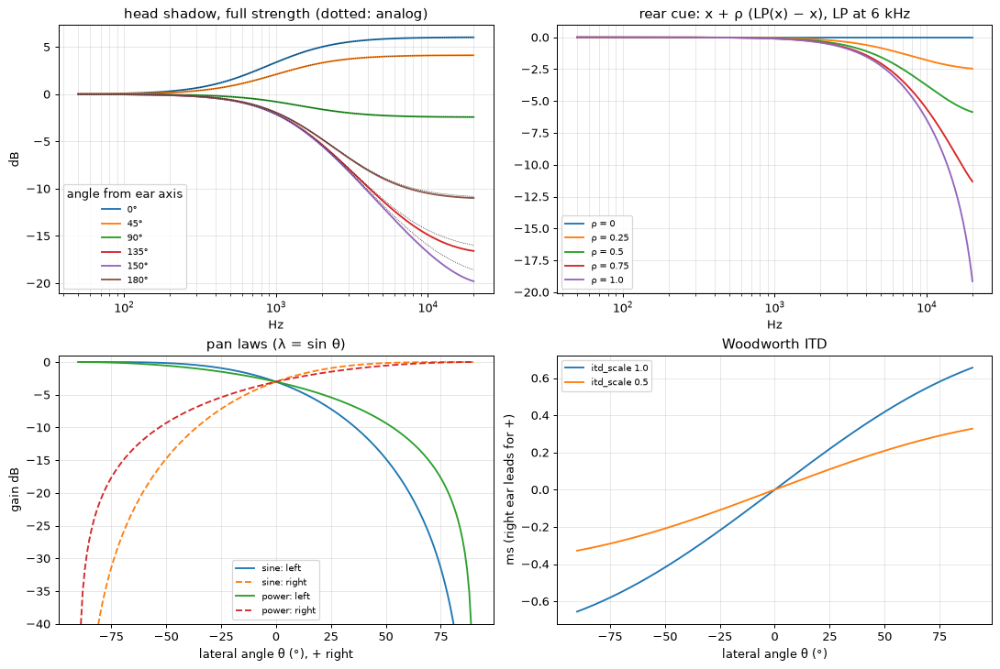

# Panning

Left/right placement on two loudspeakers by level difference. Panning is the primary direction cue;
[ITD](itd.md) and the [head shadow](head-shadow.md) add to it in the `hybrid` panner.

## Model

From the camera-space direction of the retarded source, the lateral sine
`λ = x / sqrt(r² + r_min²)` (−1 left … +1 right; `r_min = 0.25 m` keeps it smooth when a source
passes through the camera). Two constant-power laws (`g_L² + g_R² = 1`, centre −3.01 dB each),
selected by `pan_law`:

```
sine  (default):  φ = (λ + 1) π / 4,   g_L = cos φ,   g_R = sin φ
power:            g_L = sqrt((1 − λ) / 2),   g_R = sqrt((1 + λ) / 2)
```

`power` splits the power linearly with the lateral sine; it is what Blender's speakers do
(measured in Phase 0). It is softer at the sides:

| Angle (right of centre) | `sine` R/L | `power` R/L |
|---|---|---|
| 30° | 7.7 dB | 4.8 dB |
| 60° | 19.5 dB | 11.4 dB |
| 76° | 32.6 dB | 18.2 dB |
| 90° | ∞ | ∞ |



## Background

The classic stereophonic laws relate the gains to the perceived image angle φ between loudspeakers
at ±φ₀: the sine law `sin φ / sin φ₀ = (g_L − g_R)/(g_L + g_R)` and the tangent law with `tan`
(Pulkki 1997 derives the tangent law as the 2D case of VBAP). They place a phantom image *between*
the loudspeakers. A 3D scene also has sources beyond the loudspeaker base (to the side, behind);
both laws used here map the full lateral range −90°…+90° onto the full pan range, so a source at
the side is fully in one channel. The `sine` law reaches far-channel levels of −30 dB already at
75°, which makes distant side sources sound hard-panned; `power` keeps more of the far channel.

## Choices

| Question | Choice | Alternatives and why not |
|---|---|---|
| Input | Lateral sine of the retarded direction | Azimuth only: wraps at the back and does not distinguish front from back anyway (stereo cannot); the lateral sine is smooth everywhere. |
| Law | Both `sine` and `power` selectable; default `sine` (standard; confirmed by listening) | Tangent law with a loudspeaker angle: defined only inside the base; extending it to ±90° needs a choice of mapping that is again a listening question. |
| Constant power | Yes | Constant amplitude (−6 dB centre): a source crossing the centre dips in loudness. |
| Lens | Selectable by `pan_reference`. `screen` (default): through the lens to the position on a screen whose edges are seen at `screen_edge_deg` (16.5°, a 16:9 screen at 3 picture heights), as in film mixing and MPEG-H screen-related remapping. `camera`: the direction relative to the camera's orientation, as in games and Blender's speakers | In camera mode, with the default 50 mm lens a source at the frame edge is heard at 9° on ±30° loudspeakers, where an HD viewer sees the edge at 16.5°; with 200 mm at 2.3°. In screen mode at 16.5° for every lens ([E17](../experiments/E17-lens-and-pan.md), [survey](../survey.md#camera-lens-and-sound-direction)). `screen` is the default because the picture is the reference for this tool's output; `camera` stays for comparison and for scenes without frame edges |

**Decided (#15):** both laws sounded right by ear, on headphones and loudspeakers, on the flyby and a
115-source real shot. `sine` stays the default as the widely used constant-power sin/cos law
(consoles, DAWs, OpenAL Soft); `power` remains available as `pan_law = "power"`.

## Verification

- `tests/test_gain_pan.py`: both laws constant power, `power` at 76° gives −18.0 ± 0.5 dB.
- [E01](../experiments/E01-blender-speaker-baseline.md): Blender's measured gains follow
  `g² = (1 ∓ sin θ)/2` within 0.03 (linear gain); balance at 76°: Blender 18.1 dB, soundstage `sine`
  31.2 dB.

## References

- V. Pulkki, "Virtual Sound Source Positioning Using Vector Base Amplitude Panning", JAES 1997
  (`pulkki1997`).
- OpenAL Soft's stereo output uses a sine/cosine response
  ([issue 194](https://github.com/kcat/openal-soft/issues/194)).
