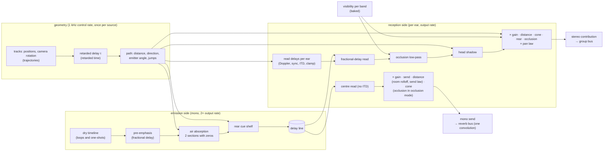
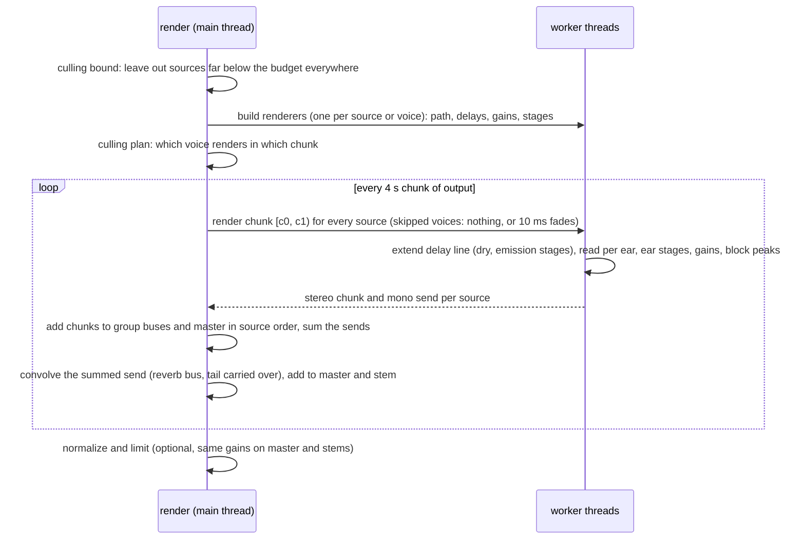

# Processing chain

How one source becomes two output channels, and where each acoustic model sits. The structure is
decided in ADR [0009](../../docs/adr/0009-processing-chain.md); the exact formulas are in
[spec/signal-model.md](../../docs/spec/signal-model.md). This page explains the structure and links
to the model documents.

## Per source

| Stage | Model document | Where in the code |
|---|---|---|
| Tracks, kinks, teleport detection | [trajectories](trajectories.md) | `engine/geometry.py` (`Track`, `ListenerTrack`, `piece_starts`, `kinks`) |
| Retarded delay | [retarded time](retarded-time.md) | `geometry.SceneGeometry.retarded` |
| Dry signal, loop seams, voices | [loops and one-shots](loops-and-one-shots.md) | `engine/signals.py` (`DryGenerator`), `source._voices` |
| Air absorption | [air absorption](air-absorption.md) | `filters.AirAbsorption`, `filters.AirStage`, `kernels.svf_cascade_track` |
| Rear cue | [rear cue](rear-cue.md) | `filters.RearStage`, `filters.rear_gain` |
| Read delays | [Doppler and delay](doppler-and-delay.md) | `propagation.read_delays` |
| Fractional-delay read, pre-emphasis | [fractional delay](fractional-delay.md) | `propagation.INTERPOLATORS`, `kernels.read_*`, `kernels.optimal2x_preemphasis` |
| ITD | [ITD](itd.md) | `panning.woodworth_itd`, `HybridPanner.itd` |
| Head shadow | [head shadow](head-shadow.md) | `filters.head_shadow_*`, `filters.ShelfStage` |
| Distance gain | [distance attenuation](distance-attenuation.md) | `filters.distance_gain` |
| Cone | [directivity](directivity.md) | `filters.cone_gain` |
| Pan law | [panning](panning.md) | `panning.PAN_LAWS` |
| Filter structures | [time-varying filters](time-varying-filters.md) | `engine/kernels.py` |
| Cuts and teleports | [cuts and teleports](cuts-and-teleports.md) | `source._Branch`, `control.ControlGrid` (jump-aware) |
| Occlusion | [occlusion](occlusion.md) | bake: `blender/occlusion.py`; engine: `filters.occlusion_filter`, `filters.fit_onepole_cutoff`, `filters.GridOnePoleStage` |
| Reverb send and bus | [reverb](reverb.md) | `source.SpatialRenderer` (send), `reverb.SendLaw`, `reverb.ReverbBus`, `reverb.synthesize` |
| Stems, normalization, limiter, report | [mixing and loudness](mixing-and-loudness.md) | `render.render` (buses), `mix.finish`, `mix.true_peak_limiter`, `report.metrics` |

Beds (`spatial: false`) skip everything except gain and fades; they feed the reverb only with an
explicit `reverb_send_db`.

## Why two signal domains

The dry signal exists in **emission time** (when sound leaves the source); the listener hears
**reception time**. The delay line converts between them. Effects that are the same for both ears
and follow the source (air absorption, rear cue) run once, mono, before the read, at the emission rate;
their parameters, computed on the reception-time control grid, are placed on emission time
`t − τ_read`. Effects that differ per ear (ITD through the read delay, head shadow, pan gains) run
after the read. Running the mono effects before the read halves their cost compared with per-ear
filtering, with no audible difference: their parameters change over milliseconds, and the read
only time-warps the signal (by at most the Doppler factor).

Occlusion is the exception: it runs per ear after the read, on the reception-time grid, because the
baked visibility already describes the path of the sound heard at each time (retarded source,
listener and occluders as the sound passed them). Placing it on emission time would retard it twice.

The emission side runs at **twice the output rate** because the standard interpolator reads a 2×
oversampled signal ([fractional delay](fractional-delay.md)).

## Chunks, threads, determinism

- Geometry and all control-rate parameters are computed once per source for the whole render
  range; only audio-rate work is chunked. Filter states live in the stage objects, so chunked
  processing equals one long run (tested). A voice that culling skipped restarts its delay line
  and filters with a 50 ms warm-up, which matches the long run to 1e-9 ([culling](culling.md)).
- The delay line keeps every emission sample a later read may still need (a cut to a farther
  camera reads further back); it is trimmed with the suffix minimum of the needed positions.
- Per-sample loops are numba kernels with `nogil=True`; with them the thread pool scales (see
  [E10](../experiments/E10-performance.md)). Chunks are summed in source order, so the result is
  bit-identical for any number of threads; a different chunk size changes results only by float
  rounding (about 1e-14).

## Adding or replacing a model

1. Write the law (a function) or the stage (an object with `process(x, a, b)` and its state).
2. Register it under a name (`INTERPOLATORS`, `PAN_LAWS`, `PANNERS`, `DISTANCE_MODELS`) and add the
   name to the schema's choices; `tests/test_models.py` checks that both lists match.
3. Document it here (a model page) and in the spec, with a known-answer test and, where a choice
   was measured, an experiment.
