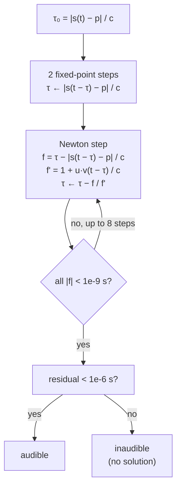

# Retarded time

The propagation delay: sound heard at reception time `t` left the source at `t − τ`, when the
source was somewhere else.

## Model

For listener position `p(t)` (at reception) and source trajectory `s(·)`, the delay `τ(t)` solves

```
τ = |s(t − τ) − p(t)| / c
```

The listener is taken at reception time (it hears where it is); the source at emission time. All
direction and distance parameters then use the **retarded** source position `s(t − τ)`: a sound is
heard from where it was emitted, with the loudness of the distance it actually travelled
(`d = c τ`).

### Solver



`u` is the unit vector from listener to source, `v` the source velocity from the spline's
derivative, so `f' = 1 − v_r/c` for a source approaching at radial speed `v_r`: positive for
any subsonic motion. The source piece (see [trajectories](trajectories.md)) is chosen by emission
time in every step.

### No solution

After a source **teleports away** (5 m → 100 m), for 277 ms nothing consistent arrives: sound from
the old place has stopped arriving, sound from the new place has not arrived yet. The iteration
oscillates between the two pieces. Those control points are marked inaudible (gain 0); entering and
leaving that state are jumps, so the old sound fades out and the new one fades in over 10 ms
([cuts and teleports](cuts-and-teleports.md)). A supersonic source has several solutions or none;
it is marked inaudible the same way where Newton does not converge.

## Choices

| Question | Choice | Alternatives and why not |
|---|---|---|
| Solver | 2 fixed-point steps, then Newton (≤ 8 steps) | The original spec: 4 fixed-point steps. Its error contracts by `v/c` per step: at Mach 0.5 the delay was off by 31 ms and the pitch by 1.8 %; at Mach 0.8 by 1.3 s and 30 % ([E07](../experiments/E07-retarded-time.md)). Newton converges quadratically for any subsonic motion: error ≤ 1.5e-9 s up to Mach 0.95. |
| Where it is solved | Control rate (1 kHz), whole render range, once per source | Per audio sample: 48× the cost for a quantity that changes smoothly; delays are interpolated to audio rate with a cubic curve. |
| Per ear | One solve per source; ears differ by ITD offsets | Per-ear solves: geometrically exact ITD but no head diffraction, and twice the work; see ADR 0006 and [ITD](itd.md). |
| No solution | Silence with fades | Keep the last value: replays the old sound with the new delay (a quiet echo of the last 277 ms). |

## Verification

- `tests/test_cuts.py::test_retarded_delay_is_exact_for_fast_motion`: Mach 0.5 pass, error < 1e-7 s
  against the analytic solution of the quadratic `|s₀ + v(t − τ)| = cτ`.
- `tests/test_cuts.py::test_source_teleport_away_leaves_a_gap_then_fades_in`: silence between the
  last old and the first new arrival, no steps, and no spurious rate-clamp warning in the gap.
- [E07](../experiments/E07-retarded-time.md): accuracy table for Mach 0.1–0.95.

## References

- J. O. Smith et al., DAFx-02 (`smith2002doppler`), on delay lines driven by geometry.
- ADR [0006](../../docs/adr/0006-propagation-retarded-time-delay-line.md).
