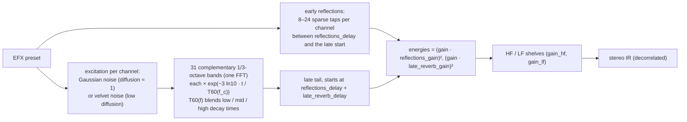

# Reverb

The space around the camera: a hangar, a city street, a forest, a space station hall. One
environment per render, fed by a send from every source (FR-48).

## Model

**Environment.** Either an **EFX preset** by name (`reverb = "hangar"`), or an impulse-response
file. The 113 EFX presets are the I3DL2/EAX environment presets known from OpenAL, DirectSound,
FMOD and game engines, including film-relevant ones (`hangar`, `city`, `alley`, `forest`,
`mountains`, `underwater`, `sewerpipe`, nine `spacestation_*`, `castle_*`, `factory_*` …). Each is a
parameter set: decay time and its low/high ratios at reference frequencies, reflection and late
gains and delays, density, diffusion, overall gain and HF/LF gain.

**Synthetic impulse response** from those parameters (stereo, seeded by the preset name):



Moorer showed that exponentially decaying noise is a natural-sounding late reverberation; real
rooms decay faster at high frequencies, so the decay time depends on frequency. `T60(f)` blends the
preset's three decay *rates* with 4th-order transitions at `lf_reference` and `hf_reference`.
EFX's `decay_hf_limit` caps the high-frequency decay by the preset's air absorption.

The noise is split into 1/3-octave bands from 20 Hz: raised-cosine crossfades between neighbouring
band centres on a log-frequency axis, which sum to exactly 1, applied in one FFT over the whole
signal. Each band is multiplied, sample by sample, by the exponential decay of `T60` at its centre.
Neighbouring bands have nearly the same decay time, so what leaks between them does not change the
decay; the envelopes are exact for short decays; and the frequency resolution is fine enough for
transitions at 100 Hz ([E12](../experiments/E12-reverb.md)).

**Send.** Every spatial source sends a mono signal, read from its delay line with the centre delay
(air absorption and the rear low-pass, applied before the delay line, are in it; pan, ITD, head
shadow and the rear gain are not), with the gain

```
send = gain · reverb_send_db(source) · reverb_send_db(scene) · g_dist(d; distance model, ref, max, room_rolloff) · b(d) · cone
```

The first part is the EFX convention: the send follows the source's distance law with the
environment's *room rolloff* (the preset's `room_rolloff_factor`, 0 for nearly all presets),
normalized at the source's reference distance, so the preset's gains set the direct-to-reverberant
ratio at the reference distance. With room rolloff 0 the reverberant level stays constant while
the direct sound falls 6 dB per doubling: the direct-to-reverberant ratio, a main distance cue
(Bronkhorst & Houtgast; Zahorik), falls with distance as in a diffuse field. That is the classical
theory of a closed room, and the reverberant energy of many sources grows with the area they cover:
over a plane of traffic around the camera, +40 dB from 100 m to 10 km
([E19](../experiments/E19-reverb-send.md)).

`b(d)` (ADR 0014) corrects this in two steps, with the environment's mid-frequency decay time `T`:

```
b(d) = exp(−ln(1000) · d / (c T))       d ≤ R       inside the listener's space
b(d) = b(R) · R / d                       d > R       from outside it
R    = c T / ln(1000)                                 (scene reverb_radius_m)
```

- **Inside** (Barron and Lee's *revised theory*): the reverberation a source excites decays from
  its emission on, and starts reaching a listener at `d` only with the direct sound, after `d / c`.
  The reflected energy the listener receives is then lower by `exp(−13.8 d / (c T))`, 60 dB per
  `c T` of distance: −0.04 `d / T` in nepers of energy, as measured in 17 concert halls (the
  classical, constant level is the limit for small rooms, where Barron's correction is a few tenths
  of a dB).
- **Outside**: a source beyond the listener's space feeds that space with the sound that reaches it,
  which falls like the direct sound; its reverberation then falls 6 dB per doubling of distance,
  and the direct-to-reverberant ratio stays constant.
- `R` defaults to where both laws fall equally fast per log distance, so `b` is smooth (its slope in
  log-log is −1 on both sides); there `b` = −8.7 dB. It is also the radius that gives the largest
  send at every distance beyond it (`R e^(−kR)` is largest at `R = 1/k`): a smaller radius (a street
  in an open city) or a larger one (one hall around all sources) only makes distant sources drier. City streets (`T` 1.79 s): `R` = 89 m, −2.9 dB
  at 30 m, −9.7 dB at 100 m, −29.7 dB at 1 km. A hangar (`T` 10 s): `R` = 499 m, −1.7 dB at 100 m.

The reverberant energy of sources spread evenly over a plane then grows by the log of the area's
radius, as the direct sound's does (+6.8 dB from 100 m to 10 km in the city preset, against +4.0 dB
direct). `reverb_send_law = "efx"` drops `b`. Beds send only with an explicit `reverb_send_db`.
Occlusion affects the send only in `occlusion` mode ([occlusion](occlusion.md)).

**Bus.** All sends are summed and convolved once per chunk with the stereo IR (FFT overlap-add);
the convolution tail carries over between chunks. The return is added to the master and written as
the stem `reverb`. Before the first output sample, the sends of one IR length (at most the baked
padding) are rendered and fed to the bus with the output discarded: otherwise the reverberation of
sound already playing at the start rises from silence over the decay time (6.2 dB low in the first
0.2 s with the concert hall; with the pre-roll 0.06 dB, `test_reverb_is_already_built_up_at_the_first_sample`).
Every shot cut together in Resolve would otherwise start dry.

## Choices

| Question | Choice | Alternatives and why not |
|---|---|---|
| Parametrization | EFX/I3DL2 presets | Own parameters: nobody knows them; EFX names are known to game-audio people and agents, documented, and cover film environments (including space stations). |
| Rendering | Convolution with a synthetic IR | Algorithmic reverb (FDN: Jot & Chaigne; Freeverb): cheaper per sample, but offline there is no real-time constraint, and convolution makes RT60 and level exactly controllable and testable. Velvet-noise FIR reverbs (Välimäki et al. 2017) are the efficient real-time form of the same idea. |
| Late tail | Decaying noise in complementary 1/3-octave bands | Three bands with causal 24 dB/octave filters: the slow mid band leaks into the high band (hangar high band 4.94 s instead of 2.31 s). Decay per frame of a 1024-point STFT: as accurate elsewhere, but its 47 Hz bins smear low-frequency transitions (+31 % in the 63 Hz band of `icepalace_mediumroom`, bank +18 %). Feedback delay networks: see Rendering. |
| Level calibration | Section energies from the preset gains | EFX gains interpreted as amplitudes of a unit impulse: depends on decay time. With energies, presets of different lengths are comparably loud and the direct-to-reverberant ratio at the reference distance is `−10 log₁₀(E)`. |
| Send distance law | EFX room rolloff × the revised theory inside `R`, spherical spreading beyond (ADR 0014) | EFX room rolloff alone (the first engine, still `reverb_send_law = "efx"`): constant reverberant level, which thousands of distant sources turn into a wash (a 2200-source city shot at −10 LUFS, limiter always on). Room rolloff 1 (the send follows the direct sound, as many game engines' send curves): right for distant sources, 10–20 dB too dry for close ones in large spaces. The revised theory alone: falls without bound (−98 dB at 1 km in the city preset), ignoring sound that reaches the listener's space from outside. Half the direct rolloff (original spec, uncalibrated −18 dB default). Critical-distance model from room volume and RT60 (Sabine): needs volumes the scene does not provide. |
| File IRs | Used as recorded | Normalizing them changes the intended level; IRs with a direct-sound spike at the start add a delayed dry copy, which users trim. |
| Spatial reverb | One stereo environment per render | Per-region environments and portals: Phase 4 if needed. |
| Start of a render | Pre-roll the bus by one IR length | Start empty: every shot starts dry and the reverb swells in. Pre-rolling longer than the baked padding: positions before the bake are held, which is fine for reverb, but the bake's padding already bounds what is known. |

Not modelled from the EFX set: reflection/late panning vectors, echo, modulation.

## Verification

[E12](../experiments/E12-reverb.md) and `tests/test_phase3.py`:

- the decay curve has the preset's low, mid and high decay times (within 2 %) two octaves away from
  the reference frequencies;
- measured T30 per octave band (63 Hz–16 kHz) against the T30 the curve predicts for that band
  filter (`reverb.expected_rt60`): median 0.8 %, 95th percentile 8.3 % over all 113 presets; the
  outliers are short decays in narrow bands, where one noise realization scatters by about 13 %;
- deterministic, left/right correlation below 0.05;
- direct-to-reverberant ratio falls 6.02 dB per doubling of distance (concert hall, room rolloff 0,
  law `efx`);
- with the revised law the reverb return falls between 10, 20, 50 and 100 m by `b(d)` within 0.3 dB
  (living room, `T` 0.5 s, `R` 25 m: inside and beyond `R`), and `b` has the same slope on both
  sides of `R` (`tests/test_phase3.py::test_reverb_send_follows_the_revised_theory_then_spreading`);
- the bus processed in two chunks equals one convolution (1e-12);
- a click through the hangar bus: the reverb return decays in 9.94 s at 1 kHz (expected 9.97 s).

## References

- J. A. Moorer, "About This Reverberation Business", Computer Music Journal 3(2), 1979 (no open
  copy; summarized in J. O. Smith, *Physical Audio Signal Processing*, "Desired Qualities of Late
  Reverberation").
- V. Välimäki, B. Holm-Rasmussen, B. Alary, H.-M. Lehtonen, "Late Reverberation Synthesis Using
  Filtered Velvet Noise", Applied Sciences 7(5):483, 2017 (`valimaki2017velvet`).
- V. Välimäki, J. Parker, L. Savioja, J. O. Smith, J. Abel, "Fifty Years of Artificial
  Reverberation", IEEE TASLP 20(5), 2012 (no open copy).
- M. Barron, L.-J. Lee, "Energy relations in concert auditoriums. I", J. Acoust. Soc. Am. 84(2),
  618–628, 1988 (the revised theory; no open copy).
- A. W. Bronkhorst, T. Houtgast, "Auditory distance perception in rooms", Nature 397, 1999; P.
  Zahorik, direct-to-reverberant ratio studies; R. Albrecht, T. Lokki, "Adjusting the perceived
  distance of virtual speech sources by modifying binaural room impulse responses", 2013
  (`albrecht2013distance`).
- EFX reverb presets: OpenAL Soft `include/AL/efx-presets.h`; I3DL2 parameters as in the
  DirectSound/BASS documentation.
