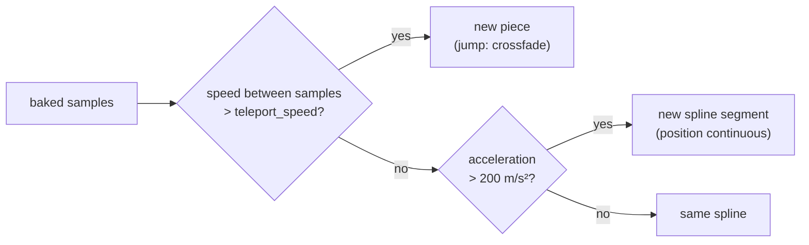

# Trajectories

Turning the baked positions (one sample per sub-frame, 120 Hz at 30 fps with 4 sub-frames) into
continuous functions of time that can be evaluated at any emission or reception time.

## Model

- **Positions** (sources and camera): cubic splines in time (scipy `CubicSpline`, not-a-knot),
  per **piece** and, within a piece, per **segment between kinks**.
  - A *piece* ends at a cut (camera switch) or a teleport (a jump faster than `teleport_speed`,
    default 3 × the speed of sound). Pieces are separate trajectories; crossing from one to
    the next is a *jump* with a crossfade ([cuts and teleports](cuts-and-teleports.md)).
  - A *kink* is a sample where the velocity changes faster than 200 m/s² (about 20 g): keyframed
    motion that starts, stops or turns instantly. Segments meet at a kink with continuous
    position, so a kink is not a jump.
- **Camera rotation**: scipy `RotationSpline` per segment (rotation vectors cubic in time;
  continuous angular rate and acceleration).
- Outside its sample range a piece is held at its end value (velocity zero there).

## Choices

| Question | Choice | Alternatives and why not |
|---|---|---|
| Position interpolation | Cubic spline, not-a-knot | Linear: velocity steps at every sample (120 Hz), the playback rate would step accordingly. Modified Akima ("makima"): no ringing but not exact for constant acceleration (errors ~1e-7 m), and at an instant velocity jump it still overshoots inside the adjacent interval (measured 1.129 against a steady rate of 1.095), because any C¹ curve through a velocity step must. |
| Kinks | Split the spline at kinks | Without splitting, the spline rings around a kink: the flyby's ship, standing still until frame 1 and then moving at 30 m/s, got a playback-rate peak of 1.112 against the physical 1.094 (+1.8 %, about 30 cents) for a few frames. With splitting the rate steps from 1.000 to 1.094. |
| Kink threshold | 200 m/s² | Smooth fast motion stays below it: a 9 g turn is 88 m/s². An instant start of even slow motion exceeds it at 120 Hz sampling (1.7 m/s → 200 m/s²). Below the threshold, a residual overshoot of a small velocity change is inaudible. |
| Rotation interpolation | `RotationSpline` | Piecewise slerp: angular rate jumps at every baked sample, so pan and ITD would change rate in steps. Quaternion components with a spline: not normalized, not uniform in angle. |
| Teleport detection | In the engine from the baked positions | In the bake: the threshold could only change with a re-bake. The scene format's `src_cuts` stays honoured for tools that know their teleports. |

Rotation interpolation has no kink handling: a camera that starts panning instantly gets a small
angular-rate overshoot, which only affects pan and ITD slightly (not pitch).

## Verification

- `tests/test_gain_pan.py`: pieces are not interpolated across a teleport; constant velocity and
  constant acceleration are reproduced exactly between samples; a start/stop is found as a kink, a
  9 g circle is not.
- `tests/test_cuts.py::test_no_pitch_overshoot_where_motion_starts`: playback rate never exceeds
  the steady value by more than 0.2 % where motion starts.
- [E09](../experiments/E09-flyby-doppler.md): the flyby's ship has a rate range of 0.920 to 1.094.

## References

- scipy [`CubicSpline`](https://docs.scipy.org/doc/scipy/reference/generated/scipy.interpolate.CubicSpline.html),
  [`RotationSpline`](https://docs.scipy.org/doc/scipy/reference/generated/scipy.spatial.transform.RotationSpline.html),
  [`Akima1DInterpolator`](https://docs.scipy.org/doc/scipy/reference/generated/scipy.interpolate.Akima1DInterpolator.html).
